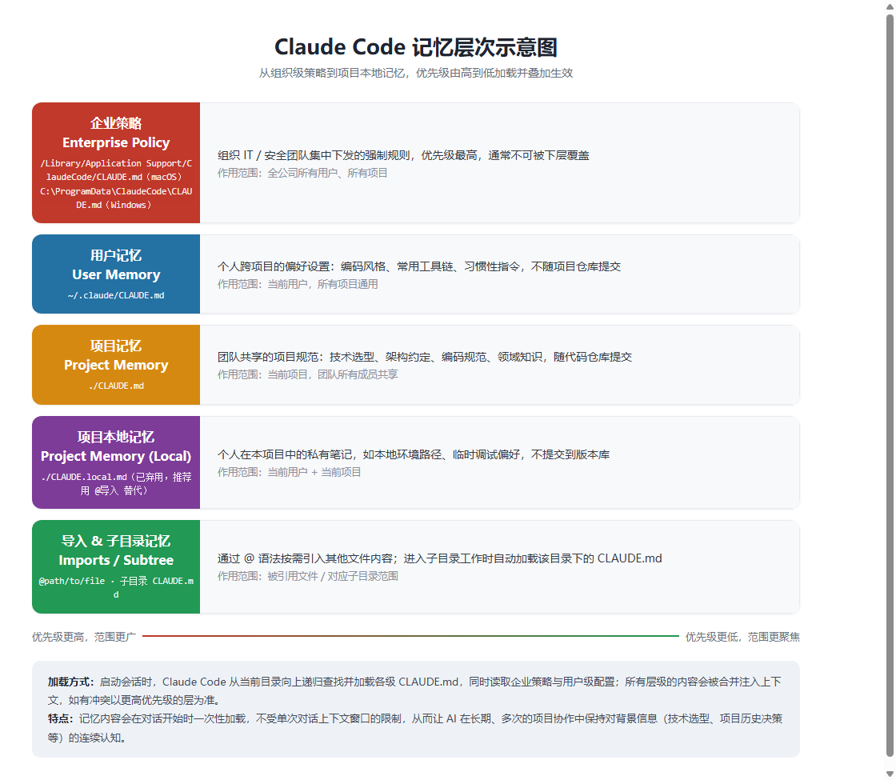
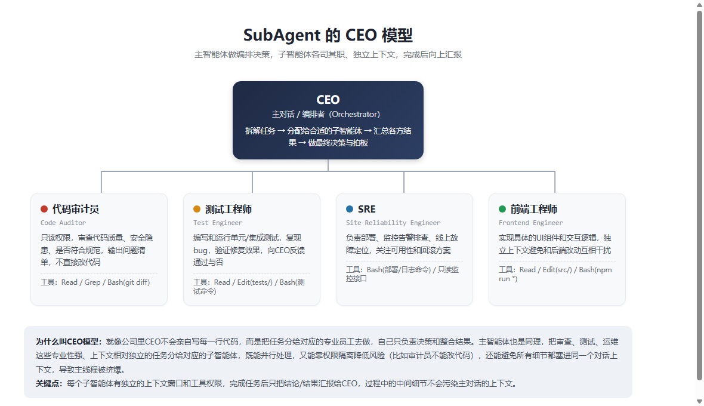

首先感谢本书作者佳哥，不论是这本书还是SDD实战，内容写得非常形象生动，便于理解，整体的篇幅300页上下，如果集中阅读一天就可以看完，看完后直接实战去体验Claude Code相关功能。

# 0.前述
Claude Code的代码生成能力我觉得在当下跟Codex可以说是并列第一档的存在。Gemini在去年还有点声势，到了2026年明显感觉有点掉队了。

AI Coding的能力来源于两个部分，一部分是大模型本身的推理能力，一部分是给大模型配套的Agent体系。至少到现在为止，如果想要发挥出AI最好最稳定的编程输出能力，仅仅依靠基础大模型是不够的。当然基础大模型在局部的代码生成能力上已经相当好了，只是说在全局或者说长上下文环境下，当下的大模型仍旧无法独立于Agent体系就把活干好。而好的Agent框架甚至可以让差一点的模型在实际中发挥出更好的效果。Harness英文中的直译叫做马具。

Claude Code的起源是Anthropic内部的员工使用Claude编程，发现不是很方便，如果给Claude加上一些工具调用和Agent，就可以把编码做得更精准。随后便一发不可收拾。Anthropic这个公司对中国的态度懂的都懂，使用各种方式封禁中国用户，搞审查、实名认证之类的手段。但是即使如此，我看到的是中国最优秀的一批人都在想方设法绕过限制去使用这个工具。这让我陷入沉思，我所经历或者看到的中国企业不论是大厂独角兽创业公司还是夫妻店，不论什么行业什么身份，他们的经营都是唯恐抢不到客户，如果客户愿意掏钱巴不得把客户服务的舒舒服服。没有一家是把愿意付钱的客户挡在外面随时封号的。让这些聪明人主动掏钱的是Claude Code独具一格的以技术为支撑的产品力。这种产品力不是国内互联网大厂那种疯狂卷产品，恨不得把一个外卖软件装进去直播和游戏引擎。但是使用者根本不Care这种东西。不是去自以为是的丰富产品功能，而是真正解决用户刚需。刚需这个词语主要用于房地产行业，用于说明年轻人想结婚必须买房才能得到落户和后代在本地接受教育的权利等。可是当一个白领每个月花几百块人民币就能从Claude上学到远超花几十万几百万买的房子所带来的教育，也就是学区房对应的学校中所有教师的知识总量还多得多甚至比所有大学加起来还多的知识量，而且大模型还比较准确的时候，曾经的一些事物的现实价值就要被重新评估。也就是在前一个时代被认为高价值的事物，在新的时代没那么值钱了。只要多看一看最近几百年的科技发展史，就可以很清晰地认识到这个问题。

我一直认为，所谓的需求，就在身边。不是无数功能的堆叠，而是我不想长时间开车所以需要自动驾驶汽车，我不想花费大量的实践做饭所以需要一个居家智能机器人，我不想浪费时间去学习完全过时的知识所以我需要一个智能的百科全书引擎等，我不想浪费时间写重复代码所以我需要一个智能编程助手把绝大多数的重复问题自己调试解决。

这些新技术所带来的便利显而易见，但是实现这些便利的技术并不容易。在时间投入和价值选择上，应该多投入精力在这些方向上。

这篇文章本身的内容是讲Claude在编程领域的一些使用方法和技巧，但我认为类似的方法可以用在其他领域。举个例子具身智能领域目前一个非常困难的问题就是模型在实际场景中泛化能力不足，常规方法肯定是大量采集数据嘛，这无可厚非，可以提升大模型的基础智能能力。与此同时Harness对于通用机器人的真正走进生活也是举足轻重的作用。因为AI大模型可以部署在云端，可以跑在服务器上，机器人的大脑还是要运行在机器人本体中的。一定要压缩模型，那么在本体中的模型的能力一定低于云端。这时候更需要Harness去补齐能力缺陷。而且这个Agent的难度要大于AI Coding中Agent的难度。因为AI Coding中的很多Agent的工具早就非常成熟，只是集成到Agent框架中加一些策略。而真机中根本没有这么成熟的Agent工具体系，而且一旦牵涉到硬件机械电子物理执行场景，问题会更加复杂。我觉得用不了多久，机器人大脑、小脑甚至灵巧手内部都会跑多个Agent。另外一个在AI领域非常有前景的方向就是生命科学。AI编程实际上做的事情是把自然语言转化为一种预设机制的计算机编程语言，而生命也可以认为是一种存在一定预设模式的语言。那么基于AI或者Agent去探索发现生命的机制甚至去设计有机体或者其他。当然这种Agent的设计就需要深刻理解生物医学的一些底层原理才能做好。

# 1.记忆系统
在跟大模型对话的时候，需要不断地把限制性的场景信息发给模型，模型才能给出一个更符合实际情况的答案。这些信息会伴随对话关闭或者超过单次对话上下文而消失。但在编程中，不是一次对话就是一锤子买卖，而是要不断地对软件和架构进行演化。上一次或者昨天，一个星期前做的决定，现在要更改，得让AI知道上下文信息。比如技术选型信息，项目背景信息，代码规范信息，领域技能信息等等。

Claude Code可以设置几种不同层次的记忆层。


公司级别的我一般不太用，这部分内容是公司强制的一些安全性质的配置。
可以在~/.claude/CLAUDE.md文件中设置个人的一些偏好。这个个人偏好可以跨项目使用，而且不进入到项目的版本管理中。
我主要使用的是项目级记忆CLAUDE.md,这个文件中把项目中基本的配置信息写出来，让大模型每次加载项目就直接可以获取这些信息。比如说你设定了C++代码规范是Google风格，加载了记忆设定的模型就会按照这个规范去生成代码。CLAUDE.md文件是伴随项目进行代码版本管理的。

下面是一个前端Web项目的CLAUDE.md简单示例：

```markdown
# 项目说明
一个基于 React + TypeScript 的后台管理系统前端。

# 技术栈
- React 18 + TypeScript
- Vite 构建
- 状态管理：Zustand
- UI 组件库：Ant Design
- 请求库：axios，统一封装在 src/api/request.ts

# 代码规范
- 组件使用函数式组件 + Hooks，禁止使用 class 组件
- 每个组件一个文件夹，内含 index.tsx、style.module.css
- 命名统一使用小驼峰，组件名用大驼峰
- 提交前必须通过 eslint 和 prettier

# 目录结构
- src/pages 页面级组件
- src/components 通用组件
- src/api 接口请求
- src/store 全局状态

# 常用命令
- 开发：npm run dev
- 构建：npm run build
- 测试：npm run test

# 注意事项
- 涉及金额的字段统一用分为单位，展示层再转换为元
- 所有接口请求需处理 loading 和错误提示，不要吞掉异常
```
CLAUDE.md主要写为什么要这样做，做什么，不做什么，如何做。不要写得太多，把整个项目基本框架说清楚就行，每句话尽量短小精悍，语义明确。

.claude/rules/*md是项目规则级限定。这个解决的问题是避免在单个CLAUDE.md文件中造成文件臃肿，而且如果全部放在单个文件中每次加载会有大量内容不需要却被加载进来造成浪费Token。现在的Token还是很贵的。

./CLAUDE.local.md存放个人临时的一些配置，比如在调试阶段加的一些限制，这个不进入版本管理。

所以核心就是CLAUDE.md和.claude/rules/*.md下面的文件

# 2.SKILL
记忆系统是为了解决信息丢失导致AI生成不符合设定的代码的问题。只不过CLAUDE.md管理总体，.claude/rules/*.md做一些更细分的分系统设定。
SKILL是另外一种模式。它是在某些情况下需要才会被触发，用于解决特定领域问题的技能包。

一个SKILL的典型目录结构如下：

```
.claude/skills/
└── pdf-processing/           # 技能目录，目录名即技能名
    ├── SKILL.md              # 必需：技能说明，含 frontmatter(name/description) + 使用指引
    ├── scripts/               # 可选：技能要用到的可执行脚本
    │   └── extract_text.py
    ├── references/            # 可选：按需加载的参考文档，避免一次性塞进上下文
    │   └── api_reference.md
    └── assets/                # 可选：模板、图片等静态资源
        └── template.docx
```

SKILL.md的frontmatter中description字段很关键，Claude是靠它来判断当前任务是否需要触发这个技能，所以要写得具体、覆盖触发场景的关键词。scripts、references、assets都是按需加载，不会一开始就占用上下文，这也是SKILL相比塞进CLAUDE.md更省Token的原因。

以我的经验这些结构都没必要死背，可以让AI生成一个骨架然后自己往里面填写自己要做的SKILL就行。由于绝大多数内容都是自然语言，本身的门槛不大。而且github上经常有各种开源的SKILL库，直接安装使用也很方便。

就像前面所说的，SKILL的触发依赖description字段，所以这个内容要写得非常短小精悍准确。甚至可以在自己写完后让AI帮你总结写description。

SKILL.md头部的frontmatter字段说明（所有字段都是可选的，但description强烈建议写，否则Claude不知道什么时候该用这个技能）：

| 字段 | 说明 |
| --- | --- |
| name | 展示名，默认取目录名。技能被调用的命令名一般还是来自目录名，不受此字段影响（插件技能除外） |
| description | 技能的用途和触发场景，Claude靠它判断当前任务是否需要调用该技能，是最关键的字段 |
| when_to_use | description的补充说明，比如触发词、示例问法，会拼接到description后面一起参与匹配 |
| disable-model-invocation | 设为true后Claude不会自动调用，只能用户手动`/技能名`触发，适合有副作用的操作如部署、发消息 |
| user-invocable | 设为false后不出现在`/`菜单里，只能被Claude自动调用，适合背景知识类技能 |
| allowed-tools | 该技能被调用的这一轮里，免确认放行的工具列表，下一条消息就失效 |
| disallowed-tools | 该技能激活期间禁止使用的工具，适合自主运行、不该乱用某些工具的场景 |
| model | 该技能激活时切换使用的模型，仅本轮有效 |
| effort | 该技能激活时使用的推理强度（low/medium/high/xhigh/max） |
| context | 设为fork时技能会在独立的子agent中运行，看不到主对话历史 |
| agent | 配合context:fork使用，指定用哪个子agent类型来执行 |
| argument-hint | 输入`/技能名`时自动补全提示参数格式，比如`[issue编号]` |
| arguments | 给技能声明具名参数，正文中用`$参数名`引用 |
| paths | 用glob限定这个技能只在操作匹配的文件时才自动触发 |

正文部分（frontmatter之后）就是给Claude看的操作说明，写清楚这个技能具体怎么做、分几步、遇到什么情况怎么处理即可。

SKILL可以设置的字段比较多，具体用哪个直接问AI查一下、自己实验一下就行。比如一些简单的事情，通过model设置更加便宜的模型就可以节省整个AI任务的成本。权限设置的工具可以设置或者禁用一些工具防范行为越界。比如做代码评审的SKILL就不要给写入权限等。

SKILL是Harness里面最常用的功能之一。因为这玩意基本是用自然语言写的，门槛比较低，但是做得好的SKILL效果立竿见影。经常会出现一个大神在github发布一个SKILL，不到一百行，几万个星星。

在使用的时候SKILL可以被显式调用也可以通过description被激活动态调用。尤其被自动激活调用的时候就会有一个SKILL触发概率的问题。我们是希望100%精准触发，这只是理想，现实是尽可能提高命中率。欠触发就是应该触发没有触发，过触发就是不应该触发但是触发了。 编写明确的description是提升准确率的关键。description（连同when_to_use）合计限制1536个字，需要明确定义核心能力到底是做什么的，明确触发场景，什么时候触发，划定排除范围，什么时候不触发等等。不要写模糊的语义。

一个SKILL一般是解决一个领域内的专门问题。要把SKILL.md当作路由器，而不是把所有该SKILL包含的知识都放在SKILL.md中。

举个例子，假设要做一个处理PDF的SKILL，反面写法是把提取文本、填表单、合并拆分这些操作的详细步骤全部写进SKILL.md，文件一下涨到几百行，每次触发都要整段加载进上下文。路由器写法应该是这样：

```markdown
---
name: pdf-processing
description: 处理PDF文件，包括提取文本、填写表单、合并拆分。当用户需要读取、编辑或生成PDF时使用
---

# PDF处理

根据任务类型，只读取需要的参考文档：

- 提取文本/表格 → 阅读 references/extract.md
- 填写PDF表单 → 阅读 references/fill_form.md
- 合并或拆分PDF → 阅读 references/merge_split.md

所有操作优先调用 scripts/ 下的脚本，不要自己手写解析逻辑。
```

SKILL.md本身只做三件事：说明这个技能是干什么的（description）、列出有哪些子任务、告诉Claude该子任务去哪个文件找详细做法。真正的操作细节放在references/extract.md、references/fill_form.md里，只有真正用到对应功能时才会被读取加载，没用到的部分完全不占上下文。这样即使这个SKILL覆盖的领域很大，SKILL.md本身也能一直保持短小。

再举两个更贴近日常开发的例子，一个是代码评审，一个是代码提交，正好对应两种不同的权限思路：评审只读不能改，提交是有副作用的操作需要人来确认触发。

代码评审SKILL：只给读权限，不给写权限，防止"评审"顺手把代码改了。

```markdown
---
name: code-review
description: 评审当前分支未提交的代码改动，检查bug、安全问题、代码规范。用户要求审查代码、看看改动有没有问题时使用
allowed-tools: Read Grep Glob Bash(git diff *) Bash(git log *)
disallowed-tools: Edit Write
---

# 代码评审

1. 用 `git diff` 查看未提交的改动
2. 检查改动是否有明显bug、边界条件遗漏
3. 检查是否有安全隐患（如硬编码密钥、SQL拼接）
4. 检查是否符合CLAUDE.md里约定的代码规范
5. 按严重程度列出问题清单，每条给出文件和行号，不要直接改代码
```

代码提交SKILL：涉及git commit这种有副作用的操作，设置`disable-model-invocation: true`，只能用户手动敲`/commit`触发，Claude不会自己判断"改完了就该提交"。

```markdown
---
name: commit
description: 暂存并提交当前的代码改动，生成规范的commit message
disable-model-invocation: true
allowed-tools: Bash(git add *) Bash(git status *) Bash(git commit *) Bash(git diff *)
---

# 提交代码

1. 执行 `git status` 和 `git diff` 查看改动内容
2. 按项目规范生成简洁的commit message，说明改动的原因而不是罗列改了哪些文件
3. `git add` 相关文件（不要用 `-A`，避免误提交无关文件）
4. `git commit`，提交后执行 `git status` 确认结果
```

这两个例子体现的思路是：评审类、只读分析类的SKILL可以放心让Claude自动触发，但涉及写入、提交、发布这种不可逆或有外部影响的操作，最好用`disable-model-invocation`把决定权留给人，工具权限也要卡得更紧一些。

# 3.SubAgent
子智能体主要是用来解决单个会话上下文窗口限制。



上面这个CEO模型对应的文件结构大致长这样，每个员工就是.claude/agents/下面的一个md文件：

```
.claude/agents/
├── code-auditor.md      # 代码审计员
├── test-engineer.md     # 测试工程师
├── sre.md               # SRE
└── frontend-engineer.md # 前端工程师
```

以代码审计员为例，code-auditor.md的内容大致是这样：

```markdown
---
name: code-auditor
description: 只读审查代码质量、安全隐患、是否符合项目规范，不修改代码。当需要评审改动、检查代码问题时调用
tools: Read, Grep, Glob, Bash
model: sonnet
---

你是一名代码审计员，只负责发现问题，不负责修复。

1. 用git diff查看改动范围
2. 检查bug、边界条件、安全隐患（硬编码密钥、SQL拼接等）
3. 对照CLAUDE.md里的项目规范挑不一致的地方
4. 输出问题清单，每条注明文件、行号、严重程度

不要执行任何写入、提交类操作。
```

frontmatter里的name/description跟SKILL类似，是CEO（主智能体）用来判断"这个任务该分给谁"的依据；tools限定这个员工能用哪些工具，比如代码审计员就不给Edit/Write；model可以给不同角色配不同模型，简单重复的活（比如跑测试）用便宜模型，需要深度判断的（比如审计、排障）用更强的模型，这样整个团队的Token成本才可控。设计子智能体的时候要尽量避免类似并发编程中的共享数据问题，纯并行或者做成流水线都是可以的，但不要在执行过程中去修改别的智能体的共享数据，毕竟在自然语言层面没有明确的锁机制保证数据同步与数据安全，这跟纯编程是不一样的。

子Agent我觉得就类似于并行线程或者并行进程。只不过子Agent具备不同的执行语义，在语义和能力上比编程模型中的进程和线程强很多。像上面先审查再测试这种串行流水线，其实就是设计模式中的责任链模式。这也意味着每个子智能体其实就是单个跟AI对话的人。


# 4.Hooks
Hooks在软件领域就是钩子的意思，这个在软件测试框架里非常常见。在Claude Code中主要是用于事件触发来拦截一些AI行为，保证系统稳定。
AI去自动做事情，很快但是也存在危险，Hooks就是设置规则拦截这种风险用的。这就涉及事件生命周期的问题。

按一次会话的生命周期，从开始到结束常用的事件节点如下：

| 事件 | 触发时机 |
| --- | --- |
| SessionStart | 会话开始或恢复时 |
| UserPromptSubmit | 用户提交prompt后，Claude处理前 |
| PreToolUse | 每次工具调用执行前 |
| PostToolUse | 工具调用执行成功后 |
| SubagentStop | 子智能体执行完成时 |
| PreCompact | 上下文即将被压缩前 |
| Stop | Claude完成这一轮回复时 |
| Notification | Claude Code需要通知用户时（如等待权限确认） |
| SessionEnd | 会话结束时 |

实际用得最多的是PreToolUse和PostToolUse：前者可以拦截、修改甚至阻止一次工具调用（比如禁止对生产环境执行删除命令），后者可以在工具跑完后做校验或者记录日志。

其实并没有什么复杂的东西，就是用户或者智能体之类的干一件事之前、干完一件事之后、或者出了异常后，在常规跟AI对话的时候，一般会弹出来让你做决定的选项1、2、3，Hooks做的事情就是判断这些事件的时机，然后触发Hooks中设定的工具调用或者一些行为来保证系统下限，不至于失控。从这个机制上也看得出来，想让Hooks有效拦截的前提是先设定好，这个事就是一点点补，在项目初期可能会踩坑然后再补齐进去。

Hooks配置在settings.json里，一个禁止执行危险命令的例子：

```json
{
  "hooks": {
    "PreToolUse": [
      {
        "matcher": "Bash",
        "hooks": [
          {
            "type": "command",
            "command": "scripts/check-dangerous-cmd.sh"
          }
        ]
      }
    ]
  }
}
```

matcher指定只拦截Bash工具调用，command指向一个检查脚本，脚本里如果发现命令包含`rm -rf`之类的危险操作就返回退出码2，Claude Code看到2就会阻止这次工具调用并把脚本的报错信息反馈给Claude，让它换个方式重试。

这样可以做危险命令拦截或者敏感文件保护。比如说在自动化运维里面，可以通过设置Hooks，让Claude每次写入代码文件就触发代码格式化、Lint反馈循环，或者用stop hook触发质量门控。

对应的三个简易示例：

**1. 敏感文件保护**，禁止Claude读写.env等包含密钥的文件：

```json
{
  "hooks": {
    "PreToolUse": [
      {
        "matcher": "Read|Edit|Write",
        "hooks": [{ "type": "command", "command": "scripts/block-env-files.sh" }]
      }
    ]
  }
}
```

**2. 写入后自动格式化**，每次Edit/Write完成后自动跑一次prettier：

```json
{
  "hooks": {
    "PostToolUse": [
      {
        "matcher": "Edit|Write",
        "hooks": [{ "type": "command", "command": "npx prettier --write $CLAUDE_FILE_PATH" }]
      }
    ]
  }
}
```

**3. Stop时质量门控**，Claude准备结束这一轮回复前先跑一遍测试，测试不过就拒绝停止：

```json
{
  "hooks": {
    "Stop": [
      {
        "hooks": [{ "type": "command", "command": "scripts/run-tests-before-stop.sh" }]
      }
    ]
  }
}
```

第三个例子里脚本如果测试失败就返回退出码2，Claude Code会把失败信息重新丢给Claude，逼着它继续修复而不是草草收工。

# 5.MCP
MCP解决的是模型调用其他软件的能力，MCP本身是个协议。支持这个协议的大模型或者Agent就可以跟支持这个协议的软件进行通信交互。

实际的效果就是人在对话框中写入自然语言，执行后，Agent通过MCP服务器控制软件执行你的想法。比较常见的，比如在做UI设计，目前基本所有的设计师都使用AI去驱动设计行为而不是再像以前那样全部自己手动修改参数，我之前用Figma就这么干的。或者使用Codex驱动Solidworks画图。

也就是把编程能力拓展成了大量操作其他软件的能力，而且还可以使用前面说的记忆系统，SKILL系统，子智能体系统和Hook来做一些支撑。这比单独操作更加体系化。

我在年初说想做研发体系变革，就是想使用这种途径，把大量不同技术岗位的研发操作全部AI化，提速，让一个人就能迸发出之前一个团队的产出力量。有点理想化，还在尝试中。

# 6.Headless与CI/CD
CI/CD是后台服务，使用Claude Code就不能像在IDE中那样交互了。

Headless模式就是用`-p`参数一次性把prompt扔给Claude Code，执行完直接退出，不进入交互式对话框，适合放进CI流水线里跑。一个在CI里做代码评审的例子：

```bash
claude -p "检查本次PR的改动，找出明显的bug和安全隐患，只列问题，不要修复" \
  --output-format json \
  --allowedTools "Read Grep Glob Bash(git diff *)" \
  > review-result.json
```

- `-p`：非交互模式，传入一句prompt执行完就结束，没有人在旁边点确认
- `--output-format json`：输出结构化JSON而不是聊天式文本，方便后续脚本解析、写入PR评论
- `--allowedTools`：显式限定这次调用能用哪些工具，CI环境没人盯着，权限必须收紧，不给写入类权限

这段命令跑完，CI脚本读取review-result.json，就能自动把发现的问题贴到PR评论里，人只需要看结果而不用手动跑一遍审查。

在Headless模式下还有几个常用参数：

| 参数 | 作用 |
| --- | --- |
| `--model` | 指定用哪个模型跑，CI里跑简单任务可以换便宜模型 |
| `--max-turns` | 限制最多执行几轮工具调用，防止跑飞、无限循环耗Token |
| `--permission-mode` | 设置权限模式，比如acceptEdits自动接受编辑，无人值守时常用 |
| `--append-system-prompt` | 在默认系统提示词后追加内容，微调这次执行的行为 |
| `-c` / `--continue` | 接着上一次的会话继续跑，而不是每次都从零开始 |

不用死记，用到的时候查一下`claude -p --help`就行。

CI/CD一般在公司里面是软件的基础设施。使用Headless模式除了便捷性外，要格外注意安全性。包括认证的鉴权，操作的数据保护等。不论是Gitlab的Runner还是Jenkins本质上都是工具而已，都是可以被Agent调度的。安全性在这一部分极其重要。如果在公司层面出现重大事故，很可能被开除。策略，隔离，审查，评审，测试要非常小心！一定要做好底层的兜底策略！

# 7.SDK
前面那些操作本质都是直接使用Claude Code的产品级别交互方法。而SDK可以把Claude Code集成到软件代码中调度。比如说claude的Python SDK
https://github.com/anthropics/claude-agent-sdk-python/tree/main
我最近其实就在设计开发SDK，其中就包括Python的SDK。我在设计自己做的SDK的时候我还专门参考了Claude这个SDK。比如说在Python版本的SDK中使用异常而不是错误码到底专业不专业。我没看Claude的SDK源码前，我是觉得没问题的。我就去看了一下，其实都差不多。我的错误异常设计得还多一些，可以精细控制。看完之后我就安心了。Claude提供Python和TypeScript两种语言的SDK。我以前都不太用TS，也是去年夏天在研究Agent的时候发现这些框架基本都是使用TS写的，才自学了一下前端和Node.js。

使用SDK就是把前面说的功能放进程序中，这么做的好处就是可以把Claude Code的功能用代码改造成Service。像前面的CI/CD，我觉得真正集成的时候，并不是直接安装一个到服务器上，而是独立出一个或者几个服务，给CI/CD调用更稳健和合理，也方便隔离和提升系统可观测性。SDK的使用就是纯Python或者TS编程了，用的时候也就是一些配置，没啥特殊的。

# 8.Plugins
插件主要是把自己设计的Claude Code的能力打包给其他人使用，或者使用别人打包好的。就是分发。

一个完整插件的目录结构大致长这样：

```
my-plugin/
├── .claude-plugin/
│   └── plugin.json        # 插件清单，只有这一个文件能放在这个目录下
├── skills/                # 技能，结构跟前面SKILL章节一样
│   └── code-reviewer/
│       └── SKILL.md
├── commands/               # 更简单的技能写法，单个md文件直接对应一个命令
│   └── status.md
├── agents/                 # 子智能体定义，结构跟SubAgent章节一样
│   └── security-reviewer.md
├── hooks/
│   └── hooks.json          # Hook配置
├── .mcp.json                # 该插件自带的MCP服务器定义
├── scripts/                 # Hook和技能里用到的脚本
│   └── security-scan.sh
└── LICENSE
```

说白了插件就是把前面几章讲的SKILL、SubAgent、Hooks、MCP打包进一个目录，唯一要注意的是除了`.claude-plugin/plugin.json`这个清单文件，其他目录（skills/、commands/、agents/、hooks/等）都必须放在插件根目录下，不能塞进`.claude-plugin/`里面，否则装上也识别不到。

插件这个东西只要是大型软件都会设计的。比如VSCODE，没有插件根本没法用。再比如我比较熟悉的ROS2，也是各种插件。而且现在如果设计开发软件平台都要设计插件系统的。这样系统才好拓展。在Claude Code中插件系统是已经设计好的，只需要按照约定用就行。

常用的安装卸载命令：

```bash
# 先注册插件市场（装社区插件一般要先加这一步）
claude plugin marketplace add anthropics/claude-plugins-official

# 安装插件
claude plugin install formatter@my-marketplace

# 卸载插件
claude plugin uninstall formatter@my-marketplace

# 查看已安装的插件
claude plugin list
```

install/uninstall默认作用于user范围（对当前用户所有项目生效），加`--scope project`就是写进项目的.claude/settings.json，团队clone项目后插件也一起生效；加`--scope local`则只在本地生效、不进版本管理。这几个命令在`/plugin`交互界面里也有对应操作，效果一样。


# 9.Token经济学
因为现在的Token很贵，所以不同的任务可以使用不同价格的模型。难的任务使用贵的模型，简单任务甚至可以使用免费模型。在SKILL中可以设置模型，在SubAgent中也可以指定模型让他执行。比如说写commit这个事情，我觉得用最便宜的模型就绰绰有余了。但是进行架构设计或者修复并发bug这种就应该使用最强的模型甚至人工介入保证结果稳定性。

另外一点就是缓存命中率对于Token的花销影响非常大。Claude Code我觉得做得比较好，对于同一个会话命中率比较高。一样的事情，Codex消耗会大一些，Gemini就太拉了。所以在规划任务的时候，把单一任务设定得更聚合，可以增加缓存命中率，这点在实践中非常重要。
