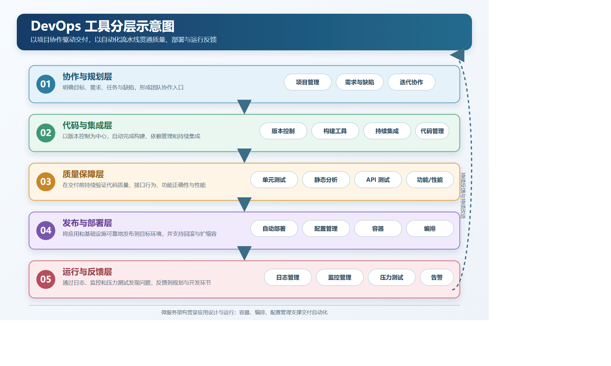
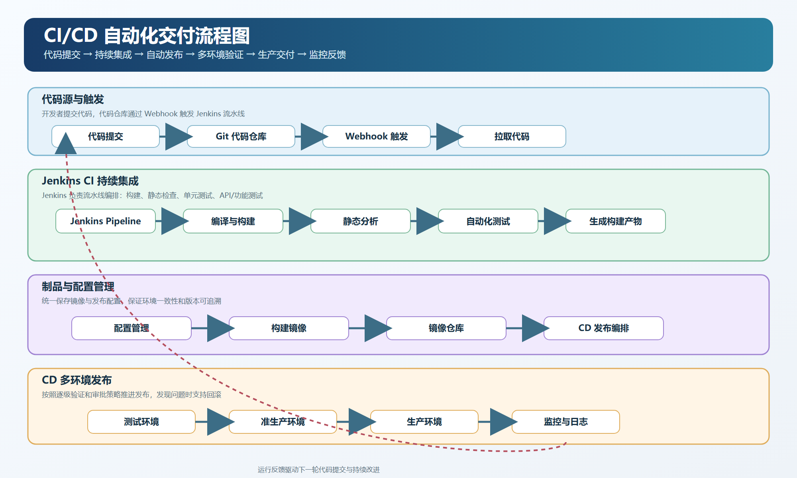
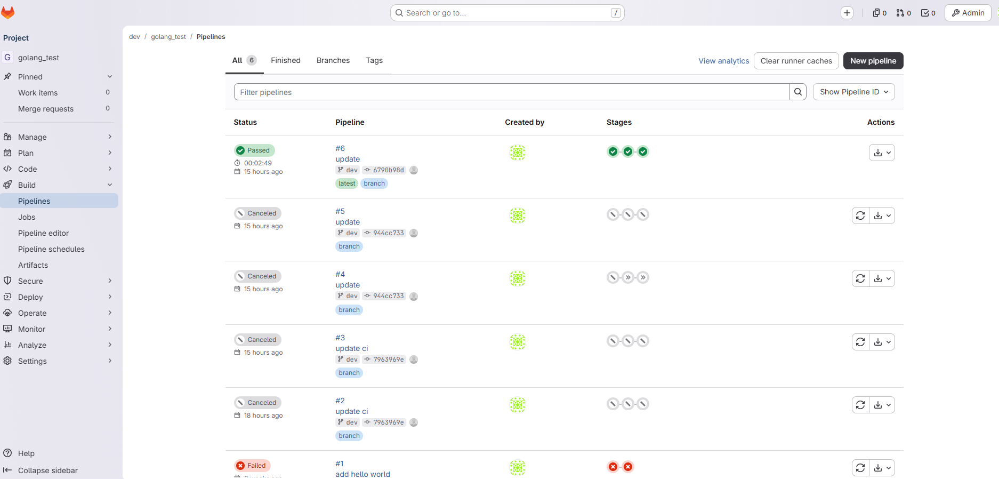
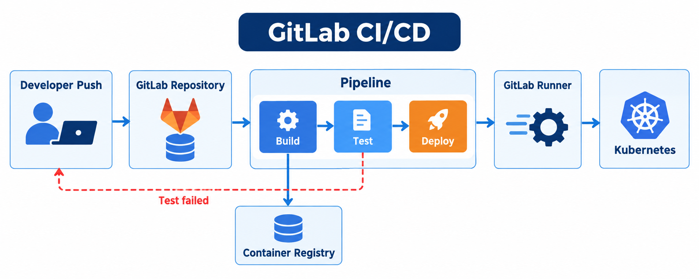
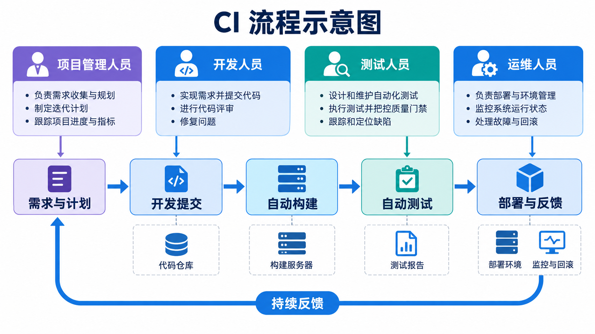
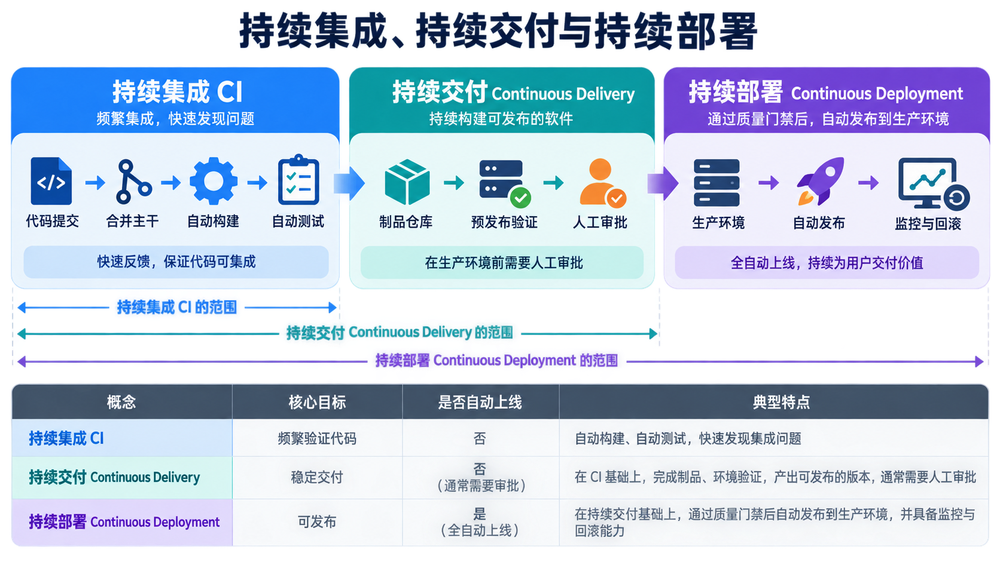
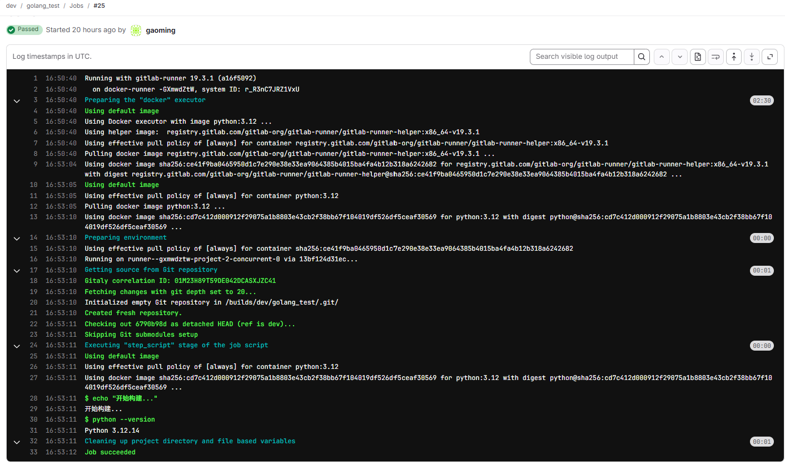
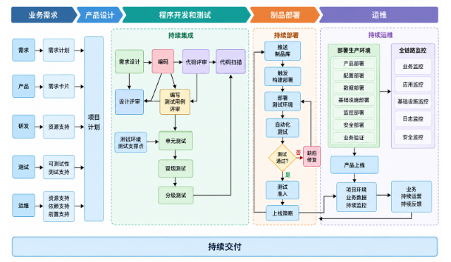

我真正接触 DevOps，是在进入百度自动驾驶部门之后。当时给我定的岗位是高级测试开发工程师，部门归在测试部，我也就从开发转向了测试。比较巧的是，正是借助这个机会，我接触到了比较正规的软件架构体系。当时仅仅是测试环节的步骤和流程，就已经非常复杂。比如每天凌晨会自动拉取 dev 分支的代码进行构建，这样研发人员每天来到工位后，就可以尽早发现软件集成中存在的冲突并及时解决，而不是等到各个子模块集成了很多功能后再处理大量冲突。又比如，会有专门针对深度学习不同场景搭建的 MLOps。因为深度学习本质上是数据驱动的，所以配套的数据平台会对接数据采集和数据回流，以构建数据飞轮。那个时候强化学习在自动驾驶中的应用还不多，站在 2026 年的时间节点再看，强化学习已经是不可或缺的技术。为了配套强化学习，还要搭建相应的数据生成和仿真体系。像整机系统，就要搭建软件在环和硬件在环体系，并通过数据回灌，在软件上车之前尽量测试出系统的边界能力。车端软件为了获得高性能，通常都要用 C++ 开发；大型 C++ 软件项目的编译、打包以及不同嵌入式平台的适配，都需要在架构层面进行设计。

所以，构建并做好 DevOps 平台，对于整个产品技术团队来说，是非常核心的基础设施。根据我的观察，国内技术比较好的一些公司都非常重视这一块。由 DevOps 引申出来的实践包括 DevSecOps、MLOps，甚至目前基于大模型 Agent 的 AIOps。代码绝大多数环节已经不再需要人手敲写，搭建智能化的 AI 辅助开发、测试和部署流水线，正在逐步拓展传统 DevOps 的边界。

这本书是我 2022 年买的，那个时候还处于古典 DevOps 的年代，当时我自己的技术水平也不是很强。经过几年的发展，我学习、成长了很多，也可以更自信地从完成单点开发任务，转向构建整套研发体系和攻坚前沿技术。借助 AI 完成经过前人验证的事情是理所当然的；做一些目前最先进的 AI 还做不到的事情，或者让 AI 突破当前的能力范围，则让我更加兴奋。

这本书的内容整体偏向互联网产品的 DevOps，我会在其中补充 AI 工程和机器人相关的内容。需要强调的一点是，DevOps 是一个非常工程化的领域，所以所有内容都要通过使用或实战设计去体验。即使是全球行业内的一些技术会议，真正有价值的地方也在于如何帮助产品研发和发布提效。

另外需要强调一点的是，这本书讲的是 IT 领域的 DevOps，不论是使用者、作者还是读者，基本都来自 IT 行业。DevOps 本身也脱胎于 IT 行业，并长期服务于 IT 行业。这一点无可厚非。可是站在 2026 年的当口，我认为 DevOps 的发展应该借助 AI 进入更多其他技术部门，比如机械、电子、电气、能源等。这些行业的一个特点是与硬件结合紧密，但是在实际工作中也会大量使用专业软件，比如 CAD、CAE 等。AI 工作流的应用范围不仅限于编程领域，目前也可以使用 AI 通过 MCP 控制不同的专业软件，甚至设计出辅助设计的 Agent。由此引发的研发模式变革，需要更强大的基础设施来支撑。

在我过往的研发经历中，其实经常涉及跨专业学科协作，比如研发机器人整机、多模态灵巧手、精密仪器设备、火箭和卫星等。一般的分工都是按照专业和职责划分为机械部门、电子硬件部门、嵌入式软件部门、应用与云软件部门等。这样划分后，一个部门内部的交流至少没有太高的专业门槛。那么，新型的、支撑多部门多专业协作的 AI 驱动 DevOps 基础设施，应该能够从多个专业的需求出发，提供研发与管理支撑。举个例子，在 IT 的 DevOps 中，Code Review 已经比较完善，有现成的功能；但是对于机械设计图纸，设计评审以及相关设计资源的管理，就没有像代码评审这样完善。所以，基于 IT 和 AI，把其他专业的大量研发、测试、部署、仿真与协作活动也集成到更广泛、统一的 DevOps 体系中，并深度结合 AI，我认为这是未来研发模式的一种形态。目前，这方面还没有成熟的体系，也没有公司真正大规模采用。我想在下半年自己实验一下。

我要将 IT 的 DevOps 提升为 AI 引导的全面工程 DevOps！书中把 DevOps 当作企业发展提供锦上添花的工具，我认为当下并非如此：DevOps 体系是科技企业核心竞争力的保障，也是科技企业研发最核心的 Infra 基础设施。

DevOps 一般包含的流程有：项目立项、需求整理、架构设计、代码开发、集成构建、代码测试、持续部署、配置管理、上线及监控工具集成等。DevOps 这个领域其实比较年轻，2007 年左右开始形成概念，并出现了一些专业技术交流会议。到了 2010 年，《What is DevOps》这篇文章让这个领域开始具备相对严谨的理论表述。中国真正开始将 DevOps 引入企业级开发生产环境，大概是在 2015 年左右。中国的互联网企业是 DevOps 实践探索的先行者。

DevOps 不是纯技术体系，这套体系要与组织模式配合工作，才能发挥威力。举个我亲身经历的例子：我之前待过的一个团队科研水平很好，发表了很多不错的论文，但工程技术能力非常欠缺，整个公司的组织体系犹如 90 年代的国企，研发推进经常被非常基础、简单的事情延误。在这样的团队中，别说推行高效的现代研发体系和 DevOps，连最基本的沟通都十分复杂。更有甚者，很多宣称要用 AI 改变行业的企业，在 2026 年依然如此。

这本书核心讲的是 IT 的信息化转型。到了 2026 年下半年，FDE 已经兴起，整个企业或组织都需要进行更深度的 AI 化变革。

# DevOps 工具门类

下表按 DevOps 生命周期整理常见工具，实际选型时应结合团队规模、技术栈、部署环境、安全要求以及已有基础设施综合评估。

| 工具门类 | 主要用途 | 代表性工具 |
| --- | --- | --- |
| 版本控制与代码管理 | 管理源代码、分支、合并和代码评审 | Git、GitHub、GitLab、Gitea、Bitbucket |
| 构建工具 | 编译、打包、依赖管理和构建产物生成 | Maven、Gradle、npm、pnpm、Bazel、Make、CMake |
| 持续集成 | 自动触发构建、测试和质量检查 | Jenkins、GitLab CI/CD、GitHub Actions、TeamCity、Tekton |
| 自动部署 | 自动发布应用和基础设施，支持回滚与发布策略 | Argo CD、Flux、Spinnaker、Octopus Deploy、Harness |
| 配置管理 | 管理服务器、运行环境和基础设施配置 | Ansible、Puppet、Chef、SaltStack、Terraform、Pulumi |
| 容器 | 封装应用及其运行依赖，实现环境一致性 | Docker、Podman、containerd、Buildah |
| 编排 | 管理容器集群、服务调度、扩缩容和故障恢复 | Kubernetes、OpenShift、Nomad、Docker Swarm |
| 微服务 | 支持服务注册发现、配置、网关和服务治理 | Spring Cloud、Dubbo、Istio、Linkerd、Nacos |
| 单元测试 | 验证函数、类和模块等最小代码单元 | JUnit、pytest、TestNG、Go test、xUnit |
| 代码静态分析 | 检查缺陷、代码规范、复杂度和安全问题 | SonarQube、Semgrep、Klocwork、ESLint、Pylint |
| API 测试 | 验证接口协议、参数、返回值和鉴权逻辑 | Postman、Apifox、SoapUI、Karate、REST Assured |
| 功能测试 | 验证业务功能和用户场景是否符合需求 | Selenium、Playwright、Cypress、Appium、Robot Framework |
| 性能测试 | 评估响应时间、吞吐量、资源消耗和稳定性 | JMeter、Gatling、k6、Locust、wrk |
| 日志管理 | 采集、检索、分析和归档应用及基础设施日志 | ELK/Elastic Stack、Loki、Fluent Bit、Splunk、Graylog |
| 监控管理 | 监测指标、可用性和系统健康状态并触发告警 | Prometheus、Grafana、Zabbix、Datadog、VictoriaMetrics |
| 压力测试管理 | 组织压测场景、负载模型、执行过程和结果分析 | JMeter、Gatling、k6、Locust、BlazeMeter |
| 项目管理 | 管理需求、任务、缺陷、迭代和研发协作流程 | Jira、Trello、禅道、Tapd、Azure DevOps、Linear |

## DevOps 分层示意图



# 1. DevOps 工具集
DevOps 能够发挥作用，工具和调度是核心。一般来说，DevOps 部署在服务器上，只不过涉及企业机密的代码会部署到私有服务器上，一些构建或编译任务则会部署到公有云。选择公有云可以避免自行搭建大型服务器带来的许多麻烦，而且公有云对 DevOps 的支持都比较完善，尤其是国内外的大厂，其内部的大量研发工作都使用自有云。

不同的工具选择需要考虑不同的因素。下面的表格简单列出了一些考量点。

| 工具 | 选择考量 |
| --- | --- |
| 项目管理工具 | 支持成员管理、权限管理、项目范围管理、沟通管理，消息管理等等 |
| 需求管理工具 | 需求创建、修改、删除、查询、数据可视化，需求指派，进度，需求定义评审 |
| 计划与任务管理工具 | 任务创建，子任务，标签，指派，对应源码分支与负责人，任务评价 |
| 文档管理工具 | 文档上传预览，编辑，同步 |
| 知识管理工具 | Wiki 创建、检索 |
| 团队协作工具 | 即时通信，过程展示 |
| 统计与度量工具 | 进度指标，交付与质量指标，缺陷解决指标，交付时长，代码提交，构建，单测，集成，部署，与集成测试时长 |
| 应用设计工具 | 服务发现，自动注册，负载均衡 |
| 集成开发环境工具 | 支持在线编写，构建运行程序，支持多种编程语言，支持创建工作空间，高亮，对接代码托管 |
| 版本控制工具 | 分支管理，预览代码，tag，hook，数据备份机制，二进制文件快速存储，代码审查，持续集成，持续交付，代码检测，自动化测试工具调用 |
| 构建与持续集成工具 | 多种编程语言支持，定时触发，手动触发，自动拉取代码，可视化，分布式编译，构建任务度量，输出报告 |
| 制品管理工具 | 制品备份，恢复，检索，打包，存储 |
| 部署管理工具 | 部署权限，并发部署，批次部署，定时触发部署，回滚， |
| 发布管理工具 | 发布权限、发布策略、自动生成 release notes、蓝绿发布、金丝雀发布 |
| 环境管理工具 | 开发、测试、预发布、生产环境，集群，DNS 管理，配置信息持久化，提供 API 给外部编排 |
| 应用配置管理工具 | 配置权限管理，配置数据一致性，支持灰度发布 |
| 数据管理工具 | 不同用户数据隔离，数据持久化存储，数据查询变更，数据容灾，数据全量增量备份 |
| 流水线管理工具 | 配置流水线，多种触发模式，实时查看，历史信息查看，停止启动，统计信息，质量门禁，并行串行，动态可伸缩执行环境 |
| 测试用例管理工具 | 用例集包含多个用例和子用例集，支持不同优先级，与分支版本关联，自动化测试集成，用例评审 |
| 测试计划管理工具 | 反馈失败原因，对执行结果进行统计，测试日志保存 |
| 缺陷管理工具 | Bug 分级、指派、状态管理、版本关联 |
| 静态代码检查工具 | 静态扫描、安全漏洞、编程规范、自动触发、自动生成报告、与缺陷管理打通 |
| 单元测试工具 | 断言，生成测试报告，支持多种框架 |
| 接口和服务测试工具 | 支持主流接口，支持多种报文，接口鉴权 |
| UI 测试工具 | 控件识别、数据驱动、测试过程截屏、录制与回放 |
| 移动自动化测试工具 | 支持通用自动化测试框架，支持点击、滑动、长按等操作，支持基本控件识别 |
| 性能测试工具 | 支持主流测试协议，支持性能测试脚本，支持长连接短连接，支持测试仪表盘，按需自动扩充压力测试源 |
| 容量与成本管理工具 | 支持定义不同容量类型，支持多种容量采集方式，定义容量与成本角色，定义容量指标 |

DevOps 平台一般都运行在云上，只是会根据不同的需求选择私有云或公有云。目前常见的形态是容器化平台加 Kubernetes（K8s）。Docker 主要用于构建和分发容器镜像；在 Kubernetes 集群中，容器运行时需要通过 CRI 与 kubelet 对接，常见实现包括 containerd 和 CRI-O。关于容器的内容，我之前已经写过很多文章，这里不再赘述。

Kubernetes 集群通常由控制平面（control plane）和工作节点（worker node）组成。控制平面主要包含 kube-apiserver、etcd、kube-scheduler 和 kube-controller-manager；工作节点通常运行 kubelet、kube-proxy 和容器运行时。高可用集群可以部署多个控制平面节点，但这些节点并不是普通意义上的 leader 和 follower：etcd 使用 Raft 进行选主，kube-scheduler 和 kube-controller-manager 通过租约机制进行组件级别的 leader election，kube-apiserver 则可以作为无状态服务运行多个副本。工作节点不会在控制平面故障后自行选举出新的控制平面；如果控制平面不可用，已有工作负载通常仍可能继续运行，但集群的调度、变更和状态管理会受到影响。组件的部署通常依赖一组配置文件，其中包括路径、参数、IP 地址以及不同组件的连接信息等。
Kubernetes 集群中的通信并不只有 HTTP 或 gRPC。kubelet 与 kube-apiserver 之间通常使用 HTTPS，etcd 的客户端和节点间通信主要使用基于 gRPC 的协议；Pod、Service 以及外部系统之间的业务通信，则取决于应用协议和集群网络插件（CNI）的配置。

容器云的 DevOps 设计包含 etcd（分布式键值存储）集群、域名和 DNS、容器私有仓库、K8s 集群、Jenkins、GitLab、统一的集成编译镜像、Nginx 负载均衡和图形化管理页面。如果涉及 AI，还要包含 GPU 集群管理、模型、数据管线以及评测仿真体系等。可以使用 Dockerfile 构建镜像。

## CI/CD 流程图



书里面介绍的项目管理工具比较成熟，比如禅道、Jira。我觉得这些工具比较老，因为我十年前就已经使用过它们。问题在于，它们不能很好地适配当下的 AI 体系。

书里介绍了很多代码管理工具的使用，比如 GitLab。这些都是很熟悉的内容，这里就不再介绍了。GitLab 提供 API，可以服务于整个 DevOps 体系，其他组件可以通过调用 API 来避免手动操作。

Jenkins 是一个 CI 工具，GitLab 本身也带有 CI 功能。我以前参与的老项目使用 Jenkins 多一些，新的项目则使用 GitLab CI。一般需要在项目中配置 `.gitlab-ci.yml` 文件。

```yaml
default:
  tags:
    - test

stages:
  - build
  - test
  - deploy

build:
  stage: build
  script:
    - echo "开始构建..."
    - python --version

test:
  stage: test
  script:
    - echo "开始测试..."

deploy:
  stage: deploy
  script:
    - echo "开始部署..."
```
上面的 demo 只是分了构建、测试和部署阶段。真实项目要比这个复杂得多，可能会使用多个镜像、拉取数据等。



Maven 是 Java 项目常用的构建工具。不同编程语言的构建工具和包管理工具各不相同。除此之外，编译构建还会涉及外部依赖包缓存、内部包编译缓存、镜像缓存等。可以使用自建仓库工具 Nexus，它提供 REST API。



SonarQube 是一个用于持续检查代码质量和安全问题的平台，主要通过静态代码分析（Static Application Security Testing / Static Analysis）发现 Bug、安全漏洞、可维护性问题和重复代码等。它经常被集成到 CI/CD 流程中，作为代码合并或发布前的质量门禁（Quality Gate）。这个工具支持绝大多数主流编程语言。比较新的版本集成了 AI 功能，AI 提供了不依赖规则的、更灵活的代码检测能力。

服务压力测试工具书里面介绍的是 JMeter，这个工具略老，比较新的开源工具可以使用 k6。k6 是一个现代化的开源性能测试和负载测试工具。它和 JMeter 做的事情类似，但更强调代码化（Performance Testing as Code）、CLI 和 CI/CD 集成。面向外部提供的云服务都要做压力测试，因为要测试系统到底可以承受多大的并发量。摸清这个底线之后，可以指导后续进一步扩容等设计。

## 运维监控与自动化配置

运维工具 Zabbix 略显老旧，主要负责服务器、网络设备、数据库、应用等基础设施的监控、指标采集和告警。例如：

- CPU 使用率 > 90%
- 内存使用率 > 85%
- 磁盘使用率 > 90%
- 服务器宕机
- MySQL 连接数异常
- HTTP 服务不可用

云原生环境可以使用 Prometheus + Grafana。

Ansible 解决的是另一类问题：我有几十、几百甚至几千台服务器，不想一台一台通过 SSH 登录操作。有了 Ansible 后，可以编写一个 Playbook：

```yaml
- hosts: webservers
  become: true

  tasks:
    - name: Install nginx
      apt:
        name: nginx
        state: present
```
这个工具主要用于系统批量配置、批量部署和批量执行命令。

# 2. 运维服务

DevOps 中内嵌了一些运维服务。

变更服务：配置变更、系统变更、架构变更、网络变更、调度变更等 -> 创建变更流程、建立变更通知机制、制定回滚策略、指定应急方案、创建变更规则。

容量服务：数据中心容量、计算资源容量、存储资源容量、网络资源容量、系统容量用量和余量 -> 制定容量指标、确定上下游容量依赖关系、评估容量总量及余量，并建立复盘机制。

容灾服务：数据容灾、计算资源容灾、存储资源容灾、网络资源容灾、流量控制、系统容灾 -> 开展容灾演练、制定容灾应急方案、实施容灾切换。

巡检服务：系统可靠性指标、计算资源指标、存储资源指标、缓存依赖、消息依赖、接口依赖 -> 梳理巡检上下游关系，确定巡检异常检测方式。

故障管理服务：故障分类、故障定级、故障通知、故障复盘、故障处理 -> 定义服务与故障的关系，实施故障闭环管理，建立故障知识体系。

标准化服务：计算资源标准化、存储资源标准化、网络资源标准化、日志资源标准化、数据输出标准化 -> 创建标准化模板、标准化审批流程和标准化参考依据。

上面列的这些都是比较基础常规的，如果使用公有云或者买现成的私有云服务，上述的很多能力是自带的。只是不见得全，有时候需要自己补充一些。

敏捷开发和 Scrum 在项目管理中的实践，目前使用飞书里的工具已经非常方便了。

# 3. CI/CD
CI 是持续进行编译、测试、检查并形成制品的过程。当源码发生改变时，需要触发构建动作。持续集成的优点是可以更早地发现缺陷，从而更早地处理缺陷。可以及时采集并分析 CI 过程中的数据，形成反馈机制，推动交付团队持续优化。持续集成鼓励开发者持续增量开发，并将代码提交、合并到主干。

下图是一个基本流程比较简略，实际的复杂项目会有非常多的细节和子流程。



## 持续集成 持续交付与持续部署的区别



下面的图是我一个项目 CI 的日志。随着 CI 流程变得复杂，其中会加入自动化测试、单元测试、性能测试、集成测试、场景测试等一系列 stage。


构建部分，比如大型 C++ 项目，需要进行并行分布式构建，并建立高效的缓存机制来提升编译速度。测试需要设计整体测试体系架构，在自动化测试框架下，为打包后的应用构建测试场景，并使用测试场景数据进行回归测试。对于一些纯应用软件，可以使用 Docker 测试容器，配置系统资源，比如 CPU 核心数、GPU 单元和显存等，然后运行测试用例。对于运行在 SoC 开发板上的嵌入式应用软件，比如机器人本体主控软件等，需要搭建测试台架，把 CI 接入具体的嵌入式开发板，在硬件环境上直接运行测试用例。对于更大规模的平台，比如机器人整体平台，由于会搭载很多传感器和 AI 模型，需要搭建整机 HIL，使用传感器采集的真实数据，在真机上运行模型评测，并进行性能和压力测试，甚至进行缺陷注入测试，让一部分组件失效，以检测系统的应变能力。对于更底层的操作系统 Linux 和 RTOS，可以部署模糊测试来检测系统的安全漏洞和内存安全等问题，避免长期运行时因偶发性内存或多线程问题导致系统失效。对于长期运行的测试，需要进行场景和数据埋点；当触发指定错误时，可以将流式分布式数据和系统状态保存为快照，用于后续调试和回放。

在编写测试用例时，需要经历测试需求分析、测试用例设计、测试用例评审、测试用例生成、集成到自动化测试框架、执行测试用例、跟踪测试问题等流程。自动化测试框架除了可以构建 Mock 数据进行测试，有时也需要集成数据集来评测算法。比如机器人系统中的目标检测算法，可以由自动化测试框架调用算法评测数据集，将 AI 推理结果与预期结果进行对比，评测 AI 模型的能力是否下降，并构建专项测试来评测模型对不同场景的适应能力。我以前的项目使用 Robot Framework 结合 ROS 搭建机器人软件测试系统。

前面的简单 GitLab CI 示例是我在项目中配置的。实际上，不同项目需要不同的镜像；到了真实项目中，不能只使用第三方镜像，而是需要自行制作镜像，因此也需要进行私有镜像资源管理。除此之外，还需要配置 GitLab Runner。如果需要将 Runner 配置到嵌入式开发板，还要搭建测试环境、管理 IP，并在开发板上部署 Runner。

软件制品的发布，也有很多的发布策略。比如最简单的单批次发布策略，这就是最常规的版本发布。

金丝雀发布策略一般是在正式发布前，先在少量服务器上发布新版本进行测试，以验证新版本。如果经过一段时间运行没有问题，再全量推送到所有服务器。这种方式在互联网上非常常见，先使用新版本的用户通常称为体验服或内测用户。

波浪发布类似于金丝雀发布，只不过会根据网络流量智能地进行版本切分。每个批次切换版本时，先将旧版本流量从负载均衡中移除，再执行发布动作；发布完成后，再导入流量，以保证用户尽可能平滑地使用服务。

蓝绿发布，同时准备两套几乎相同的生产环境，一套运行旧版本，一套部署新版本；验证新版本没问题后，把流量一次性切过去。

对于这种互联网应用的发布，可以对用户进行 A/B 测试，通过负载均衡将一部分用户导入新版本，将另一部分用户导入旧版本。这种方式在互联网产品中非常常见。同一个用户第一次进入产品时可能看到一个页面，第二次进入时可能看到另一个页面。另外，互联网产品部署基本都是上云的微服务架构。其实在具身智能机器人中也有微服务，比如基于 MQTT、HTTP 的服务以及系统检测服务等，只是规模没有云端大。

制品和制品库。不同的语言和项目，制品及制品库的形态差别很大。一般来说，制品是源码编译后的二进制文件。对于 Java 应用来说，制品就是 JAR 包；对于 C/C++ 应用来说，制品就是二进制可执行文件。由于面向部署的软硬件架构差别很大，比如 x86 平台、ARM64 平台等，制品除了包含编译好的二进制文件，也可以是镜像或各种软件包。



书里面提到的一些技术债观点很有道理，只是这里不再详细说明。DevOps 用好了可以消除一部分技术债，但只能消除一部分。

还有一个问题是代码评审和规范。公司中一般会规定不同的命名方法。现在有了 AI，我觉得方便了很多：将规范做成 Skill 后，编写一个 Agent，在每次提交代码前让 AI 自动检查代码规范。这个过程也可以使用 AI 的无头模式，集成到 DevOps 中。如果使用 SonarQube，它可以对代码进行静态扫描，并通过分支覆盖率、新代码分支覆盖率、单元测试忽略数、未覆盖代码行、单元测试错误数、单元测试持续时间、重复块、重复行和违规统计等指标来衡量代码质量。

对于大型软件系统，比如苹果的操作系统这类基础软件，软件安全性非常重要，不能因为安全漏洞泄露用户隐私。因此，后来提出了 DevSecOps。我以前的团队曾自研模糊测试引擎，用于测试数据库、操作系统和许多底层软件。除此之外，还有 SCA（软件成分分析）、DAST（动态应用安全测试）等方法，这些主要属于安全领域。

最后说明一下，DevOps 非常依赖工具体系。DevOps 只是一个框架，真正发挥作用的是具体工具以及技术团队的适配。AI 给 DevOps 带来了很大改变：既包括为 AI 模型设计的 MLOps 数据管线和模型评测，也包括在一般软件项目中加入 AI 以提升智能化水平。另外，许多 Agent 工具目前也可以以工具的形式集成到 DevOps 中。DevOps 会伴随技术发展而快速变化，需要持续更新工具和团队组织架构，以适应 AI 带来的变化。


