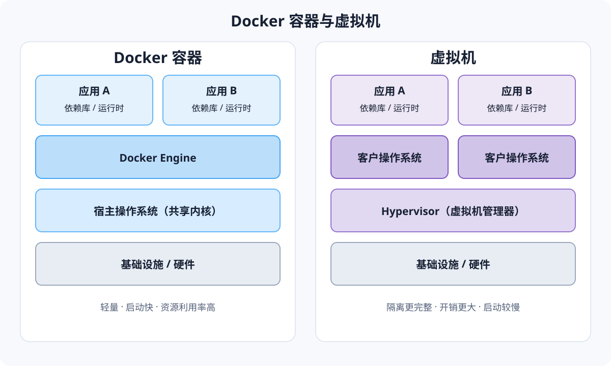

这本书刚工作的时候就买了，当时只看了一点点。那个时候的个人状态非常浮躁，不仅看不进去书，对于技术也是浮于表面，追逐热点，导致在初期做项目的产出非常不靠谱。后面是经历了一些项目打磨，尤其自己亲自去机器人AI项目落地的工厂解决问题，甚至一次就要在工厂蹲一个多月的出差，才对技术，产品，工程质量有了真正的敬畏，才开始认识到自己基础的薄弱。不论是学习做技术还是其他，都应该脚踏实地，这是对自己负责，也是对别人的信任负责。

关于Docker的一些基础内容我在上一篇文章中写的比较多了，所以对于一些重复内容会不再赘述。

# 1.Docker基本概念

## Docker 与虚拟机的区别



Docker 容器共享宿主机的操作系统内核，每个容器只携带应用及其依赖；虚拟机则通过 Hypervisor 运行各自完整的客户操作系统，因此通常具有更强的隔离性，但资源开销和启动时间也更大。
Docker 在 DevOps 中具备更快速交付和部署、更高效资源利用、更轻松迁移扩展、更简单更新管理的特点。

Docker 对于镜像的构建思路参考了 Git，上传下载镜像的命令也很相似。镜像可以推送到公开的仓库比如 Docker Hub，也可以使用国内云服务商提供的仓库服务，或者自己搭建本地内部的私有仓库。

Docker 安装参考官方文档或者用 AI 做一下就行，比较常规。安装完在 Linux 下为了避免每次都使用 sudo 权限操作 docker，可以把当前用户加入 docker 用户组
```shell
sudo usermod -aG docker $USER
```
自动清理遗留镜像文件,释放存储空间
```shell
docker image prune -f
```

## Docker 容器运行模式

截至 2026 年 7 月 11 日，Docker Engine 的最新版本为 **29.5.3**（发布于 2026 年 6 月 3 日）。`docker run` 是 `docker container run` 的简写，其基本格式为 `docker run [OPTIONS] IMAGE [COMMAND] [ARG...]`。

| 运行方式或选项 | 完整选项 | 说明 | 常用示例 |
| --- | --- | --- | --- |
| 前台模式（默认） | 无须额外选项 | 容器主进程占用当前终端，标准输出和标准错误直接显示在终端中；主进程退出后容器停止。 | `docker run nginx` |
| 后台模式 | `-d`、`--detach` | 在后台启动容器并输出容器 ID，不占用当前终端；可用 `docker logs` 查看日志，用 `docker attach`重新连接。 | `docker run -d --name web nginx` |
| 附加指定标准流 | `-a`、`--attach` | 将当前终端连接到容器的 `STDIN`、`STDOUT` 或 `STDERR`，可多次使用以指定多个流。 | `docker run -a stdout -a stderr nginx` |
| 交互模式 | `-i`、`--interactive` | 即使当前终端未附加到容器，也保持标准输入 `STDIN` 打开；适合输入管道或交互操作。 | `echo hello \| docker run --rm -i busybox cat` |
| 伪终端模式 | `-t`、`--tty` | 为容器分配一个伪终端，使终端程序获得格式化输出、密码隐藏等 TTY 能力；通常与 `-i` 配合。 | `docker run -it ubuntu bash` |
| 交互式后台模式 | `-dit` | `-d`、`-i`、`-t` 的组合：容器在后台运行，同时保留交互终端，之后可通过 `docker exec -it` 或 `docker attach` 进入。 | `docker run -dit --name dev ubuntu` |
| 自定义脱离快捷键 | `--detach-keys` | 覆盖从容器终端脱离但不停止容器的按键序列；默认脱离序列为 `Ctrl-p Ctrl-q`。 | `docker run -it --detach-keys="ctrl-x" ubuntu` |
| 退出后自动清理 | `--rm` | 容器退出时自动删除容器及其关联的匿名卷，适合一次性任务；它是生命周期选项，可与前台或后台模式组合。 | `docker run --rm alpine echo hello` |
| 使用轻量 init 进程 | `--init` | 在容器内以 PID 1 启动轻量 init，负责转发信号并回收僵尸进程，适合主程序不能正确处理 PID 1 职责的情况。 | `docker run --init my-app` |

> 说明：`-it` 并不是一个独立选项，而是 `-i` 与 `-t` 的常用组合。后台容器是否持续运行取决于其主进程；主进程结束时，容器也会停止。

资料来源：[Docker Engine 29 发布说明](https://docs.docker.com/engine/release-notes/29/)、[Running containers](https://docs.docker.com/engine/containers/run/)、[`docker container run` 命令参考](https://docs.docker.com/reference/cli/docker/container/run/)。

## `docker create`：容器环境与配置

以下内容同样基于 Docker Engine **29.5.3**。`docker create` 是 `docker container create` 的简写，用于根据镜像创建并配置容器，但**不会启动容器**；创建完成后容器状态为 `created`，需要使用 `docker start <容器名或 ID>` 启动。`docker run` 实际上也会先执行创建阶段，再启动容器。

基本格式：`docker create [OPTIONS] IMAGE [COMMAND] [ARG...]`

| 配置类别 | 选项 | 说明 | 示例 |
| --- | --- | --- | --- |
| 容器名称 | `--name` | 为容器设置易于识别且在当前 Docker 主机中唯一的名称；未指定时由 Docker 随机生成。 | `docker create --name web nginx` |
| 环境变量 | `-e`、`--env` | 设置单个环境变量，可重复使用；只写变量名时，会读取客户端当前环境中的同名变量值。 | `docker create -e APP_ENV=prod -e DEBUG=false my-app` |
| 环境变量文件 | `--env-file` | 从文件批量读取环境变量，适合将大量配置与命令分离；文件通常每行使用 `KEY=VALUE` 格式。 | `docker create --env-file ./app.env my-app` |
| 主机名 | `-h`、`--hostname` | 设置容器内部看到的主机名。 | `docker create --hostname app-node my-app` |
| 工作目录 | `-w`、`--workdir` | 设置容器内命令的工作目录，并覆盖镜像 Dockerfile 中的 `WORKDIR`。 | `docker create -w /app my-app` |
| 运行用户 | `-u`、`--user` | 设置容器进程使用的用户名或 UID，可附带组名或 GID，格式为 `user[:group]`。 | `docker create --user 1000:1000 my-app` |
| 启动入口 | `--entrypoint` | 覆盖镜像 Dockerfile 中定义的 `ENTRYPOINT`；镜像名后面的内容作为命令和参数。 | `docker create --entrypoint /bin/sh alpine -c "echo hello"` |
| 元数据标签 | `-l`、`--label` | 为容器添加键值形式的元数据，可重复使用，便于分类、过滤及自动化管理。 | `docker create -l env=prod -l team=backend my-app` |
| 标签文件 | `--label-file` | 从按行分隔的文件中批量读取容器标签。 | `docker create --label-file ./labels.txt my-app` |
| 网络 | `--network` | 创建时将容器连接到指定网络；可使用网络名称或支持的网络模式。 | `docker create --network app-net my-app` |
| 网络别名 | `--network-alias` | 为容器设置指定网络范围内可解析的别名。 | `docker create --network app-net --network-alias api my-app` |
| DNS | `--dns`、`--dns-search`、`--dns-option` | 分别设置 DNS 服务器、搜索域和解析器选项，均可重复指定。 | `docker create --dns 1.1.1.1 my-app` |
| 端口映射 | `-p`、`--publish` | 将容器端口发布到宿主机；仅配置映射，实际监听要等容器启动。 | `docker create -p 8080:80 nginx` |
| 数据挂载 | `--mount` | 使用显式键值语法配置卷、绑定挂载、tmpfs 等；配置较复杂时比 `-v` 更清晰。 | `docker create --mount type=volume,src=data,dst=/data my-app` |
| 简写挂载 | `-v`、`--volume` | 使用简写语法挂载命名卷、匿名卷或宿主机目录。 | `docker create -v app-data:/var/lib/app my-app` |
| 只读根文件系统 | `--read-only` | 将容器根文件系统设为只读；需要写入的位置可另外挂载卷或 tmpfs。 | `docker create --read-only --tmpfs /tmp my-app` |
| CPU 限制 | `--cpus` | 限制容器最多可使用的 CPU 数量。 | `docker create --cpus 1.5 my-app` |
| 内存限制 | `-m`、`--memory` | 设置容器可使用的内存上限，支持 `m`、`g` 等单位。 | `docker create --memory 512m my-app` |
| 重启策略 | `--restart` | 设置容器退出后的重启策略，可选 `no`、`on-failure[:次数]`、`always`、`unless-stopped`。 | `docker create --restart unless-stopped my-app` |
| 健康检查 | `--health-cmd` 等 | 设置健康检查命令以及检查间隔、超时、启动宽限期和重试次数；`--no-healthcheck` 可禁用镜像自带的检查。 | `docker create --health-cmd "curl -f http://localhost/ || exit 1" nginx` |
| 拉取策略 | `--pull` | 创建前的镜像拉取策略：`always`、`missing`（默认）或 `never`。 | `docker create --pull always nginx` |
| 目标平台 | `--platform` | 在支持多平台的 Docker 环境中指定镜像平台。 | `docker create --platform linux/amd64 alpine` |

组合示例：

```shell
docker create \
  --name web \
  --env-file ./app.env \
  --network app-net \
  -p 8080:80 \
  --memory 512m \
  --cpus 1.5 \
  --restart unless-stopped \
  nginx

docker start web
```

> 注意：环境变量选项适合普通配置，不应直接承载密码、令牌等敏感信息，因为容器配置可通过 `docker inspect` 查看。敏感数据应使用适合部署环境的密钥管理方案。

资料来源：[`docker container create` 命令参考](https://docs.docker.com/reference/cli/docker/container/create/)、[`docker container run` 命令参考](https://docs.docker.com/reference/cli/docker/container/run/)、[Docker Engine 29 发布说明](https://docs.docker.com/engine/release-notes/29/)。

## `docker create`：容器资源限制与安全防护

以下选项基于 Docker Engine **29.5.3**。Docker 容器默认可以按宿主机内核调度能力使用资源，因此生产环境通常应明确配置资源上限，并遵循最小权限原则设置安全选项。`docker create` 只保存这些配置，容器通过 `docker start` 启动后配置才会生效。

### 资源限制选项

| 资源类别 | 选项 | 作用与注意事项 | 示例 |
| --- | --- | --- | --- |
| 内存硬限制 | `-m`、`--memory` | 设置容器可使用的内存上限，Linux 下最小值为 `6m`；达到上限且无法回收内存时，进程可能被 OOM Killer 终止。 | `docker create --memory 512m my-app` |
| 内存软限制 | `--memory-reservation` | 主机发生内存竞争时使用的软限制，应设置得低于 `--memory`；它不保证容器绝不会超过该值。 | `docker create --memory 1g --memory-reservation 512m my-app` |
| 内存与 Swap 总量 | `--memory-swap` | 必须结合 `--memory` 理解；该值是内存与 Swap 的总和。与 `--memory` 相同表示禁用 Swap，`-1` 表示可使用无限 Swap。 | `docker create --memory 512m --memory-swap 1g my-app` |
| Swap 倾向 | `--memory-swappiness` | 设置匿名内存页换出的倾向，范围为 `0`～`100`；`0` 尽量不换出，未指定时继承宿主机设置。 | `docker create --memory-swappiness 10 my-app` |
| CPU 数量上限 | `--cpus` | 设置容器最多可使用的 CPU 数量，支持小数；是多数场景下最直观的 CPU 限制方式。 | `docker create --cpus 1.5 my-app` |
| CPU 相对权重 | `-c`、`--cpu-shares` | 设置 CPU 竞争时的相对权重，默认值为 `1024`；这是软限制，CPU 空闲时不会阻止容器使用更多算力。 | `docker create --cpu-shares 512 my-app` |
| 绑定 CPU 核心 | `--cpuset-cpus` | 限制容器只能在指定逻辑 CPU 上运行，可使用列表或范围。 | `docker create --cpuset-cpus 0,2-3 my-app` |
| CFS 配额 | `--cpu-period`、`--cpu-quota` | 精细设置 Linux CFS 调度周期与周期内可使用的 CPU 时间；通常优先使用更简单的 `--cpus`。 | `docker create --cpu-period 100000 --cpu-quota 50000 my-app` |
| 进程数量 | `--pids-limit` | 限制容器可创建的进程数量，防止 fork bomb；`-1` 表示不限制。 | `docker create --pids-limit 200 my-app` |
| 共享内存 | `--shm-size` | 设置容器 `/dev/shm` 的大小，浏览器、数据库及多进程程序可能需要调整。 | `docker create --shm-size 256m my-app` |
| 块设备 I/O 权重 | `--blkio-weight` | 设置块设备 I/O 的相对权重，范围为 `10`～`1000`，仅在发生 I/O 竞争时体现。 | `docker create --blkio-weight 500 my-app` |
| 设备读写速率 | `--device-read-bps`、`--device-write-bps` | 按设备限制每秒读写字节数，也可用 `--device-read-iops`、`--device-write-iops` 限制 IOPS。 | `docker create --device-read-bps /dev/sda:10mb my-app` |
| 进程资源上限 | `--ulimit` | 设置容器进程的 `ulimit`，如打开文件数、进程数或锁定内存等。 | `docker create --ulimit nofile=1024:2048 my-app` |
| GPU | `--gpus` | 向容器提供指定或全部 GPU；需要宿主机、驱动及容器运行时支持。 | `docker create --gpus all my-app` |

### 安全防护选项

| 防护类别 | 选项 | 作用与安全建议 | 示例 |
| --- | --- | --- | --- |
| 非 root 用户 | `-u`、`--user` | 指定容器进程的用户或 UID/GID。应用没有 root 需求时，应优先使用非特权用户运行。 | `docker create --user 1000:1000 my-app` |
| 删除 Linux 能力 | `--cap-drop` | 移除容器进程的 Linux capability；推荐先使用 `ALL` 删除全部能力，再按实际需要添加。 | `docker create --cap-drop ALL my-app` |
| 添加 Linux 能力 | `--cap-add` | 仅添加应用必需的 capability，比使用 `--privileged` 风险更低。 | `docker create --cap-drop ALL --cap-add NET_BIND_SERVICE my-app` |
| 禁止获取新权限 | `--security-opt no-new-privileges=true` | 阻止容器进程及其子进程通过 setuid、setgid 等机制提升权限。 | `docker create --security-opt no-new-privileges=true my-app` |
| Seccomp 策略 | `--security-opt seccomp=...` | 使用 Docker 内置或自定义 seccomp 配置限制系统调用。不要在普通场景使用 `seccomp=unconfined`。 | `docker create --security-opt seccomp=builtin my-app` |
| AppArmor 策略 | `--security-opt apparmor=...` | 在支持 AppArmor 的 Linux 主机上应用指定安全配置；默认通常使用 `docker-default`。 | `docker create --security-opt apparmor=my-profile my-app` |
| SELinux 标签 | `--security-opt label=...` | 在启用 SELinux 的主机上配置进程安全标签；不建议为图方便使用 `label=disable`。 | `docker create --security-opt label=type:my_app_t my-app` |
| 只读根文件系统 | `--read-only` | 禁止写入容器根文件系统，缩小被入侵后篡改文件的范围；必要写入目录应单独挂载卷或 tmpfs。 | `docker create --read-only --tmpfs /tmp my-app` |
| 用户命名空间 | `--userns` | 覆盖 Docker daemon 的用户命名空间设置；启用 daemon 的 `userns-remap` 可将容器内 UID 映射到宿主机的非特权 UID，而 `--userns=host` 会对单个容器关闭该映射。 | `docker create --userns host my-app` |
| Cgroup 命名空间 | `--cgroupns` | 使用 `private` 可让容器拥有独立 cgroup 命名空间；`host` 会降低隔离程度。 | `docker create --cgroupns private my-app` |
| PID 命名空间 | `--pid` | 控制进程命名空间。默认即为容器独立的 PID 命名空间；`host` 或 `container:<名称>` 会共享其他进程视图并降低隔离程度。 | `docker create --pid container:debug-target my-app` |
| IPC 命名空间 | `--ipc` | 控制进程间通信隔离。默认私有模式更安全；`host` 或共享其他容器的 IPC 会降低隔离程度。 | `docker create --ipc private my-app` |
| 设备访问 | `--device` | 只向容器开放确实需要的宿主机设备，并可用 `:rwm` 子集限制读、写及创建设备节点权限。 | `docker create --device /dev/sda:/dev/xvda:r my-app` |
| 特权模式 | `--privileged` | 授予几乎全部 Linux capabilities、设备访问及更宽松的系统路径权限，容器不再是安全沙箱；除非确有必要，否则不要使用。 | `docker create --privileged my-app` |

推荐的基础加固示例：

```shell
docker create \
  --name secure-app \
  --user 1000:1000 \
  --memory 512m \
  --memory-swap 512m \
  --cpus 1.0 \
  --pids-limit 200 \
  --read-only \
  --tmpfs /tmp:rw,noexec,nosuid,size=64m \
  --cap-drop ALL \
  --security-opt no-new-privileges=true \
  my-app
```

> 注意：资源选项能否生效取决于宿主机操作系统、内核、cgroup 和 Docker daemon 配置。可通过 `docker info` 检查支持情况。`--privileged`、`--pid=host`、`--ipc=host`、`seccomp=unconfined` 等选项会显著降低隔离强度，不应作为常规故障解决手段。

资料来源：[Docker 资源限制](https://docs.docker.com/engine/containers/resource_constraints/)、[`docker container create` 命令参考](https://docs.docker.com/reference/cli/docker/container/create/)、[Docker Engine 安全](https://docs.docker.com/engine/security/)、[`docker container run` 安全选项](https://docs.docker.com/reference/cli/docker/container/run/)、[Docker Engine 29 发布说明](https://docs.docker.com/engine/release-notes/29/)。

## Docker 容器常用管理命令

以下命令基于 Docker Engine **29.5.3**，完整命令均可省略中间的 `container`，例如 `docker container cp` 可简写为 `docker cp`。

| 操作 | 命令格式 | 简单说明 | 示例 |
| --- | --- | --- | --- |
| 本地复制到容器 | `docker cp SRC_PATH CONTAINER:DEST_PATH` | 将本地文件或目录复制到运行中或已停止的容器。目标父目录必须已经存在。 | `docker cp ./app.conf web:/etc/app/app.conf` |
| 容器复制到本地 | `docker cp CONTAINER:SRC_PATH DEST_PATH` | 将容器中的文件或目录复制到本地，可用于提取日志或临时备份数据。 | `docker cp web:/var/log/nginx ./nginx-logs` |
| 查看文件系统变更 | `docker diff CONTAINER` | 列出容器可写层相对于初始镜像发生变化的文件和目录。输出中的 `A` 表示新增、`C` 表示修改、`D` 表示删除。 | `docker diff web` |
| 查看全部端口映射 | `docker port CONTAINER` | 显示该容器所有已发布端口及其对应的宿主机地址和端口。 | `docker port web` |
| 查看指定端口映射 | `docker port CONTAINER PRIVATE_PORT[/PROTO]` | 仅查询某个容器端口的映射；协议可指定为 `tcp`、`udp` 或 `sctp`。 | `docker port web 80/tcp` |
| 更新容器配置 | `docker update [OPTIONS] CONTAINER...` | 动态更新一个或多个容器的部分资源限制或重启策略，可用于运行中或已停止的 Linux 容器。 | `docker update --cpus 2 --memory 1g web` |

### 复制文件：`docker cp`

`docker cp` 的行为类似 `cp -a`，可递归复制目录并尽可能保留权限。容器路径以容器根目录 `/` 为基准，开头的 `/` 可以省略；本地相对路径则以执行命令时的当前目录为基准。

常用选项：

- `-a`、`--archive`：归档模式，保留源文件的 UID 和 GID 信息。
- `-L`、`--follow-link`：复制符号链接指向的实际内容，而不是链接本身。
- `-q`、`--quiet`：不显示复制进度。

```shell
# 将本地配置复制到容器
docker cp ./nginx.conf web:/etc/nginx/nginx.conf

# 将容器日志复制到当前目录
docker cp web:/var/log/nginx ./nginx-logs
```

> `docker cp` 不会自动创建不存在的目标父目录，也不适合复制 `/proc`、`/sys`、`/dev` 等特殊文件系统中的内容。对于持久化数据，通常应优先使用卷或绑定挂载，而不是长期依赖手工复制。

### 查看容器变更：`docker diff`

`docker diff` 用于检查容器创建后，其可写层发生的文件系统变化：

| 标记 | 含义 |
| --- | --- |
| `A` | 新增了文件或目录（Added） |
| `C` | 修改了文件或目录（Changed） |
| `D` | 删除了文件或目录（Deleted） |

```shell
docker diff web

# 可能的输出
C /etc/nginx/nginx.conf
A /var/log/nginx/access.log
D /tmp/old-file
```

该命令适合排查容器运行后修改了哪些文件，但不会显示文件的具体内容差异。

### 查看端口映射：`docker port`

```shell
# 查看容器的全部端口映射
docker port web

# 只查询容器的 80/TCP 端口
docker port web 80/tcp
```

可能的输出为 `0.0.0.0:8080`，表示容器端口被发布到宿主机所有 IPv4 网络接口的 `8080` 端口。`docker port` 只能查看创建容器时通过 `-p` 或 `-P` 建立的发布映射，Dockerfile 中的 `EXPOSE` 本身并不会将端口发布到宿主机。

### 更新配置：`docker update`

`docker update` 可以同时更新一个或多个现有容器，无须重新创建容器。常用可更新配置如下：

| 配置类别 | 选项示例 | 说明 |
| --- | --- | --- |
| CPU | `--cpus`、`--cpu-shares`、`--cpuset-cpus` | 更新 CPU 数量上限、相对权重或允许使用的 CPU 核心。 |
| 内存 | `--memory`、`--memory-reservation`、`--memory-swap` | 更新内存硬限制、软限制以及内存和 Swap 总量。 |
| 进程数 | `--pids-limit` | 更新容器可创建的最大进程数量，`-1` 表示不限制。 |
| 块 I/O | `--blkio-weight` | 更新块设备 I/O 的相对权重，范围为 `10`～`1000`。 |
| 重启策略 | `--restart` | 更新为 `no`、`on-failure[:次数]`、`always` 或 `unless-stopped`。 |

```shell
# 更新一个容器的 CPU 和内存限制
docker update --cpus 2 --memory 1g web

# 同时更新多个容器的重启策略
docker update --restart unless-stopped web api worker
```

> `docker update` 不能修改镜像、环境变量、端口映射、挂载、网络或安全能力等创建期配置；这些配置通常需要删除并重新创建容器。该命令不支持 Windows 容器。使用 `--rm` 创建的容器不能再设置重启策略，因为自动删除与自动重启互斥。

资料来源：[`docker container cp`](https://docs.docker.com/reference/cli/docker/container/cp/)、[`docker container diff`](https://docs.docker.com/reference/cli/docker/container/diff/)、[`docker container port`](https://docs.docker.com/reference/cli/docker/container/port/)、[`docker container update`](https://docs.docker.com/reference/cli/docker/container/update/)、[`docker container run`](https://docs.docker.com/reference/cli/docker/container/run/)。

上面这些表都是用AI自动查询Docker最新的发布文档提取生成的。我要自己手敲半天时间就没了。

## Docker私有镜像仓库
在安装Docker环境后，可以使用官方提供的镜像registry搭建私有仓库。有点套娃的感觉的。这对于一些公司内部环境还是非常有用的。

## 数据卷
数据卷可以用来持久化容器的数据，可以在容器被删除后依然保留数据。而且数据卷可以被不同容器共享，可以通过创建数据卷容器的方式，实现多个容器共享同一个数据卷，在某个容器写入共享数据卷，在其他共享该数据卷的容器可以看到数据更新。而且数据卷容器还有一个好处是便于数据迁移。可以对数据卷进行备份恢复来实现数据迁移。

## 端口映射和容器互联
对于需要对容器外提供网络服务的容器，需要设置端口映射，来使用宿主机的端口，把内部网络应用的端口映射到内部端口，这样内部的程序照常使用自己程序或者配置文件中定义的端口，外部按照设定去访问宿主机的指定端口即可。

另外一种方式是使用容器的互联机制，也就是指定link参数通过docker内部的网络虚拟化进行通信。

## Dockerfile创建镜像
镜像毕竟也是二进制文件，不利于使用代码平台维护。Dockerfile实际上就是一个文本文件，里面按照Docker的语法定义了一些变量，可以设置拉取镜像，以及安装的软件包依赖，还有在构建镜像过程中运行一些命令操作。

## Dockerfile 常用指令

Dockerfile 是用于描述镜像构建过程的文本文件。Docker 默认按文件中的顺序执行指令，每条构建指令通常会产生可缓存的构建结果。以下内容参考 Docker Engine **29.5.3** 及当前 Dockerfile 语法文档。

| 指令 | 基本用法 | 作用与注意事项 | 示例 |
| --- | --- | --- | --- |
| `FROM` | `FROM image[:tag] [AS name]` | 指定基础镜像并开始一个新的构建阶段。通常是 Dockerfile 的第一条指令；全局 `ARG` 可以写在它之前。使用 `AS` 命名阶段可进行多阶段构建。 | `FROM golang:1.25 AS builder` |
| `RUN` | `RUN command` 或 `RUN ["程序", "参数"]` | 在**构建镜像时**执行命令并保存结果，常用于安装依赖和编译程序。应合并相关操作并清理缓存，减少镜像层和体积。 | `RUN apt-get update && apt-get install -y curl` |
| `CMD` | `CMD ["程序", "参数"]` | 设置容器启动时的默认命令或 `ENTRYPOINT` 的默认参数。一个阶段只有最后一条 `CMD` 生效，运行时提供的命令会覆盖它。 | `CMD ["nginx", "-g", "daemon off;"]` |
| `ENTRYPOINT` | `ENTRYPOINT ["程序", "参数"]` | 设置容器的默认可执行程序。运行时参数通常追加到 exec 格式的 `ENTRYPOINT` 后面，可用 `docker run --entrypoint` 覆盖。 | `ENTRYPOINT ["/usr/local/bin/app"]` |
| `COPY` | `COPY [选项] 源 目标` | 将构建上下文、其他构建阶段或指定上下文中的文件复制到镜像。普通文件复制应优先使用 `COPY`。 | `COPY --from=builder /src/app /usr/local/bin/app` |
| `ADD` | `ADD [选项] 源 目标` | 与 `COPY` 类似，还可处理远程 URL、Git 仓库及本地归档解包等高级来源。没有这些需求时优先使用 `COPY`，行为更明确。 | `ADD app.tar.gz /opt/app/` |
| `WORKDIR` | `WORKDIR /path` | 设置后续 `RUN`、`CMD`、`ENTRYPOINT`、`COPY` 和 `ADD` 的工作目录；目录不存在时会自动创建。建议使用绝对路径。 | `WORKDIR /app` |
| `ENV` | `ENV KEY=value` | 设置构建阶段及最终容器中持续存在的环境变量，可被后续指令使用，也可在运行容器时覆盖。不要用于保存密码或令牌。 | `ENV NODE_ENV=production` |
| `ARG` | `ARG NAME[=default]` | 声明仅在构建阶段使用的变量，通过 `docker build --build-arg` 传值。默认不会作为环境变量保留在最终容器中，但也不适合传递秘密。 | `ARG APP_VERSION=1.0.0` |
| `EXPOSE` | `EXPOSE port[/protocol]` | 声明镜像内应用预期监听的端口，主要用于文档和元数据；它不会自动将端口发布到宿主机。 | `EXPOSE 8080/tcp` |
| `USER` | `USER user[:group]` | 设置本阶段后续 `RUN` 指令以及容器运行时 `CMD`、`ENTRYPOINT` 使用的默认用户和组。建议最终切换到非 root 用户。 | `USER app:app` |
| `VOLUME` | `VOLUME ["/data"]` | 声明容器运行时的挂载点。未显式指定卷时，Docker 会为该路径创建匿名卷。具体宿主机来源应在运行容器时配置。 | `VOLUME ["/var/lib/app"]` |
| `LABEL` | `LABEL key=value` | 为镜像添加键值形式的元数据，如版本、源码地址和维护者信息；可通过 `docker image inspect` 查看。 | `LABEL org.opencontainers.image.version="1.0.0"` |
| `HEALTHCHECK` | `HEALTHCHECK [选项] CMD command` | 定义容器健康检查，可设置间隔、超时、启动宽限期和重试次数；`HEALTHCHECK NONE` 可禁用继承的检查。 | `HEALTHCHECK --interval=30s --timeout=3s CMD curl -f http://localhost/health \|\| exit 1` |
| `STOPSIGNAL` | `STOPSIGNAL signal` | 设置 Docker 停止容器时发送给主进程的信号；未指定时默认为 `SIGTERM`。 | `STOPSIGNAL SIGQUIT` |
| `SHELL` | `SHELL ["程序", "参数"]` | 覆盖 shell 格式的 `RUN`、`CMD` 和 `ENTRYPOINT` 所使用的默认 shell，Windows 镜像中尤其常见。 | `SHELL ["/bin/bash", "-c"]` |
| `ONBUILD` | `ONBUILD <指令>` | 注册延迟执行的触发器：当前镜像作为其他 Dockerfile 的基础镜像时执行。适合制作框架型基础镜像，但会增加隐式行为。 | `ONBUILD COPY . /app/src` |
| `MAINTAINER` | `MAINTAINER name` | 设置镜像作者的旧指令，现已弃用；应改用 OCI 标准的 `LABEL`。 | `LABEL org.opencontainers.image.authors="dev@example.com"` |

### 几组容易混淆的指令

| 对比 | 区别 |
| --- | --- |
| `RUN` 与 `CMD` | `RUN` 在构建镜像时执行；`CMD` 只定义以后启动容器时的默认命令。 |
| `CMD` 与 `ENTRYPOINT` | `ENTRYPOINT` 适合定义固定主程序，`CMD` 适合定义可被运行参数覆盖的默认命令或默认参数。常见组合为 `ENTRYPOINT ["app"]` 加 `CMD ["--help"]`。 |
| `COPY` 与 `ADD` | 两者都能复制文件；`ADD` 还具有远程来源和归档处理等扩展能力。简单复制优先使用语义明确的 `COPY`。 |
| `ARG` 与 `ENV` | `ARG` 主要存在于构建过程；`ENV` 会写入镜像配置，并在容器运行时继续存在。二者都不应保存秘密。 |
| `EXPOSE` 与 `-p` | `EXPOSE` 只是镜像端口声明；`docker run -p 宿主端口:容器端口` 才会真正发布端口。 |

### 简单的多阶段构建示例

```dockerfile
# syntax=docker/dockerfile:1
FROM golang:1.25-alpine AS builder
WORKDIR /src
COPY go.mod go.sum ./
RUN go mod download
COPY . .
RUN CGO_ENABLED=0 go build -o /out/app ./cmd/app

FROM alpine:3.22
RUN addgroup -S app && adduser -S -G app app
WORKDIR /app
COPY --from=builder /out/app ./app
USER app:app
EXPOSE 8080
HEALTHCHECK --interval=30s --timeout=3s CMD ["/app/app", "healthcheck"]
ENTRYPOINT ["/app/app"]
CMD ["serve"]
```

> 建议优先使用 JSON 数组形式的 `ENTRYPOINT` 和 `CMD`，使应用直接成为容器的 PID 1，能够正确接收停止信号。构建上下文中不需要的文件应通过 `.dockerignore` 排除；构建所需的秘密应使用 BuildKit 的 `RUN --mount=type=secret`，不要写入 `ARG`、`ENV` 或镜像层。

资料来源：[Dockerfile 指令参考](https://docs.docker.com/reference/dockerfile/)、[Dockerfile 概念介绍](https://docs.docker.com/build/concepts/dockerfile/)、[Docker 构建检查](https://docs.docker.com/reference/build-checks/)。

.dockerignore文件是在创建镜像时，忽略一些路径和文件。对于开发镜像和运行镜像，开发镜像往往需要安装很重的编译开发环境，但是运行镜像其实只需要很少的依赖就可以运行。所以在设计devops的时候需要将二者区分开来。

# 2.Docker应用
非常小的Linux镜像可以使用BusyBox，这个里面集成了上百个linux命令，镜像大小只有几MB。Alpine额外提供了包管理器和一些libc等，但是相比ubuntu镜像依然很小。我比较常用的好事ubuntu镜像，不论是做一些web的开发还是做一些嵌入式平台比如RK3588等都可以。也非常适合集成到CICD中。Jenkins做代码流水线持续集成的工具，可以配合跟Gitlab一起使用。数据库比如MySQL服务，一般都是跟着web后端服务一起配套搭建微服务体系。MongoDB，noSQL数据库，提供高性能的数据查询能力。Redis也是一个NoSQL数据库，这几个在Web后端中都非常常见。现在大型互联网公司或者云服务基本都是微服务架构，一些分布式平台也会使用提供docker镜像方便开发和部署，比如Hadoop，Spark。这种大数据分布式技术我不是很懂。

书里面介绍了在容器中安装ssh-server，这个很基操，这本书写的比较早，那个时候vscode的远程容器开发还没有现在这么成熟，现在直接用远程容器插件远程开发非常方便普遍。

## 编程开发
在容器里面可以配置各种编程语言的开发环境。正好我最近也在做一些相关的事情吧。比如在项目中建立统一的基础编译工具链版本控制以及方便的开发环境以及部署环境等。
比如对于C++开发比较重要的编译器版本Gcc还是Clang。对于Java，什么版本的虚拟机，spring boot的配置与安装；python的解释器是什么版本，包管理器是pip还是uv等等。这些在It技术比较好的技术团队都会配置的非常清晰来保证协同。

## 云服务
这些互联网大公司除了自己的产品使用docker跑在自己的云上，一般也会提供对外的公有云服务，让客户可以直接使用docker来部署他们的应用，并且提供弹性计算的服务。举个例子，Gitlab的服务也可以部署到云上，我以前一个公司就部署到阿里云上。比较常见的云服务上AWS,Google，Azure，腾讯云，阿里云等。


书里面一些过时的内容就不讲了

# 3.K8s
Docker自带的Compose主要用于单机的容器编排，比如自己在一个服务器上搭建一个Gitlab之类的。而K8s主要是用于云端多机集群的容器编排，是正儿八经给大规模互联网服务提供基础设施支撑的。到目前为止已经是事实标准了。提供了强大的应用管理和任务调度能力。

因为我没在互联网大厂做过这种集群服务的开发，这里的介绍也仅仅局限在我自己的一些读书和理解吧。2015年七月份那个时候我正好大学毕业，不过那时候没想做软件开发，一心想搞科研，弄天文去了。真是命运的戏弄！

Pod容器组是K8s中最小的资源单元。同一个容器组的容器共享命名空间，比如网络，IPC等。而在真正使用的时候使用Service对外提供服务，每个Service都是会配置一些Pod。服务的配置使用yaml或者json即可。整体的使用思路类似于Compose，只不过K8s底层封装了集群的那些功能，拓展集群应用更方便。
