这本书应该是 2021 年买的，不过一直没时间看。那个时候正好是国产替代的高峰期，关于国产操作系统、国产浏览器、国产芯片、国产数据库等方面的消息很多。现在来看，真正有竞争力的不多，很多都是基于开源项目改出来的。在那个时间点，我正好工作了三年多，在自己比较熟悉的技术领域已经可以独当一面了，就想着向其他方向扩展。

这本书是日本人写的，主要讲 FPGA 芯片的基本原理，算是一本入门进阶类书籍。我自己虽然没在芯片行业工作过，主要集中在 AI、机器人、智驾这些方向。不过，这些方向如果真的想做好产品，也离不开硬件的支撑。比如，具身机器人的端侧 AI 推理能力需要大算力 AI 芯片的支撑，否则机器人的智能水平就会低很多。再比如，被称为具身智能硬件“皇冠上的明珠”的灵巧手，如果想做得足够灵巧、智能，就需要让灵巧手具备多模态感知能力和实时控制能力。但是，灵巧手内部空间非常小，因此需要足够小、足够强的芯片来支撑数据采集和实时 AI 推理。目前，在机器人端侧算力和生态方面表现较好的英伟达端侧平台，其价格和能力大致如下：

| 平台 | 形态 | AI 算力 | 内存 | 功耗 | 官方参考价（美元） | 典型用途 |
| --- | --- | ---: | ---: | ---: | ---: | --- |
| Jetson Orin Nano 4GB | 量产模组 | 34 TOPS | 4GB | 7–25W | $199（千片起） | 入门级视觉 AI、轻量机器人 |
| Jetson Orin Nano 8GB | 量产模组 | 67 TOPS | 8GB | 7–25W | $299（千片起） | 多路视觉、轻量生成式 AI |
| Jetson Orin Nano Super | 开发套件 | 67 TOPS | 8GB | 7–25W | $249 | 学习、原型开发、小型机器人 |
| Jetson Orin NX 8GB | 量产模组 | 117 TOPS | 8GB | 10–40W | $399（千片起） | 无人机、AMR、工业视觉 |
| Jetson Orin NX 16GB | 量产模组 | 157 TOPS | 16GB | 10–40W | $599（千片起） | 多传感器融合、中型机器人 |
| Jetson AGX Orin 32GB | 量产模组 | 200 TOPS | 32GB | 15–40W | $999（千片起） | 自动驾驶开发、高端机器人 |
| Jetson AGX Orin 64GB | 量产模组 | 275 TOPS | 64GB | 15–60W | $1,599（千片起） | 大模型推理、复杂自主机器 |
| Jetson AGX Orin Industrial | 工业量产模组 | 248 TOPS | 64GB ECC | 15–75W | $1,999（千片起） | 宽温、长寿命工业设备 |
| Jetson AGX Orin | 开发套件 | 275 TOPS | 64GB | 15–60W | $1,999 | AGX Orin 全系列开发与仿真 |
| Jetson AGX Thor | 开发套件 | 2,070 FP4 TFLOPS | 128GB | 40–130W | $3,499 | 人形机器人、VLA/VLM、物理 AI |
| Jetson T5000 | 量产模组 | 2,070 FP4 TFLOPS | 128GB | 40–130W | $2,999（千片起） | 新一代高端机器人量产 |

高端的芯片平台动辄几万元人民币，这还仅仅是算力平台，不包含其他软硬件设备。可想而知，如果在产品中使用这些平台，那么最终整个产品的成本一定会非常高。造价太高，尤其是对于 To C 产品来说，会非常难以落地。毕竟，购买一部价格从几千元到一万元左右的智能手机，很多人都需要仔细考虑，更何况是一台用于家庭工作的机器人呢？国产 SoC，比如瑞芯微的 RK 系列或地平线的地瓜机器人系列，相对而言便宜很多。目前，很多机器人量产项目都大量使用这类国产芯片来降本。

一般来说，在公司里使用电子硬件产品可以分为几个层级。最简单的是买来硬件，按照教程或文档完成一些常规的预期功能。这部分工作目前结合 AI，已经没有太大门槛了，尤其是对于一些很常见的硬件产品。稍微有一点经验的人，除了能完成基本的功能开发，也知道硬件和产品层面的各种坑，能够解决一些疑难问题，并做一些优化。再往上，是非常懂硬件，能够制定大量定制化和优化方案的人，这一层已经属于作为使用者非常资深的工程师了。再往上，就不只是使用芯片，而是可以自己设计芯片，甚至能够打通软件、算法和硬件之间的壁垒，做出创新。我觉得自己追求的是最后一层。目前，我在一些方向上可以做到第三层，在另一些方向上可以做到第二层。

一般来说，做芯片设计的公司在流片前都会进行仿真与验证。FPGA 可编程的特性可以用来承担原型验证，因为芯片流片的成本非常高，而 FPGA 可以根据烧录的内容切换不同的电路。

我决定研究一下 FPGA，有几个原因。第一，FPGA 可以作为我设计 CPU、GPU、NPU 等芯片时的早期验证平台，我可以先在上面积累一些经验。第二，FPGA 可以用来做实时性非常高的运动控制器，这对于设计高性能具身智能机器人的控制器有很大帮助。在当前的机器人领域，常规情况下使用 MCU 也可以完成电流环、速度环和位置环的实时控制，基本上是够用的。但是，我认为如果想实现更高动态、更精准、更灵巧的操作，以及更稳定的控制，可以考虑使用 FPGA。第三，FPGA 也可以进行并行度非常高的实时数据解算，作为端侧异构计算的支撑。比如，我以前所在的 3D 相机团队就是用 FPGA 做端侧图像处理。这对于后续设计高性能具身智能配套设备，比如数据采集手套、灵巧手，都是很好的支撑。目前，主流的技术方案是只在灵巧手中搭载 MCU，将 AI 推理放在外部。但是，我认为多模态智能灵巧手的未来发展，需要把常规执行所需的 AI 功能集成到灵巧手中。这样可以极大简化机器人集成和具身智能项目开发的难度。第四，我也想借此验证 AI 对工程研发范式的改变。FPGA 开发相比于 MCU 或 SoC，公认开发难度更大、调试更加困难。AI 已经对常规软件开发产生了颠覆性影响，我想探索 AI 对物理世界研发的进一步改变。

除了上面提到的机器人领域，FPGA 在其他很多领域也有广泛应用。

比如航空航天领域，卫星、火箭中的部分控制系统和信号处理设备会使用 FPGA，利用其并行处理、确定性时序和可重构的特点，满足一些特殊的实时性与可靠性要求。在超算和数据中心领域，FPGA 也可以与 CPU、GPU 组成异构计算系统，针对特定任务进行硬件加速。高速网络设备也是 FPGA 的典型应用场景。利用硬件流水线和并行处理能力，FPGA 可以实现高速网络协议解析、数据包处理和定制化网络加速。在大规模数据检索领域，微软十多年前就通过 Catapult 项目，使用 FPGA 加速 Bing 搜索中的排序计算，后来又扩展到网络和 AI 推理等场景。高频量化交易也是一个应用领域。这个领域对交易链路的延迟非常敏感，很多系统会使用 C++，结合内核旁路、CPU 绑核等技术进行极致优化。但软件优化终究存在一定的性能边界，因此部分公司会进一步使用 FPGA，将行情解析、订单簿处理、简单策略判断等逻辑直接实现为硬件电路。相比传统软件方案，FPGA 的优势不仅是处理速度快，更重要的是能够获得更低、更稳定的延迟。人工智能也是 FPGA 的重要应用方向。早期专用 AI 加速芯片还不成熟时，很多神经网络推理任务会使用 FPGA 加速。近几年，随着 GPU、NPU 等专用 AI 芯片的发展，FPGA 在通用 AI 推理中的优势逐渐减弱，但在低延迟、低功耗和高度定制化的视觉感知等场景中，依然有其价值。我有一个同学创业做高速视觉感知，就尝试将 AI 模型的推理计算直接部署到 FPGA 上，实现针对特定任务的硬件优化。

目前，FPGA 行业的巨头基本就是 AMD（Xilinx）和 Altera 两家。近几年，国内也出现了一些国产替代产品，但是在高端领域仍存在较大的技术差距。

# 1. FPGA 原理与结构
当前主流的 FPGA 使用 SRAM 存储逻辑配置信息，逻辑的实现主要基于 LUT（查找表）。逻辑配置信息也有其他存储方式，比如闪存等，但是目前不算主流。逻辑的实现除了查找表，也有基于乘积项的，乘积项结构主要用在 CPLD 上。

下图是一个非常简单的、具有 3 个输入的电路的 LUT 示意图。存储器中可以存储逻辑电路的真值表。

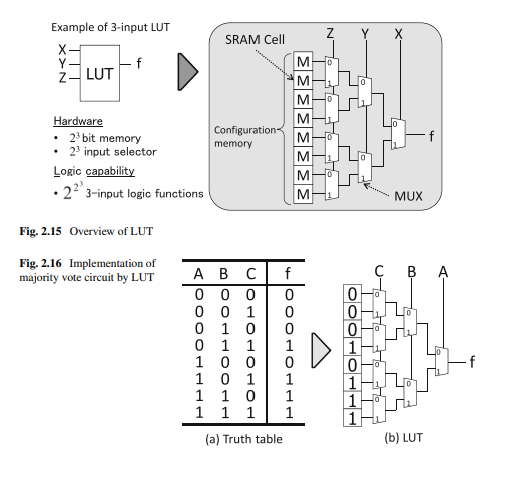

现代 FPGA 的主流配置是 6 输入 LUT，3 输入只是为了示意。LUT 本质上是“2ⁿ 位 SRAM + 多路选择器”。

目前 FPGA 的主流构型基本属于岛型。如下图所示，主要包括由逻辑要素构成的逻辑块、由输入/输出要素构成的 I/O 块、由开关块、连接块和布线通道构成的布线要素，以及存储器块、乘法器块等。现在，很多型号中也会加入 DSP 块来提升数据处理能力。

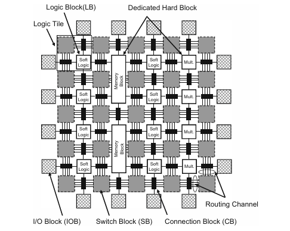

下图是从 FPGA 架构设计层面对输入数量进行论证的示意图。可以看出，6 个输入既能支持较多的输入，又能将面积和传输延迟控制在较小范围内。所以，目前高端型号的 LUT 输入数量主流为 6 个，低端型号的 LUT 输入数量为 4 个。我觉得，在这个行业中，一些关键的技术决策最好能有这种严格的研究和数据论证作为依据，这样更有说服力！

逻辑块中除 LUT 和触发器外，还有专用进位逻辑。它在相邻逻辑单元之间提供硬连线的进位通路，使加法器、计数器、比较器等算术电路的进位不必经过通用布线，从而大幅缩短延时、节省布线资源。

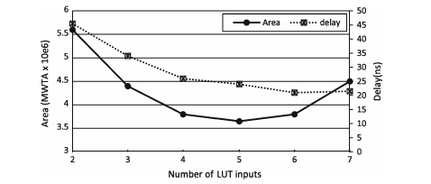

逻辑簇可以提升逻辑块的功能性；相比于直接增加输入数量，它又能有效避免单个逻辑块面积过大、延迟过高的问题。

一般来说，逻辑簇中基本逻辑单元（BLE）的数量为 3～10 个，输入数量为 4～6 个。
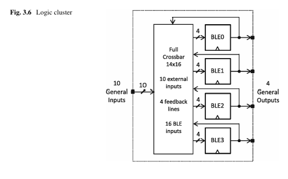

Altera 的自适应查找表（ALUT）位于 ALM 中，8 个输入可灵活组合为一个 6 输入 LUT 或两个较小的 LUT，以提高 LUT 资源利用率；Xilinx 则采用可拆分为两个 5 输入 LUT 的 LUT6，思路相同。这样做主要是为了避免因输入不足而造成资源闲置。当前 FPGA 生态主要由这两家巨头主导。当然，它们都已被更大的芯片公司收购。类似的技术在不同公司的产品中会有不同的命名和技术实现细节，如下图所示。

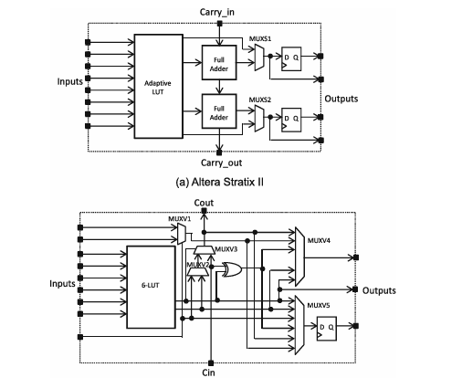

常见的布线构型有下图所示的四种：完全连接型、一维阵列、二维阵列（岛型）和层次型。
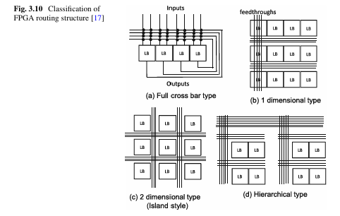

目前 FPGA 主流使用的布线构型是岛型。

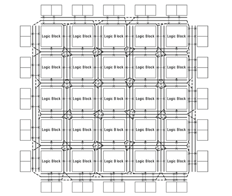

实际使用 FPGA 进行应用开发时，都是在已经设计好的布线芯片上配置不同的开关。只有 FPGA 厂商需要考虑不同硬件布线的设计。

开关块用来连接不同的逻辑块。开关块构型一般有三种：不相交型、通用型和威尔顿型。这些都由厂商设计，而且一般不对外公开具体信息。

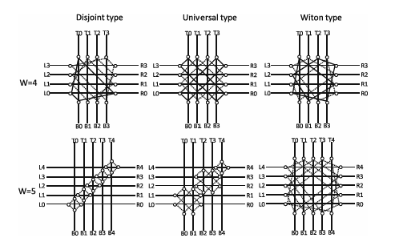

连接块负责把逻辑块的输入/输出引脚接入布线通道，其灵活性用 Fc 表示。由于逻辑簇内部有局部互连且 LUT 输入可交换，现代 FPGA 的连接块通常采用稀疏连接，以节省面积。

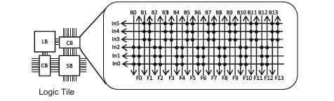

DSP 块是由乘法器、预加器、累加器和流水线寄存器构成的硬核运算单元，按列分布在芯片中，主要用于滤波、FFT、矩阵运算等乘累加密集型任务。现代 DSP 块已支持浮点和 AI 常用的低精度格式，部分器件还加入了专用的 AI 张量块。DSP 块在当前尤其是高端 FPGA 中，是非常重要的参数指标。而且，DSP 块在进行密集矩阵计算等任务时也具备性能优势。

硬宏（硬核 IP）是厂商固化在芯片中的专用电路，如 BRAM、DSP、PLL、高速收发器、PCIe 和存储控制器、ARM 处理器等。与用可编程逻辑实现的软核相比，硬宏性能高、面积和功耗低，但功能固定。现代高端 FPGA 已演变为可编程逻辑与大量硬核结合的异构平台。

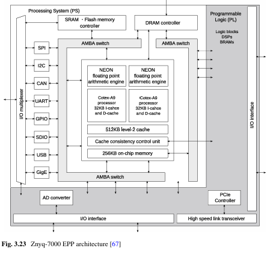

上图展示的是 Zynq 的一个型号。除了由 ARM 处理器核构成的处理系统外，PL 中也包含 DSP、BRAM（块存储器）等组件。这种板卡也支持常规的嵌入式通信协议，比如 SPI、I2C、CAN、UART、GPIO、USB，甚至 GigE 这种工业图像传输协议。GigE 在工业相机自研视觉模组中应用得很多。这些硬宏的接入和使用，一般由 FPGA 厂商提供工具支持。JTAG 可以将上位机中的电路配置下载到板卡上，也支持对运行中的数据信号进行测试和调试。

一般板卡上只有一两个晶振，但是不同用途的设备所需的时钟频率差异很大。PLL 是 FPGA 中的硬核时钟管理电路，可以从参考时钟生成多路不同频率和相位的时钟，并具有消除时钟偏斜、过滤抖动的作用。PLL 可以实现倍频和分频。DLL（延迟锁相环）也能完成类似的工作，但是使用的原理不同。DLL 通过调整延迟线的延迟量，使输出时钟与输入时钟对齐，结构简单、稳定、不累积抖动，但频率合成能力较弱。早期 FPGA 的时钟管理以 DLL 为主（如 Xilinx DCM）；现在通用时钟生成已改用 PLL / MMCM，DLL 主要用于 DDR 等接口中的精确移相和延迟校准。

# 2. 设计与工具
大致的设计流程如下图所示。

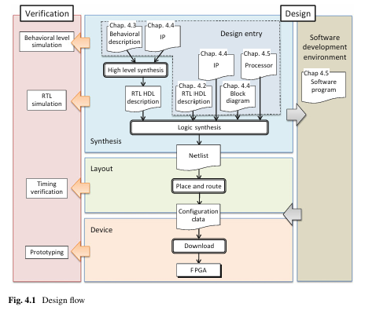

通常先在上位机软件中编写代码进行硬件行为描述，也可以引入 IP 核；然后进行逻辑综合生成网表，再进行布局布线生成配置数据，最后下载到实际芯片或板卡中。在设计流程中可以进行各种层次的仿真，包括行为级仿真、RTL 仿真和时序仿真，直至真机部署。

我使用的芯片是 Zynq，开发板属于 Xilinx 产品，所以使用 Vivado 进行代码编写和仿真。

需要从 AMD 官方网站下载，我目前使用的都是免费模块。FPGA 这一领域，尤其是高性能 FPGA，在军事航天和前沿科技领域十分重要。很多高端型号的软硬件受到美国对华出口管制。我以前做的一些项目中，用于雷达信号处理的高性能 FPGA，通常没办法通过正常渠道买到。

由于我现在没有使用这么高级的芯片和配套工具，限制不大，注册账号后就可以下载。

下图是我为软件注册时获得的认证。

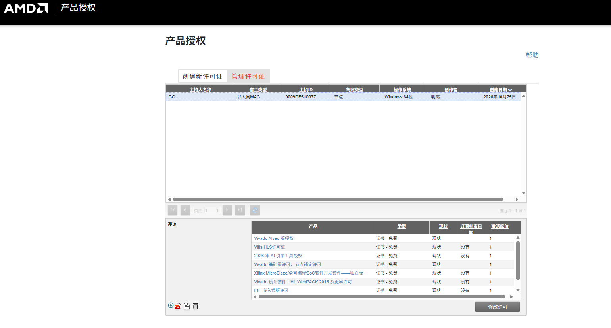

我用的是比较新的软件版本。在 demo 仿真项目中，选择的芯片型号是 xc7a35tcpg236-1。
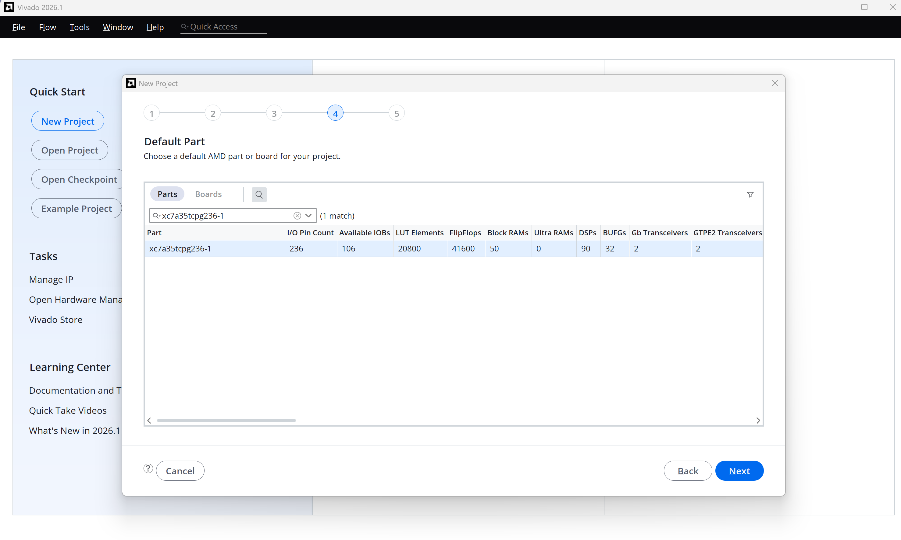

一路按默认选项创建项目即可。

仿真项目运行结果如下：
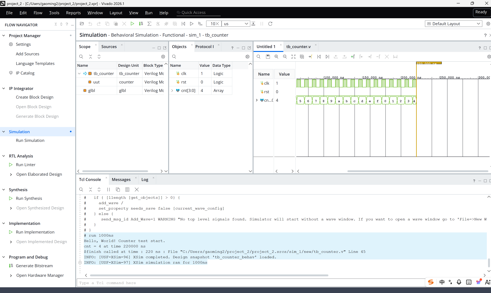

完整的软件包需要很大的磁盘空间，我只安装了一部分。

除了直接使用 Verilog 这种硬件描述语言进行电路设计，目前也可以使用 C/C++ 等高级编程语言进行硬件设计，再通过编译器将代码转换为 RTL。这种方式的开发效率通常更高，其特点与使用高级编程语言替代低级编程语言类似。在一些特定行业中，使用 FPGA 进行加速时，不可能把所有功能都手动用 RTL 编写，因此会使用 C++ 等高级语言封装库。这样可以进行行为级仿真和高层次综合，从高级语言和应用的角度实现快速仿真验证与执行优化，尽可能利用 FPGA 的特性提升并行度。

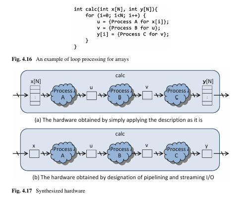

此外，也可以像在 C++ 中调用库一样，调用别人已经设计好的功能模块。在 FPGA 中，这些模块称为 IP 核。如果使用 Zynq 这种平台，除了 FPGA 逻辑外还有 ARM 核，可以运行 Linux，并编写常规 C/C++ 代码来控制或调用 PL 中的逻辑。

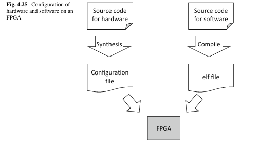

一般的 FPGA 设计流程如下：
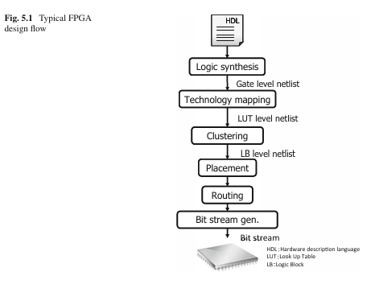

硬件描述语言的代码通过逻辑综合会生成门级网表。门级网表不依赖于任何器件的工艺设计。但是，如果想将其真实部署到指定器件上，就需要进行工艺映射，把与工艺无关的网表映射成指定器件类型的 LUT 级网表。这部分主要使用图算法，这些算法会以指定型号的工艺包形式存在于开发软件中。想把源码编译到什么板子上运行，就配置对应的器件型号。当然，图算法也是一个研究方向，感兴趣的话可以自行研究。不过，由于这类芯片内部的很多设计都不开源，会存在一些上下游限制。比较经典的是 FlowMap 算法，这也是这个方向的里程碑，可以在多项式时间内求出深度最优的 K-LUT 映射。

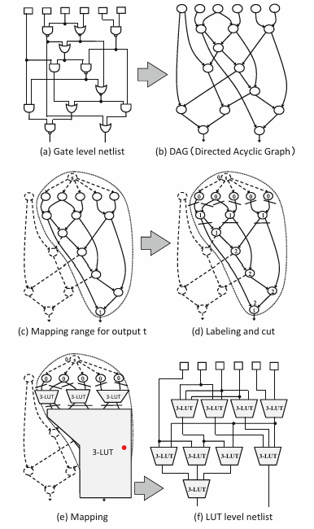

逻辑打包（packing，也叫聚簇（clustering））是工艺映射之后的下一步：把映射得到的 LUT 和触发器装进逻辑簇（CLB / LAB）里。需要考虑如何提高资源利用率、降低资源浪费和布线时延。书中讲的是 VPack 算法，这是一种贪心算法。商用软件中使用的通常都是封装好的算法，不对外公开。

布局（Placement）是把打包好的逻辑簇、DSP、BRAM、I/O 等放到芯片上具体的物理位置，每种元件只能放在对应类型的位置上（DSP 只能放 DSP 列，依此类推）。目标是让相连的元件尽量靠近，减少总线长；让关键路径上的元件优先靠近；同时避免某些区域过于拥挤，导致无法完成布线。线长通常用半周长线长（HPWL）估算：每个网络所有端点构成的外接矩形的半周长之和。

布线（Routing）是在芯片固定的布线资源中，为每个网络选出具体的线段和开关，把所有端点连接起来。工具先把芯片所有线段、引脚抽象成布线资源图（节点是线段和引脚，边是可编程开关），布线就变成了在图上寻找路径的问题。

布局和布线的开源生态相对较好。布局算法包括模拟退火、基于划分的布局和解析式布局；布线算法则包括 A*、PathFinder 协商式拥塞算法等。甚至还可以加入机器学习、强化学习和博弈论等算法。其实，这部分与 EDA 工具链的研究方向相同，也是我未来想进一步结合 AI，探索电路自动布线并将其工程化的方向。毕竟，最近 OpenAI 的模型已经展现出了这方面的能力，我想把它真正落地到工程中。

# 3. 硬件算法
FPGA 的并行性很强，因此使用 FPGA 进行硬件算法加速时，通常需要充分利用这一特点。

Flynn 分类法从指令流和数据流两个维度，将计算机体系结构分为四类：单指令单数据、单指令多数据、多指令单数据和多指令多数据。
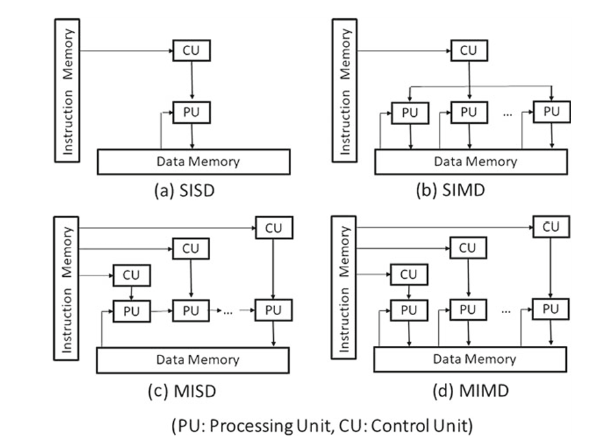

其中，单指令多数据可以实现数据并行，从而提升处理器的运行效率。MIMD 架构可以同时提供数据并行与功能并行，多核系统就是采用这种架构。

脉动阵列是由 H. T. Kung 等人在 1978 年前后提出的。其核心思想是：把大量相同的简单处理单元（PE）排成规则的一维或二维阵列，每个 PE 只和相邻的 PE 通信。数据从阵列边缘输入后，像血液随心跳一样，每个时钟周期向相邻 PE 前进一步，在流动过程中被各个 PE 反复使用并完成计算，“脉动”一词就来自这个比喻。

以矩阵乘法 C = A × B 为例，在一个二维 PE 阵列中：

A 的数据从左向右流动；
B 的数据从上向下流动；
每个 PE 每个周期做一次乘累加（c += a × b），再把 a 传给右边、b 传给下边；
若干周期后，每个 PE 中就积累出 C 的一个元素。

因此，脉动阵列与 FPGA 的硬件结构天然吻合。

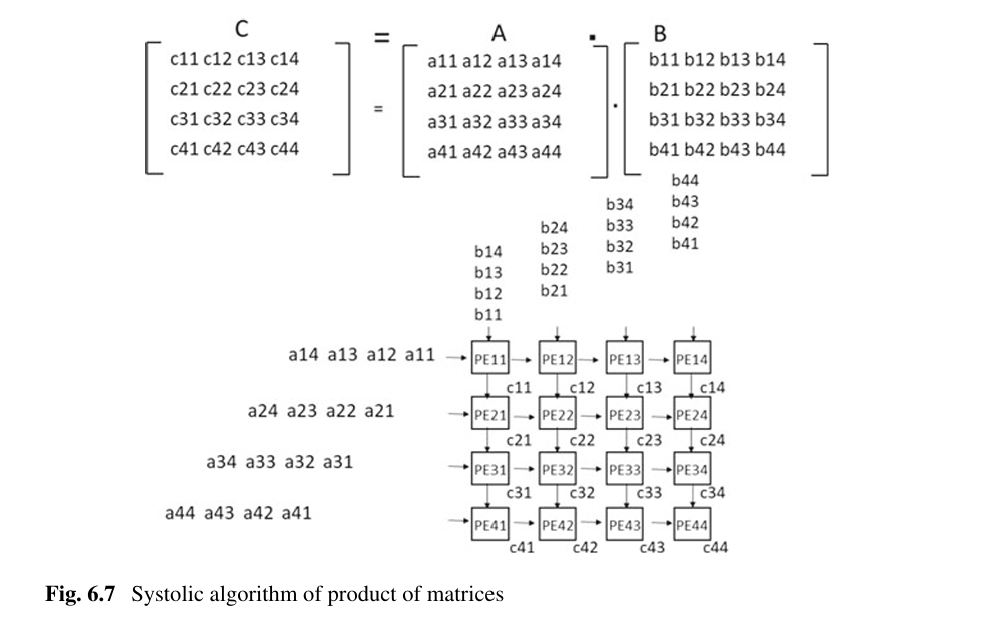

书中的硬件排序实现示例：
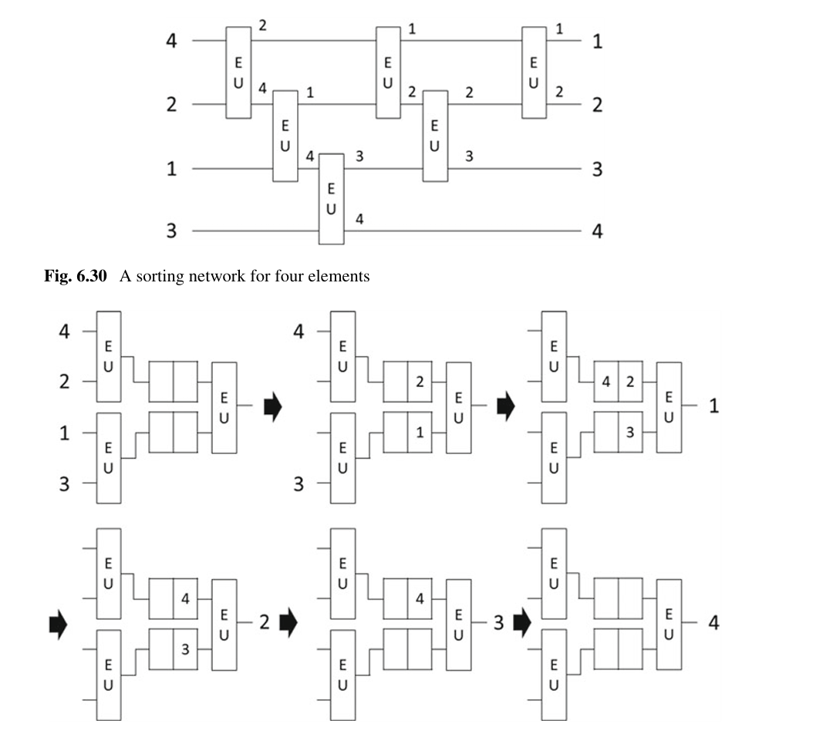

书中使用电路进行正则表达式匹配的示例：
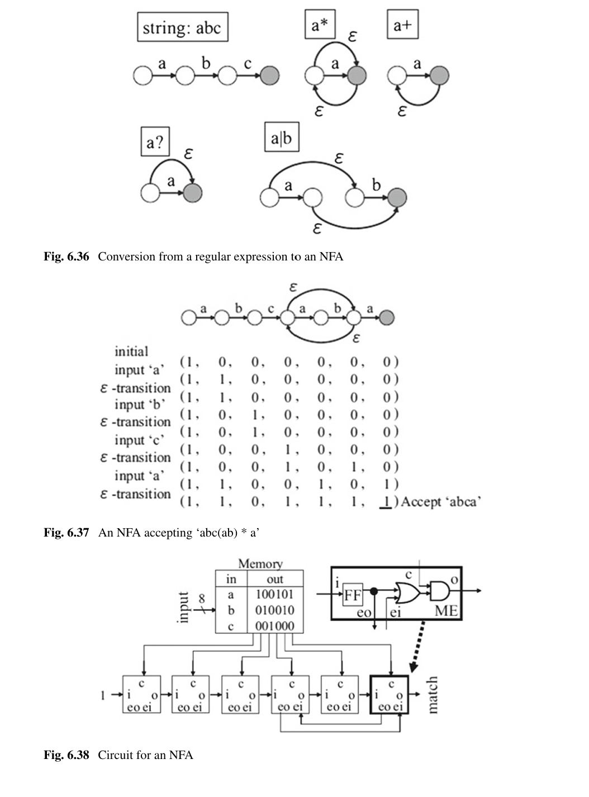

我之前在项目中做过这种基于 FPGA 的算法工程化部署。一般流程是先在常规 CPU 或 GPU 上实现算法，验证其基本功能和性能；确认没有问题后，再对算法进行并行化分析，拆解可并行化的部分，开始结合硬件进行真正的电路实现。

这本书的作者是大学教师，所以写的内容整体比较学术化。其中很多内容要想真正弄懂，比如前面提到的工艺包中封装的算法，或者用硬件实现的算法，都需要仔细研读论文并亲自实现、调试，才能真正透彻地理解。
