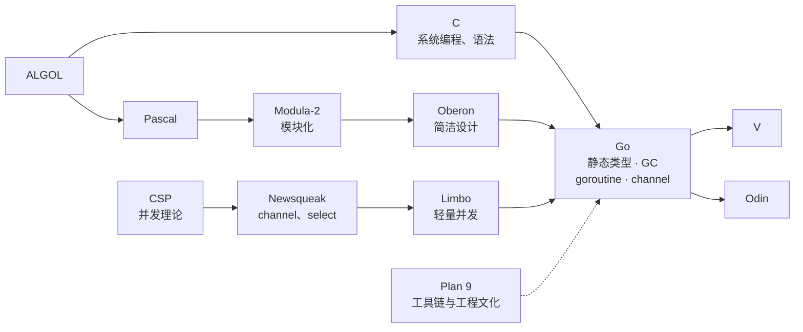
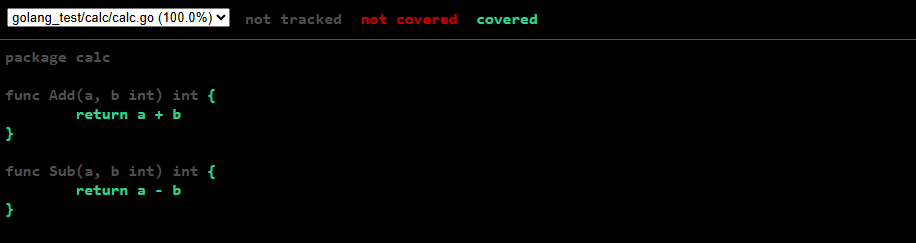

这本书是2021年年末买的，当时我要开发部署在阿里云上的DevOps功能。我的主力开发语言是C++，懂行的都知道，这种语言的开发速度比较慢。那个时候还没有大语言模型写代码这回事。在确认要写微服务且没有硬性要求必须使用C++后，我买了几本书，边看边学，不到一个星期就开始上手写项目了。Golang的语法比较简单，而且很适合云端服务或网络通信服务这类场景。所以其实不仅我自己喜欢用，像字节这种大厂也喜欢用。它主要与处于同一生态位的Java竞争。那个时候，阿里巴巴是Java大厂，爹味十足，很多年轻开发者，或者像我这种没有与Java绑定的开发者，都直接选择Golang进行开发。后来我在旷视做机器人，我们的服务调度集群就是完全使用Golang开发的。如果经常逛大型社交平台GitHub，也会发现很多网络代理软件是用Golang开发的。最近几年，我发现机器人本体中的一些服务也开始使用Golang编写。毕竟对于非实时的系统服务，用Golang开发比使用传统的C/C++开发更快、更稳，开发的心智负担也小一些。相比Python，Golang的静态语言特性使它在项目代码规模较大时更便于进行软件质量管理。Python若没有强制约束，各种动态特性就会满天飞，其实很难维护。Python如果老老实实按照静态类型的方式去写，那还不如直接使用Golang；打包也方便，可以直接静态链接成二进制文件，部署起来也很方便。我觉得这就是目前Golang的生态位吧。我目前也在搭建自己的DevOps服务。对于通信层面的服务，相比Python，我更喜欢使用Golang。

Golang这门语言是Google开发的，算是一门比较年轻的语言。它于2009年正式对外发布，2012年推出了Go 1.0稳定版。这个时间正好是字节跳动刚起步的时候。不巧的是，那个时候我基本不会编程。等到我自学Golang时，已经是2021年了。我之前认识一位技术比较资深的前辈，他在七牛云做了很多基于Golang的组件。听说这家公司当初为了在内部推广这门语言，在Golang还不太成熟的时候就开始力推，因此踩了很多坑。另外，Golang这几年虽然也在不断更新，目前最新的版本是1.26，但它对之前的语法兼容得比较好。新增加的特性不算特别多，在其他现代语言中基本都能找到对应的概念，比如Module、泛型、for range、上下文（context），以及一些标准库内容。

我不打算把这篇文章写成一篇Golang语法教程，因为没什么意义，现在使用AI已经很方便了。本文主要介绍Golang这门语言的一些特性、设计思路以及在项目中的应用。使用Golang开发的知名开源项目有很多，比如Docker、K8s等。

不得不感慨一下，计算机领域的一些框架、语言特性、API等人为约定的知识，往往几年内就会发生不少变化，导致人们需要重新学习才能跟上更新。而像物理这样的学科，经典力学即使有局限，也不会改来改去。一百年前的书，绝大多数内容不仅仍然可用，甚至还非常经典……

# 1. Hello World

在Ubuntu镜像中安装Golang开发环境：
```shell
apt update
apt install -y golang-go git curl build-essential
go version
```

相比C/C++，Golang实现了垃圾回收。Golang通常直接编译为本地机器码，不依赖JVM或CPython这类独立的虚拟机环境。我觉得它比Python更适合构建基础设备类软件。Golang刚出现时，一个很鲜明的特点就是原生支持协程。goroutine的创建成本非常低，创建100万个也能接受；相比之下，在直接使用原生系统线程的多线程程序中，业务层面无法创建这么多线程。



一个最简单的Hello World程序，在`main.go`中填入以下代码：
```golang
package main

import "fmt"

func main() {
    fmt.Println("Hello, 中国!")
}
```
直接运行：
```shell
go run main.go
```
也可以生成同名可执行文件，然后直接运行：
```shell
go build main.go
```

所以可以看出，这类比较新的编程语言在设计理念和工程化方面更加现代，而且编译器、工具链和标准库原生提供了许多现代开发常用的功能。与C++相比，使用体验舒服多了。

开发和调试时可以安装下面四个工具包：
| 工具 | 作用 | 是否重要 |
|---|---|---|
| `gopls` | 代码补全、跳转定义、查找引用、错误检查、重构、格式化 | **核心工具** |
| `dlv` | Go 调试器，支持断点、单步执行和查看变量 | **调试必需** |
| `impl` | 自动生成接口实现的方法框架 | 可选 |
| `goplay` | 把代码发送到 Go Playground 运行 | 可选 |

安装Go包前，先配置国内代理：
```shell
go env -w GOPROXY="https://goproxy.cn|direct"
```
安装工具包：
```shell
go install golang.org/x/tools/gopls@latest
go install github.com/go-delve/delve/cmd/dlv@latest
go install github.com/josharian/impl@latest
go install github.com/haya14busa/goplay/cmd/goplay@latest
```

检查安装结果
```shell
ls -l "$HOME/go/bin"
"$HOME/go/bin/gopls" version
"$HOME/go/bin/dlv" version
```

# 2. 工具链
## 2.1 `gofmt`
官方工具链自带代码格式化器，可以自动将Golang代码文件格式化为标准形式：
```shell
gofmt -w main.go
```
这种理念和操作在比较规范的软件开发团队中非常重要。一般会在代码库的CI中加入这些工具自动检查代码。

# 3. 语言特性
对于基本的语法学习，由于目前AI非常便捷，我觉得可以直接使用Codex对着文档学习，甚至在实际用到时直接询问AI就已经很好了。不像我刚开始接触的时候，还需要自己看书、搜帖子，手动拼接和复制代码，一路踩坑。

## 3.1 设计哲学
Golang的编译器会检查代码中变量的使用情况，对于未使用的临时局部变量会直接报错。一般基建比较完善的软件体系会在CI中做这些检查，Golang好的一点是直接把一些规范集成到语言的语法和编译器中。这很符合Google这种C++大厂在足够庞大、复杂的项目中积累的工程经验。同样，如果导入未使用的包，编译也会直接报错。在默认配置下，C++原生编译器不会在编译期拦下未使用变量或未使用头文件这类问题，通常需要依靠额外的静态检查工具（比如clang-tidy、cpplint）在工程治理层面补上。换言之，设计哲学上的核心差异在于：Go把更多工程约束变成默认规则，而C++更多地允许项目自行制定规范。高手或者高水平软件技术团队可以把C++项目的上限做得非常高，但是对于一般的开发者，Golang项目往往可以保证更高的下限。

## 3.2 指针
Golang是有指针的，可以取地址和解引用。它保留了“通过地址引用和修改对象”的能力，但基本去掉了“把内存地址当作数字操作”的能力。Golang里面也有`new`，但是与C++不同，这里的`new`只是获得一个指向相应类型零值的指针。内存通过垃圾回收机制进行管理，而在C++中，内存需要由程序员自己管理，或者使用RAII结合智能指针进行管理。

Golang编译器会对变量进行逃逸分析，因此变量的实际存储生命周期可能超过其词法作用域。对于高性能场景，频繁发生逃逸可能导致更多堆分配，并增加垃圾回收压力，因此热点路径中需要关注不必要的逃逸。

```go
package main

import "fmt"

func stackValue() int {
	x := 10
	return x
}

func escapedValue() *int {
	x := 20
	return &x
}

func main() {
	a := stackValue()
	b := escapedValue()

	fmt.Println(a)
	fmt.Println(*b)
}
```
打印结果是
```shell
10
20
```
`escapedValue`中的变量`x`原本只在函数内可见，但是函数返回了指向它的指针，因此它的生命周期需要延长，不能随着函数执行结束而终止。编译器发现对象发生了逃逸，需要保证它在函数结束后仍然有效。

## 3.3 包
Golang以package作为代码组织和名称作用域的重要单位。同一个包中的代码可以直接访问该包内定义的标识符；其他包访问时，通常通过“包名.标识符”的形式引用。标识符是否可以被其他包访问，由其首字母是否大写决定：首字母大写的标识符是exported（导出的），首字母小写的标识符只能在当前包内访问。

Go的可执行程序使用`package main`，并以其中的`func main()`作为程序入口。普通package可以被main包导入使用；而`package main`表示一个可执行命令，工程上不应把需要复用的公共逻辑放在其中。

### 导入本地包
项目结构示例：
```
myapp/
├── go.mod          // module myapp
├── main.go
└── util/
    └── math.go      // package util
```
`main.go`中使用module path与package在module内的路径进行导入：
```go
package main

import (
	"fmt"
	"myapp/util"
)

func main() {
	fmt.Println(util.Add(1, 2))
}
```

### 导入网络包（第三方包）
先拉取依赖，再在代码中导入：
```shell
go get github.com/google/uuid
```
```go
package main

import (
	"fmt"

	"github.com/google/uuid"
)

func main() {
	fmt.Println(uuid.New())
}
```
`go get` 会自动写入 `go.mod`/`go.sum`，记录依赖及其版本。

Golang自带包管理器。

## 3.4 模块
package是代码组织和编译的基本单位，而module是依赖与版本管理的单位。一个module通常可以包含多个package，例如：
```shell
myapp/                ← module
├── go.mod
├── main.go            ← package main
├── util/
│   └── math.go        ← package util
└── config/
    └── config.go      ← package config
```

## 3.5 slice
Go 中的 slice 有些类似 C++ 的 std::vector，但二者的对象模型并不相同。slice 本身并不直接包含所有元素，它更像是一个指向底层数组的描述符，其中包含底层数组的位置、长度 len 和容量 cap。当一个 slice 赋值给另一个 slice 时，只会复制这个描述信息，因此两个 slice 通常仍然指向同一个底层数组。修改其中一个 slice 的元素，另一个 slice 也可能看到变化。

使用 append 添加元素时，如果底层数组容量足够，新元素会直接写入原来的底层数组；如果容量不足，运行时会申请新的底层数组并复制原有元素，此后新旧 slice 就可能不再共享底层存储。因此在使用 slice 时需要特别注意这种“共享底层数组但可能因为 append 而分离”的行为。现代 C++ 在高性能场景下也越来越多地使用 std::span、std::string_view、Ranges view 等非拥有型视图，以减少不必要的数据复制。
```go
package main

import "fmt"

func main() {
	// 创建长度 2、容量 2 的 slice
	a := make([]int, 2, 2)

	a[0] = 10
	a[1] = 20

	// b 和 a 共享底层数组
	b := a

	fmt.Println("=== append 前 ===")
	fmt.Printf("a = %v, len=%d, cap=%d, addr=%p\n",
		a, len(a), cap(a), &a[0])

	fmt.Printf("b = %v, len=%d, cap=%d, addr=%p\n",
		b, len(b), cap(b), &b[0])

	// a 容量已经满了
	// append 会触发扩容
	a = append(a, 30)

	fmt.Println("\n=== append 后 ===")
	fmt.Printf("a = %v, len=%d, cap=%d, addr=%p\n",
		a, len(a), cap(a), &a[0])

	fmt.Printf("b = %v, len=%d, cap=%d, addr=%p\n",
		b, len(b), cap(b), &b[0])

	// 修改 a
	a[0] = 999

	fmt.Println("\n=== 修改 a[0] 后 ===")
	fmt.Println("a =", a)
	fmt.Println("b =", b)
}
```
## 3.6 JSON和HTML
对于Web开发来说，后端接口传输数据通常使用JSON，当然Protobuf、XML、HTML等格式也很常见。Golang的标准库直接提供了JSON序列化与反序列化功能，还提供了HTML模板。

下面是一个简单的示例：
```go
package main

import (
	"encoding/json"
	"fmt"
	"html/template"
	"net/http"
)

type User struct {
	Login string `json:"login"`
}

type PullRequest struct {
	URL string `json:"url"`
}

type Issue struct {
	Number      int          `json:"number"`
	Title       string       `json:"title"`
	State       string       `json:"state"`
	HTMLURL     string       `json:"html_url"`
	User        User         `json:"user"`
	PullRequest *PullRequest `json:"pull_request"`
}

var pageTmpl = template.Must(template.New("issues").Parse(`
<!DOCTYPE html>
<html>
<head>
    <meta charset="UTF-8">
    <title>GitHub Issues</title>
</head>
<body>
    <h1>golang/go Issues</h1>

    {{range .}}
        <div>
            <h3>
                <a href="{{.HTMLURL}}" target="_blank">
                    #{{.Number}} {{.Title}}
                </a>
            </h3>

            <p>状态：{{.State}}</p>
            <p>作者：{{.User.Login}}</p>
        </div>

        <hr>
    {{else}}
        <p>没有找到 Issue</p>
    {{end}}
</body>
</html>
`))

func issuesHandler(w http.ResponseWriter, r *http.Request) {
	url := "https://api.github.com/repos/golang/go/issues?per_page=10"

	resp, err := http.Get(url)
	if err != nil {
		http.Error(w, "请求 GitHub 失败", http.StatusInternalServerError)
		return
	}
	defer resp.Body.Close()

	if resp.StatusCode != http.StatusOK {
		http.Error(
			w,
			"GitHub API 返回错误: "+resp.Status,
			http.StatusBadGateway,
		)
		return
	}

	var allIssues []Issue

	err = json.NewDecoder(resp.Body).Decode(&allIssues)
	if err != nil {
		http.Error(w, "JSON 解析失败", http.StatusInternalServerError)
		return
	}

	// GitHub Issues API 也可能返回 Pull Request
	issues := make([]Issue, 0)

	for _, issue := range allIssues {
		if issue.PullRequest != nil {
			continue
		}

		issues = append(issues, issue)
	}

	w.Header().Set("Content-Type", "text/html; charset=utf-8")

	err = pageTmpl.Execute(w, issues)
	if err != nil {
		fmt.Println("模板渲染失败:", err)
	}
}

func main() {
	http.HandleFunc("/", issuesHandler)

	fmt.Println("服务启动：http://localhost:8080")

	err := http.ListenAndServe(":8080", nil)
	if err != nil {
		panic(err)
	}
}
```
上面的代码逻辑比较简单：先定义Golang结构体及其对应的JSON字段，再使用标准库提供的HTML模板生成前端页面，模板中的参数就是issue对应的字段。然后访问GitHub上的Golang项目的issue，将返回的信息填入模板并发送给浏览器。

## 3.7 内存垃圾回收和资源回收
Golang会对内存进行垃圾回收。相关编译器设计的原理，我会在后续更深入的文章中介绍。但是需要注意，GC并不保证自动回收所有资源。打开的文件、网络连接等资源需要在使用完毕后手动关闭，或者使用`defer`在函数返回时关闭。

## 3.8 变长函数
变长函数在现代编程语言中很常见，其输入参数的数量不固定：

```go
package main

import "fmt"

// nums 可以接收任意数量的 int
func sum(nums ...int) int {
	total := 0

	for _, n := range nums {
		total += n
	}

	return total
}

func main() {
	fmt.Println(sum())
	fmt.Println(sum(10))
	fmt.Println(sum(10, 20))
	fmt.Println(sum(10, 20, 30))
	fmt.Println(sum(1, 2, 3, 4, 5))
}
```

## 3.9 panic与recover
当程序遇到无法正常继续处理的严重情况时，`panic`会立即终止当前的正常执行流程，并开始沿调用栈向上退出。

```go
package main

import "fmt"

func test() {
	defer fmt.Println("defer 1")
	defer fmt.Println("defer 2")

	fmt.Println("准备 panic")

	panic("出错了")

	fmt.Println("不会执行")
}

func main() {
	test()
}
```

运行结果

```shell
root@docker-desktop:/home/golang_test# go run .
31e5c827-bf3e-433d-a967-ce5050855fcd
准备 panic
defer 2
defer 1
panic: 出错了

goroutine 1 [running]:
golang_test/demo.test()
        /home/golang_test/demo/panic.go:11 +0xc5
golang_test/demo.TestPanic(...)
        /home/golang_test/demo/panic.go:17
main.main()
        /home/golang_test/main.go:24 +0x7d
exit status 2
```

在上面的例子中，调用panic后，当前函数的正常控制流立即终止，runtime开始进行stack unwinding。在栈展开过程中，已经注册的defer仍然会按照后进先出的顺序执行。如果panic没有被recover，最终程序会打印panic信息和调用栈并终止。

recover 是 Go 专门用来捕获当前 goroutine 中正在传播的 panic 的机制。

三者的关系如下：
panic()   → 抛出严重异常
defer     → panic 展开调用栈时仍然会执行
recover() → 在合适的 defer 中阻止 panic 继续传播

下面是一个结合三者的示例：
```go
package main

import "fmt"

func test() {
	defer func() {
		err := recover()

		if err != nil {
			fmt.Println("捕获到 panic:", err)
		}
	}()

	fmt.Println("test 开始")

	panic("程序发生严重错误")

	fmt.Println("test 结束") // 不会执行
}

func main() {
	fmt.Println("main 开始")

	test()

	fmt.Println("main 继续执行")
}
```

运行结果
```shell
main 开始
test 开始
捕获到 panic: 程序发生严重错误
main 继续执行
```
recover 可以在 deferred function 中取得当前正在传播的 panic 值，并阻止 panic 继续向上层调用栈传播。需要注意，recover 并不会让程序回到发生 panic 的位置继续执行；发生 panic 的函数仍然会终止正常执行，在相应的 defer 执行完成后返回，由它的调用方继续执行。在 Web 后端等长期运行的服务中，可以在合适的请求处理边界使用 recover，避免单个请求中的 panic 影响整个服务。

普通的、可以预期和处理的错误通常使用 error 返回。Go 并不鼓励使用 panic/recover 模拟其他语言中的异常处理机制。C++ 对异常的使用则取决于具体项目的工程规范。现代 C++ 可以通过 RAII 保证异常发生时资源得到正确释放，因此异常本身并不必然导致资源泄漏；但异常会引入非局部控制流，也会增加大型工程中异常安全、接口约束和代码推理的复杂度。一些大型 C++ 工程因此选择禁用异常，例如 Google 的 C++ 规范。这种工程思路与 Go 的显式错误处理存在一定相似之处。Go 通常使用 (value, error) 返回结果和错误；C++ 中也存在类似 Abseil Status / StatusOr<T> 的设计。它们都倾向于把“这个函数可能失败”显式体现在接口和控制流中。

## 3.10 方法

```go
package main

import "fmt"

type User struct {
	Name string
	Age  int
}

func (u *User) SetAge(age int) {
	u.Age = age
}

func main() {
	user := User{
		Name: "Tom",
		Age:  20,
	}

	user.SetAge(30)

	fmt.Println(user.Age)
}
```
Golang的主要应用领域毕竟包括后端开发。进行大型程序设计时绕不开面向对象，只不过与Java和C++相比，Golang的设计比较克制。上面的示例使用了指针接收者，在对象较大时可以避免复制大对象造成的性能损失。

## 3.11 接口
接口比较简单，使用起来比C++简单得多，主要用来隔离具体实现，进而保证软件的灵活性和API的稳定性。一个struct只有实现了某个接口声明的全部方法，才算实现了该接口。

```go
package main

import "fmt"

// 定义接口
type Speaker interface {
	Speak()
}

// Dog
type Dog struct {
	Name string
}

func (d Dog) Speak() {
	fmt.Println(d.Name, "汪汪汪")
}

// Cat
type Cat struct {
	Name string
}

func (c Cat) Speak() {
	fmt.Println(c.Name, "喵喵喵")
}

func main() {
	dog := Dog{Name: "旺财"}
	cat := Cat{Name: "咪咪"}

	var s Speaker

	s = dog
	s.Speak()

	s = cat
	s.Speak()
}
```
运行结果

```shell
旺财 汪汪汪
咪咪 喵喵喵
```

## 3.12 goroutine和channel
Golang对并发协程的原生支持，是这门语言最重要的核心特点之一；而后端服务本身也是高并发需求最常见的场景之一。

下面是一个简单的TCP server和client示例：

server
```go
package main

import (
	"fmt"
	"log"
	"net"
	"time"
)

func main() {
	listener, err := net.Listen("tcp", ":9000")
	if err != nil {
		log.Fatal("listen failed:", err)
	}
	defer listener.Close()

	log.Println("TCP server listening on :9000")

	for {
		conn, err := listener.Accept()
		if err != nil {
			log.Println("accept failed:", err)
			continue
		}

		log.Printf("client connected: %s", conn.RemoteAddr())

		go handleClient(conn)
	}
}

func handleClient(conn net.Conn) {
	defer func() {
		log.Printf("client disconnected: %s", conn.RemoteAddr())
		conn.Close()
	}()

	// 每秒触发一次
	ticker := time.NewTicker(time.Second)
	defer ticker.Stop()

	for t := range ticker.C {
		message := fmt.Sprintf(
			"%s\n",
			t.Format("2006-01-02 15:04:05"),
		)

		_, err := conn.Write([]byte(message))
		if err != nil {
			log.Printf(
				"send to %s failed: %v",
				conn.RemoteAddr(),
				err,
			)
			return
		}

		log.Printf(
			"send to %s: %s",
			conn.RemoteAddr(),
			message,
		)
	}
}
```

client
```go
package main

import (
	"bufio"
	"fmt"
	"log"
	"net"
	"strings"
)

func main() {
	conn, err := net.Dial("tcp", "127.0.0.1:9000")
	if err != nil {
		log.Fatal("connect failed:", err)
	}
	defer conn.Close()

	log.Println("connected to server:", conn.RemoteAddr())

	reader := bufio.NewReader(conn)

	for {
		message, err := reader.ReadString('\n')
		if err != nil {
			log.Println("server disconnected:", err)
			return
		}

		fmt.Println(
			"server time:",
			strings.TrimSpace(message),
		)
	}
}
```
每个连接都会单独启动一个协程来执行定时回复。从上面的例子可以看到，协程之间没有专门的通信协调机制。Golang中使用channel来实现这一功能。

无缓冲channel

```go
ch := make(chan int)
```

设置缓冲区容量的channel
```go
ch := make(chan int, 3)
```

对于无缓冲通道，如果接收者不接收数据，发送者就会阻塞。对于有缓冲通道，如果通道已满而发送者继续发送，也会阻塞；如果通道未满，则不会阻塞。同样，如果通道为空，接收者会一直阻塞，直到有数据到来。

这样就会出现一个问题：如果服务程序正在等待通道数据，但此时没有数据到来，程序就会一直阻塞，无法提供正常服务，相当于被一个通道卡死。一种解决方法是使用select，同时监听多个channel，哪个事件先到就先处理哪个，而不是被单个channel拖住。select每次只处理一个通道事件。

```go
package main

import (
	"fmt"
)

func main() {
	ch1 := make(chan string)
	ch2 := make(chan string)

	go func() {
		ch1 <- "hello from ch1"
	}()

	go func() {
		ch2 <- "hello from ch2"
	}()

	for i := 0; i < 2; i++ {
		select {
		case msg := <-ch1:
			fmt.Println("ch1:", msg)

		case msg := <-ch2:
			fmt.Println("ch2:", msg)
		}
	}

	fmt.Println("done")
}

```
上面的示例中，每个协程都向通道写入数据；使用for循环让select等待两次事件，每次到来一个就处理一个，然后结束循环。通道除了可以传递数据，也可以传递一些业务信号。

```go
package main

import (
	"fmt"
	"time"
)

func main() {
	ch1 := make(chan string)
	ch2 := make(chan string)
	abort := make(chan struct{})

	go func() {
		ticker := time.NewTicker(time.Second)
		defer ticker.Stop()

		for t := range ticker.C {
			ch1 <- "ch1: " + t.Format("15:04:05")
		}
	}()

	go func() {
		ticker := time.NewTicker(1500 * time.Millisecond)
		defer ticker.Stop()

		for t := range ticker.C {
			ch2 <- "ch2: " + t.Format("15:04:05")
		}
	}()

	go func() {
		time.Sleep(5 * time.Second)
		close(abort)
	}()

	for {
		select {
		case msg := <-ch1:
			fmt.Println(msg)

		case msg := <-ch2:
			fmt.Println(msg)

		case <-abort:
			fmt.Println("abort received")
			return
		}
	}
}

```
两个协程定时打印时间信息，等到abort关闭事件传递到select后，就结束循环。

Golang中使用channel进行协程之间的通信，背后的设计思路是“通过通信来共享内存”。除此之外，Golang也提供了基于共享变量的并发设计工具，比如互斥锁等。这部分与C++或系统编程中的用法基本一致。

Golang在编译器和工具链上集成了竞态检测器。

下面是一个存在数据竞态的示例：
```go
package main

import (
	"fmt"
	"sync"
)

func main() {
	var counter int
	var wg sync.WaitGroup

	for i := 0; i < 10; i++ {
		wg.Add(1)

		go func() {
			defer wg.Done()

			for j := 0; j < 1000; j++ {
				counter++
			}
		}()
	}

	wg.Wait()

	fmt.Println("counter =", counter)
}
```
上面的代码没有使用互斥锁之类的机制保护共享变量，因此多次运行可能出现不同的结果。

运行竞态检测器
```shell
go run -race race.go

==================
WARNING: DATA RACE
Read at 0x00c0001a4028 by goroutine 8:
  main.main.func1()
      /home/golang_test/race.go:19 +0x99

Previous write at 0x00c0001a4028 by goroutine 9:
  main.main.func1()
      /home/golang_test/race.go:19 +0xab

Goroutine 8 (running) created at:
  main.main()
      /home/golang_test/race.go:15 +0x78

Goroutine 9 (running) created at:
  main.main()
      /home/golang_test/race.go:15 +0x78
==================
==================
WARNING: DATA RACE
Write at 0x00c0001a4028 by goroutine 8:
  main.main.func1()
      /home/golang_test/race.go:19 +0xab

Previous write at 0x00c0001a4028 by goroutine 17:
  main.main.func1()
      /home/golang_test/race.go:19 +0xab

Goroutine 8 (running) created at:
  main.main()
      /home/golang_test/race.go:15 +0x78

Goroutine 17 (running) created at:
  main.main()
      /home/golang_test/race.go:15 +0x78
==================
counter = 8097
Found 2 data race(s)
exit status 66
```
这个竞态检测器发现了数据竞争问题。这才是真正的软件测试：能够从原理上分析问题并设计测试工具，而不仅仅依赖人工测试。

相比于系统线程，goroutine 的初始栈空间很小，而且 Go runtime 会根据实际使用情况动态增长和收缩栈空间，因此可以用较低的内存成本创建大量 goroutine，这也是 Go 能够支持高并发的重要原因之一。Go runtime 实现了自己的 M:N 调度器，将大量 goroutine 调度到数量相对较少的操作系统线程上执行。早期 Go 的抢占机制在很大程度上依赖函数调用等安全点，带有比较明显的协作式调度特征；现代 Go 已经支持异步抢占，runtime 可以请求正在长时间运行的 goroutine 在合适的安全点被抢占，因此不能再简单理解为只有执行 channel、系统调用或者特定语言结构时才会发生调度。Go 的 goroutine 调度主要由用户态 runtime 完成，因此很多 goroutine 之间的调度不需要像操作系统线程切换那样完全交给内核调度器处理，调度和创建成本通常比直接使用大量系统线程低。Go 调度器通常使用 G、M、P 模型：G 表示 goroutine，M 对应操作系统线程，P 表示执行 Go 代码所需要的调度资源。GOMAXPROCS 控制的是可以同时执行 Go 代码的 P 的数量，而不是 runtime 能够创建的操作系统线程总数。

C++ 其实也有内置在 Clang/GCC 里的 ThreadSanitizer（-fsanitize=thread），原理跟 Go 的 -race 类似，只是不像 Go 那样被官方大力推广成默认实践，很多项目需要自己在 CI 里主动加上这一步。

另外，我觉得Golang设计哲学中的这种约束，在当下的AI Coding中反而更容易帮助AI生成高质量代码。

## 3.13 单元测试
Golang自带单元测试模块，testing。

举个例子
```shell
golang_test/
├── go.mod
├── calc.go
└── calc_test.go
```

calc.go代码如下

```go
package calc

func Add(a, b int) int {
	return a + b
}

func Sub(a, b int) int {
	return a - b
}
```

calc_test.go

```go
package calc

import "testing"

func TestAdd(t *testing.T) {
	result := Add(1, 2)

	if result != 3 {
		t.Errorf("Add(1, 2) = %d, want 3", result)
	}
}

func TestSub(t *testing.T) {
	result := Sub(10, 3)

	if result != 7 {
		t.Errorf("Sub(10, 3) = %d, want 7", result)
	}
}
```

在包路径下执行测试命令
```shell
go test
PASS
ok      golang_test/calc        0.002s
```
其实就是自动化单元测试类似于C++中gtest或者Python中的Pytest。

另外，Golang的测试模块在较新的版本中原生支持fuzz测试。

举个例子

```go
package demo

func GetFirstChar(data string) byte {
	return data[0]
}
```
这段代码明显存在问题：如果输入为空字符串，就会触发panic。可以使用模糊测试检查是否能够发现这个问题。

测试代码
```go
package demo

import "testing"

func FuzzGetFirstChar(f *testing.F) {
	// Seed Corpus
	f.Add("hello")
	f.Add("golang")
	f.Add("123")

	f.Fuzz(func(t *testing.T, input string) {
		GetFirstChar(input)
	})
}
```
需要注意的是，进行模糊测试的函数名称必须以`Fuzz`开头。

测试结果
```shell
go test -fuzz=FuzzGetFirstChar
fuzz: elapsed: 0s, gathering baseline coverage: 0/3 completed
fuzz: elapsed: 0s, gathering baseline coverage: 3/3 completed, now fuzzing with 20 workers
fuzz: minimizing 27-byte failing input file
fuzz: elapsed: 0s, minimizing
--- FAIL: FuzzGetFirstChar (0.16s)
    --- FAIL: FuzzGetFirstChar (0.00s)
        testing.go:1927: panic: runtime error: index out of range [0] with length 0
            goroutine 32 [running]:
            runtime/debug.Stack()
                /usr/lib/go-1.26/src/runtime/debug/stack.go:26 +0x9b
            testing.tRunner.func1()
                /usr/lib/go-1.26/src/testing/testing.go:1927 +0x1d0
            panic({0x7ec4a0?, 0x34382a854120?})
                /usr/lib/go-1.26/src/runtime/panic.go:860 +0x13a
            golang_test/demo.GetFirstChar(...)
                /home/golang_test/demo/parse.go:4
            golang_test/demo.FuzzGetFirstChar.func1(0x0?, {0x0?, 0x0?})
                /home/golang_test/demo/parse_test.go:12 +0x31
            reflect.Value.call({0x7a8fa0?, 0x825738?, 0x13?}, {0x80b267, 0x4}, {0x34382a8a2780, 0x2, 0x2?})
                /usr/lib/go-1.26/src/reflect/value.go:586 +0xf06
            reflect.Value.Call({0x7a8fa0?, 0x825738?, 0xa464a0?}, {0x34382a8a2780?, 0x809f80?, 0x9ab570?})
                /usr/lib/go-1.26/src/reflect/value.go:369 +0xb9
            testing.(*F).Fuzz.func1.1(0x34382a93cb48?)
                /usr/lib/go-1.26/src/testing/fuzz.go:341 +0x30a
            testing.tRunner(0x34382a93cb48, 0x34382a87c360)
                /usr/lib/go-1.26/src/testing/testing.go:2036 +0xea
            created by testing.(*F).Fuzz.func1 in goroutine 21
                /usr/lib/go-1.26/src/testing/fuzz.go:328 +0x668
            
    
    Failing input written to testdata/fuzz/FuzzGetFirstChar/5838cdfae7b16cde
    To re-run:
    go test -run=FuzzGetFirstChar/5838cdfae7b16cde
FAIL
exit status 1
FAIL    golang_test/demo        0.166s
```
通过生成的变异数据，检测到了代码中存在因corner case（边界条件）导致崩溃的问题。

### 代码覆盖率检测
对于一些比较关键的代码，需要进行严格的代码覆盖率检测。Golang的测试模块自带这个工具，测试时加上`-cover`参数即可。

```shell
go test -cover
PASS
coverage: 100.0% of statements
ok      golang_test/calc        0.002s
```
甚至可以生成HTML测试报告，在上面的calc模块路径下执行：
```shell
go test -coverprofile=coverage.out ./...
go tool cover -html=coverage.out -o coverage.html
```
会生成HTML测试报告：


### Benchmark测试
前面的calc函数加入benchmark测试

```go
func BenchmarkAdd(b *testing.B) {
	for i := 0; i < b.N; i++ {
		Add(1, 2)
	}
}
```
运行测试命令

```shell
go test -bench=.
goos: linux
goarch: amd64
pkg: golang_test/calc
cpu: 13th Gen Intel(R) Core(TM) i9-13900H
BenchmarkAdd-20         1000000000               0.1770 ns/op
PASS
ok      golang_test/calc        0.200s
```

### CPU占用测试
```shell
go test \
  -bench=. \
  -benchtime=10s \
  -cpuprofile=cpu.out
goos: linux
goarch: amd64
pkg: golang_test/calc
cpu: 13th Gen Intel(R) Core(TM) i9-13900H
BenchmarkAdd-20         1000000000               0.1446 ns/op
PASS
ok      golang_test/calc        0.166s
```
生成CPU profile文件后，使用工具查看：

```shell
go tool pprof cpu.out
File: calc.test
Build ID: b6491e51645f74fc560099fc64a34c0a022c5116
Type: cpu
Time: 2026-08-19 16:21:36 UTC
Duration: 162.25ms, Total samples = 150ms (92.45%)
Entering interactive mode (type "help" for commands, "o" for options)
(pprof) 
(pprof) top
Showing nodes accounting for 150ms, 100% of 150ms total
      flat  flat%   sum%        cum   cum%
     140ms 93.33% 93.33%      150ms   100%  golang_test/calc.BenchmarkAdd
      10ms  6.67%   100%       10ms  6.67%  runtime.asyncPreempt
         0     0%   100%      150ms   100%  testing.(*B).launch
         0     0%   100%      150ms   100%  testing.(*B).runN
```

### 内存占用测试
```shell
go test \
  -bench=. \
  -benchmem \
  -memprofile=mem.out
goos: linux
goarch: amd64
pkg: golang_test/calc
cpu: 13th Gen Intel(R) Core(TM) i9-13900H
BenchmarkAdd-20         1000000000               0.1381 ns/op          0 B/op          0 allocs/op
PASS
ok      golang_test/calc        0.162s
```

生成内存 profile文件后，使用工具查看：

```shell
go tool pprof mem.out
File: calc.test
Build ID: b6491e51645f74fc560099fc64a34c0a022c5116
Type: alloc_space
Time: 2026-08-19 16:22:29 UTC
Entering interactive mode (type "help" for commands, "o" for options)
(pprof) top
Showing nodes accounting for 3595.14kB, 100% of 3595.14kB total
Showing top 10 nodes out of 32
      flat  flat%   sum%        cum   cum%
 3083.10kB 85.76% 85.76%  3083.10kB 85.76%  runtime.mallocgc
  512.04kB 14.24%   100%   512.04kB 14.24%  context.withCancel (inline)
         0     0%   100%   512.04kB 14.24%  context.WithCancel
         0     0%   100%   512.01kB 14.24%  runtime.(*scavengerState).sleep
         0     0%   100%   512.01kB 14.24%  runtime.(*timer).maybeAdd
         0     0%   100%   512.01kB 14.24%  runtime.(*timer).modify
         0     0%   100%   512.01kB 14.24%  runtime.(*timer).reset (inline)
         0     0%   100%   512.01kB 14.24%  runtime.(*timers).addHeap
         0     0%   100%   512.05kB 14.24%  runtime.acquireSudog
         0     0%   100%     1539kB 42.81%  runtime.allocm
```

# 4. 反射
Golang的标准库中提供了反射库，可以让程序在运行时检查变量的类型、值、字段和方法，并在一定条件下动态修改或调用它们。这也是JSON、ORM、参数校验等框架能够“自动处理struct”的基础机制之一。

```go
package main

import (
	"fmt"
	"reflect"
)

type User struct {
	Name string `json:"name"`
	Age  int    `json:"age"`
}

func main() {
	u := User{
		Name: "Tom",
		Age:  20,
	}

	t := reflect.TypeOf(u)
	v := reflect.ValueOf(u)

	field, _ := t.FieldByName("Name")

	fmt.Println(field.Tag.Get("json"))

	for i := 0; i < t.NumField(); i++ {
		field := t.Field(i)
		value := v.Field(i)

		fmt.Println(
			field.Name,
			field.Type,
			value.Interface(),
		)
	}
}

```
上面的示例不仅可以在运行时获取类型成员的类型，还可以获取tag信息。

反射的性能比直接编写的代码差，会失去部分编译期类型检查，代码也更难理解，而且使用不当容易引发panic。普通业务代码能用interface或泛型解决，就优先不要使用反射；只有需要在运行时动态处理未知类型时，再考虑使用reflect。

使用反射的常用场景
| 场景 | 反射做什么 | 典型例子 |
|---|---|---|
| JSON 序列化 | 遍历 struct 字段和 tag | `encoding/json` |
| ORM | struct ↔ 数据库字段映射 | GORM 类框架 |
| 参数校验 | 根据 tag 执行规则 | `validate:"required"` |
| 配置解析 | 配置数据填充任意 struct | YAML/配置库 |
| RPC | 动态检查/调用方法 | RPC 框架 |
| DI 依赖注入 | 根据类型寻找依赖 | IoC/DI 容器 |
| 通用工具库 | 接收未知类型 | DeepCopy、对象比较等 |

# 5. unsafe
`unsafe.Pointer`可以绕过Go普通指针的部分类型限制，实现不同指针类型之间的转换以及底层内存操作，在概念上有些类似C的`void*`。但由于Go仍然由GC管理内存，unsafe指针受到Go内存模型和指针有效性规则的约束，因此不能简单照搬C/C++的裸指针使用方式。

unsafe可用于指针转换、获取变量大小、获取字段偏移，以及按照底层内存布局进行转换等操作；常规情况下，Golang中的指针主要用于引用对象。

unsafe.Pointer
unsafe.Sizeof
unsafe.Offsetof
unsafe.Alignof
unsafe.Add
unsafe.Slice


```go
package main

import (
	"fmt"
	"unsafe"
)

func main() {
	var x int32 = 100

	p := &x

	fmt.Println("x =", x)
	fmt.Println("address =", p)

	// *int32 -> unsafe.Pointer
	up := unsafe.Pointer(p)

	// unsafe.Pointer -> *uint32
	u := (*uint32)(up)

	fmt.Println("uint32 =", *u)
}
```
`cgo`用于让Go调用C：

```go
package main

/*
int add(int a, int b) {
    return a + b;
}
*/
import "C"

import "fmt"

func main() {
	result := C.add(10, 20)

	fmt.Println(result)
}
```
能用纯 Go 就优先纯 Go；必须调用已有 C 库、系统库或硬件 SDK 时，再使用 cgo；必须做底层指针/内存操作时，再使用 unsafe。

比如使用 Go 开发视频服务时，如果底层需要复用 FFmpeg 这类成熟 C/C++ 库，就可以通过 cgo 进行调用。不过引入 cgo 后，构建过程不再只是纯 Go 编译，还需要处理 C/C++ 库的头文件、链接库、编译参数以及不同平台上的工具链和 ABI 等问题，因此工程复杂度会明显增加。
