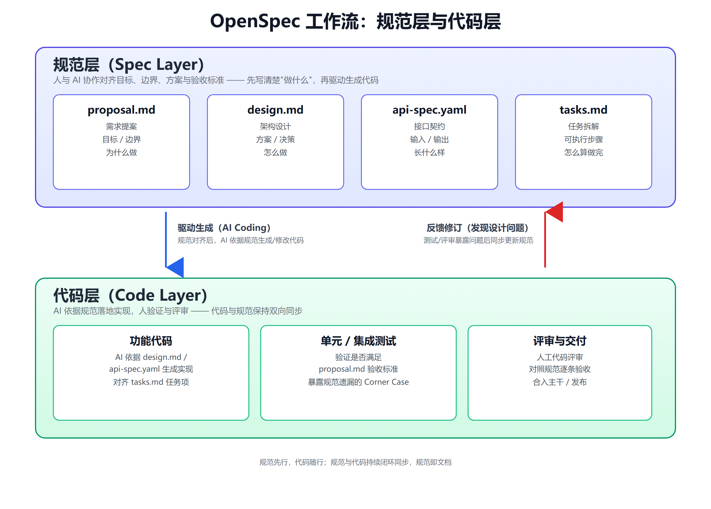

# 0. 自述
我是从2024年开始深度使用AI进行软件开发的。当然，之前一直想自己做AI编程和Research，却一直没做出什么东西来。我是个饭桶，这点我是承认的。从2025年开始，我觉得不论是自己还是身边写代码的朋友，都已经非常普遍地使用AI辅助编程了。到了今年，甚至出现了很多人完全不自己写代码的情况。Vibe Coding这个名字很贴切。

到了真实的项目实践中，我在年初制定的要求是不少于70%的代码由AI生成。到了今年年中，实际情况夸张得多，已经接近100%了。我在想，既然如此，软件工程师还有什么存在的意义呢？直接失业就完了呗！而且既然谁都能写，让刚毕业的小白做岂不是更省钱？那么，那些经验比较丰富的工程师就应该没有太大的存在意义了。

当我在一个软件项目中深度使用Vibe Coding后，我发现代码生成速度的确变快了，尤其是Demo的生成，真的就是一顿饭的功夫，AI自己就干完了。可是，人对项目的把控力正在丧失，而且非常容易出现代码出了问题、提交代码的人却一问三不知的情况。有时候，AI甚至根本不会完全按照指令执行。原因其实很好理解：给AI下达的指令过于模糊，存在太多解释空间，导致最终结果往往跟设想的不一样。这不是AI的锅，而是早在AI出现之前，就广泛存在于几乎所有组织协作中的问题。

所以，不论是进行AI Coding、用AI做其他事情，还是跟其他人协作，把需求理解清楚、把任务描述清楚、把工作分解清楚，都是做好协作必不可少的环节，也是驱动AI编写更合理代码的一种方法。这就是AI编程中规范驱动开发的基本来源。

## 0.1 AI Coding的局限性
AI Coding最常用的方式就是开个对话框跟AI沟通，然后由AI更改代码，再由人编译、运行和验证。但是，这种原始的方式存在几个问题：对话内容会随着对话终止而消失，为什么要做这个功能没有记录下来；或者由于对话上下文窗口的限制，AI忘记了之前的设定和操作；代码变更后拿给别人评审时，没有与代码匹配的文档；当软件项目的人员出现变动时，因为没有留下为什么这样编写代码的记录，导致没有人敢接手。

就我个人经历而言，除了上述因素，还有一个问题：AI生成代码的技术水平高于使用者，导致使用者无法理解代码（我经常遇到这个问题）。在AI出现之前，我接触的软件团队基本都采用敏捷开发模式，而敏捷模式用得好不好完全看团队。在AI深度介入编程后，AI成了放大器。之前技术规范做得越好的团队，借助AI，最终交付的质量和周期就越能得到显著改善。技术规范本来就做得一般的团队，往往在初期使用AI快速生成Demo代码，代码量一大就难以维护。甚至很多公司的软件在使用AI开发到大概百分之八十时，就不得不推倒重写。又花Token的钱，又要返工，很伤，尤其是在多人协作的项目中。

## 0.2 对SDD的看法
SDD的提出就是为了规范AI Coding中的这些缺陷。经过一段时间对规范驱动开发方式的尝试，我觉得SDD并没有书中说的那么完美。SDD不能解决所有AI编程中的缺陷，但它依然不可或缺。例如，它可以记录开发一个功能的理由、限制、决策过程和具体任务设计。如果没有文档，这些信息在软件项目中就是缺失的，不论后续与AI对话进行完善，还是进一步变更，都缺少依据。AI可以根据现有代码分析出整体的设计思路，但是存在细节把控不清晰、分析过于繁琐等问题。SDD本身也有问题，比如不能百分之百限制AI的一些错误行为；频繁变更设计会产生大量冗余的设计文档；随着软件规模的增加，文档也会像代码一样快速增加，变得难以维护，等等。

所以，不能把SDD当成解决AI Coding问题的万能良药，而应该把它作为一种用于AI Coding协作开发、评审和指导代码生成的轻量级脚手架。

# 1. SDD规范驱动开发范式
Vibe Coding的优点非常明显：生成代码快，很容易做出Demo级别的东西。在没有SDD约束的条件下，非常容易出现需求蒸发（需求内容随着对话丢失而丢失）、上下文漂移（每个对话都有上下文限制，超出限制后AI会忘记前面的内容）、不可审查（代码评审时，面对AI生成的大量代码，人的阅读速度和学习能力跟不上，又没有文档支撑研发过程和设计）、不可复现（人员流失后，之前使用AI生成的代码没人能接手）、不可维护（这是AI生成代码在软件工程中的命门，不可维护的代码没有商业价值）等问题。

在软件开发历史上，开发范式有瀑布模式、敏捷模式等。AI Coding出现前，团队基本采用敏捷模式。敏捷模式在每个团队中的实践都不一样，非常依赖团队的技术能力和技术氛围。以前，一些不太规范的技术团队在协作中经常缺少文档规范，但由于没有AI带来的代码生成速度提升，许多问题反而被掩盖了。现在，AI Coding凸显出来的问题并不完全是AI本身的问题，它只是一下子暴露了大量团队协作中的缺陷，比如产品功能定义模糊、单元测试不完善、工作流中的协作职责不清晰，等等。

其实，SDD就是把工程领域中的规范化带进AI Coding。如果使用OpenSpec框架，一般在proposal.md中定义需求，在design.md中定义架构设计，在api-spec.yaml中定义接口，在tasks.md中做任务拆解。这些内容既供人阅读和协作，也供AI阅读并据此生成符合规范的代码。

SDD文档的编写本身也不是一蹴而就的，这与敏捷开发模式深度契合。可以在一开始生成相对模糊的需求，然后根据实际效果逐步将其规范化，一边更新、完善Markdown文件，一边修复代码，最后在一个Feature中将功能代码、单元测试、产品功能定义和系统架构设计收敛起来。

SDD的设计核心类似于建造房屋时使用的图纸。这个类比非常恰当。如果没有图纸就随意施工，必然伴随大量返工。AI Coding也是如此，这正是很多项目组当前的现状。大家都意识到了AI Coding所带来的效率提升，却也需要面对由此暴露的问题。

在开始AI编程之前，首先要制定功能开发的规范。规范要解决做什么（目标）、不做什么（边界）、怎么做（方案）、长什么样（契约）、怎样算做完（验收标准）等问题。大概十年前，我所在的机器人团队有一位非常资深的软件工程师。遇到新功能，他从来不会上来就做，而是先调研方案、思考问题、反复确认细节，把约束弄清楚后再编码。初期看起来，他的产出比新手慢，但是到了后面的调试阶段，大量防御性设计可以避免许多无效加班和时间浪费，产出质量也很棒。所以时间久了，大家反而更加敬重他的技术水平。在AI编程前制定规范，做的就是之前那位资深程序员所做的事情。在实践中，这种规范并不好写，因为很多人想不到即将面临的Corner Case。由此产生了一个反常现象：当下，很多工作多年的软件工程师在AI的加持下反而更容易找到工作。目前的AI在实践中需要与高质量的人类伙伴协作，才能有高质量的产出。我在文章前面提到，年轻人更容易取代有经验的人，这需要等到AI进一步迭代，不再需要与经验丰富的人协作就能把事情做好时才会发生。可以把当下理解为AI仍处于实践中的成长阶段。所以，一些有经验的人其实也没有必要过于侥幸。AI每天被全世界这么多人使用，产生的大量数据会加速AI迭代。也许在未来短短几年内，AI就能摆脱绝大多数有经验者的辅助，直接端到端地产出高质量成果。

规范即文档。因为规范本身就在承载产品设计、架构设计，甚至具体功能的实施细节，所以不再需要额外的文档。规范就应该放在软件项目中进行维护和更新。在与AI对话时，首先要修改和对齐规范，再用规范驱动AI生成代码。当然，如果在代码测试中发现了设计层面的问题，再进入修改规范的循环即可。

在规范设计的细节上，要避免泛泛而谈。每句话都要有明确、清晰的语义，这样才能尽可能避免AI理解错误或者人类在协作中理解错误。能把目标拆解成更小的、可执行的步骤，也是一种很难得的能力。如果一个人面对完全陌生的领域，能明白自己在做什么已经很不容易；若还能真正把一件事情拆解成可执行的步骤——是真正可执行，而不是那种由AI生成却缺乏验证的步骤——就需要极强的学习能力和快速试错、迭代的能力。

规范制定出来之后，如果代码和规范不一致，应该改哪个？如果已经使用SDD，就应该优先尊重规范，除非规范本身出了问题，或者修改代码Bug后未同步修改规范。Claude Code或者Codex在默认情况下都存在文档更新不及时的问题。解决方案是在AGENTS.md或者CLAUDE.md中明确说明必须使用哪个Spec框架，并且自己添加一个Skill，在代码发生变更后自动检查需要更新的Spec文档。

我目前使用的是OpenSpec，比较轻量级，适合个人开发者或者人数不多的小型研发团队。

下图展示了OpenSpec的工作流：规范层（proposal.md定义需求、design.md定义架构设计、api-spec.yaml定义接口、tasks.md做任务拆解）驱动AI生成代码层（功能代码、测试、评审交付），代码层在测试评审中发现设计问题后再反馈回规范层，形成闭环。



## 1.1 规范层示例（以“订单导出CSV”功能为例）

**proposal.md**
```
## 目标
支持将某时间段内的订单导出为CSV，供财务对账。
## 边界
单次导出不超过5万条，不支持导出后自动邮件发送。
## 验收标准
- 选定起止日期后可下载CSV，字段含订单号/金额/状态/下单时间
- 超过5万条时提示"请缩小时间范围"，不生成文件
```

**design.md**
```
## 方案
后端异步生成：接口先返回任务ID，写入队列；worker查询订单表分批
写入CSV并上传对象存储，前端轮询任务状态获取下载链接。
## 决策
选异步而非同步返回：导出涉及大数据量查询，同步会阻塞请求并可能超时。
```

**api-spec.yaml**
```yaml
POST /orders/export
request: { startDate: string, endDate: string }
responses:
  202: { taskId: string }
  400: { error: "RANGE_TOO_LARGE" }

GET /orders/export/{taskId}
responses:
  200: { status: "pending|done|failed", downloadUrl: string? }
```

**tasks.md**
```
- [ ] 导出接口：校验时间范围，超限返回400
- [ ] 建立导出任务队列，worker分批查询并写CSV
- [ ] 生成文件上传对象存储，任务状态更新为done
- [ ] 前端轮询接口，done后展示下载链接
- [ ] 单元测试：超5万条拒绝、正常范围生成文件字段正确
```
上述流程的文档中，比较偏模板的内容直接使用AI生成也没有问题，但是与具体业务相关的内容必须由人把关。而且，AI生成的内容可能存在漏洞、缺陷或啰唆冗余之处，需要人清理干净。

就像前面说的，不能把SDD当作完美的解决方案。不论如何规范和限制，规范所包含的信息量一定远远小于代码本身表达的信息量。在这种情况下，不能指望AI生成完美的代码、完美领会意图。但是，如果SDD做得足够规范，至少能保证你的核心意图基本得到实现。SDD的规范到底是什么？对此没有非常严谨的量化标准。细节写得太多，整个规范就会随着软件规模的增加变成一本大书。对于几百页起步的大厚书，除了我这种每周都要在自己不熟悉的领域看新书来提升自己的变态之外，没几个人愿意看。可是换个角度来讲，大型软件本身就是知识的IT化，软件代表着知识和流程，其中数据是知识，控制流是流程。软件本身复杂，设计文档必然也复杂。如果整个软件项目都放在一个仓库下，那么每次加载设计文档都需要消耗大量Token。一个很自然的设计就是将软件划分为多个模块，或者采用微服务架构，将其分散到各个项目中。它们之间的交互只依赖少数调度服务或者接口。每个模块的职责清晰，在设计、开发和测试子模块时，就可以只加载本模块的设计，避免浪费Token。

# 2. SDD框架
我目前使用的是OpenSpec，比较简单容易操作，适合个人和小团队。更加严谨的框架还有Spec-Kit，还有多Agent对话的BMAD。关于Claude Code中比如SKILL，SubAgent，记忆系统，Hook等我会在另外一篇文章中写，这里不再赘述。框架和工具的选择根据自己团队实际情况即可。

# 3. SDD实操
我觉得SDD的内容本身并没有太多新创造的东西，都是项目流程本来就具备的内容，只是在AI编程的催化下从后台走向软件设计的前台，甚至成为一个必备流程。

比如：
目标层，要写清楚核心问题是什么？为什么这么做？旨在解决什么问题？关键内容包括项目背景、核心目标、成功标准；

范围层，具体做什么？不做什么？功能清单，明确排除，技术约束；

验收层，怎么判断项目结束？怎么验证交付质量？构建可量化的验收标准、性能指标和边界测试场景；

不论使用什么Spec框架，上面的内容都是实实在在需要的。举个例子，在我之前参与的一个研发项目中，需要做数据库选型，备选方案主要有MySQL、PostgreSQL和SQLite。在没有提供完整Spec上下文的情况下，每次与不同AI对话，得到的结果都不一样。这是因为背景约束不足，AI在当时场景下给出的结论其实不能算错。但是，如果遗漏一些关键约束，就会产生结果偏差。在与人的沟通中也是如此：贸然提出一个缺少完整上下文的问题，可解释的空间就很大。反过来，很多所谓官场和人情世故的哲学，就是利用这些语义不明确的对话来逃避责任。

比如在proposal.md中，明确不做什么很重要，性能验证要有明确的数字指标，边界场景非常容易滋生bug。这些都是一直存在的问题，也是一个资深软件工程师不论是不是自己手写代码都要在开发中解决的问题。


到了架构设计阶段，需要在design.md中明确模块划分原则、模块职责、模块关系、技术选型原因、取舍判断、接口契约和非功能性约束，比如安全、性能、运维、错误处理策略等。

## 3.1 设计取舍示例（数据库选型）

```
## 备选方案
- MySQL：团队最熟悉，生态成熟，但复杂查询和JSON字段支持较弱
- PostgreSQL：支持JSONB和复杂查询，团队需要一定学习成本
- SQLite：零运维，但不支持高并发写入

## 取舍
业务需要存储半结构化的订单扩展字段并做多维统计查询，
并发写入量中等（预计<200 QPS）。
选PostgreSQL：牺牲团队短期学习成本，换取JSONB和复杂查询能力，
避免后续再迁移数据库的更高成本。
```

这就是design.md中"取舍判断"该有的样子：列出备选项，说明放弃了什么、换来了什么，而不是只写结论。

在以前的软件团队中，只有非常资深的人才能担任架构师。从上面的例子也可以看出，要做出比较符合实际情况的架构设计，需要具备深入理解技术和业务的能力。但是，AI Coding使代码生成本身的成本大幅下降。在AI的辅助下，人类软件工程师必须接管以前软件架构师的部分职责。即使是目前最先进的模型，在进行中型软件的架构设计时也表现得很差，非常容易写出屎山代码，造成软件难以维护。这跟模型训练的数据模式有一定关系，但是我认为可以通过设计Agent来弥补。

在tasks.md中进行任务拆解，就是一般的研发主管平时做的事情：把一个大的任务需求拆解成一些相对独立的模块，分给不同研发人员完成，并安排联调、集成测试等任务。使用多Agent执行任务时，一般要求任务本身具备并行性，这样可以避免数据同步造成的各种困扰。

对于商业化软件产品，编写功能代码仅仅是软件生命周期中很小的一部分，绝大部分时间都花在软件维护上。我年轻的时候非常轻视软件维护，觉得研发就是开发新功能，直到后来经历了一些量产项目的打击，才发现只有可靠、可预期的软件才具备商业价值。用户花钱买你的软件，是为了让它帮助自己解决问题，而不是频繁遭遇软件质量问题。在用户使用产品的周期内，一旦软件产品出现Bug，供应商就要及时响应并修复。只不过，我以前待过的团队会在主要功能开发完成后裁掉很多研发人员，仅保留少量能够维护软件项目的人员。在漫长的维护期，工作其实不会像项目刚启动时那样日新月异、热火朝天地加班，每天就是平平淡淡。

# 4. Agent设计模式
不论是否使用SDD，多Agent系统都有一些比较常用的设计模式。加入SDD后，SDD文档负责全局思考、上下文管理和任务划分。文档作为规划器，Agent作为执行器。

生成-评审模式（我基本每天都用），就是由一个Agent根据需求生成代码，另一个Agent根据生成的代码和需求进行评审。而且，我比较倾向于让两个Agent使用不同厂商的大模型，这叫作有效制衡，可以避免被一家模型通过Trick的方式蒙蔽，颇有一种皇帝制衡世家大族的感觉。

层级委托模式类似于服务集群的调度机制，由一个中心节点作为Agent Manager，负责宏观任务调度，多个Worker Agent负责执行具体子任务。一般来说，这些子任务之间应尽量避免共享数据和状态。

护栏三明治模式，是在Agent处理输入之前和生成输出之后加入安全检测，就像一个三明治。输入检查包括请求是否合法、参数是否在允许范围内、是否超出权限边界等。输出检查则是验证规范中的条件是否得到满足，包括检查代码的安全漏洞等。

条件路由模式类似于编程语言中的条件判断或者Web后端的路由，分类器根据输入，把具体任务分配给不同的专职Agent执行。

# 5. 团队推广
SDD并不是必需的，也可以通过其他方式在代码中维护文档，也就是说，做这件事的形式并不唯一。在团队中要不要推广、怎么推广、使用哪个框架，都要根据团队的技术能力和品味等因素来选择。CI可以支持对规范进行检查，比如给规范加上Lint。

AI Coding相关的技术和体系仍在高速发展，所以文中的一些内容仅供参考。作为AI浪潮中的一分子，要与时俱进，也要发现问题、提出自己的解决方案、帮助更多的人，积极融入AI变革之中，不论是AI Coding、机器人，还是Auto Research！

