这本书应该是我在2019年买的。当时刚开始接触嵌入式软件开发，不知道受了什么刺激就把它买了回来，却从来没有看过，一直放在那里吃灰。那个时候我主要做SoC上的Linux应用开发，不太涉及实时系统。后来在项目中接触了一些音视频流传输方面的内容，其中虽然也有实时视频流的概念，但与实时系统还是有一定差异。

从 2025 年开始，我逐步在项目中接触一些偏控制类的内容。以具身智能机器人为例，无论是运行在运动控制“小脑” SoC 上的 WBC 和力控算法，还是部署到 MCU 或 DSP 上的实时控制，我都有所接触。当然，这些纯控制算法我依然不是很懂，只不过作为软件工程师，我参与了一些控制器软件的设计、实现与性能优化，也由此开始逐步接触相关领域。当下的具身智能行业都在拼落地能力，大模型领域的顶级人才也非常紧缺。不过，相关领域有高校中大量的优质生源作为人才供给，因此相对而言，能够从事大模型算法工作的人才池还是比较大的。但在机器人实时系统软硬件领域，人才供给并不充足，而且这个方向的优秀技术人才不能完全依靠高校培养。真正能够落地的实时系统往往需要工程师多年的项目积累，其所需能力并非局限于纯软件，而是强调软硬件结合。因此，这个领域很难招聘到优质人才。

另外，目前很多从事大模型研发的公司都想引入物理 AI。可是问题在于，即使只聚焦机器人领域，模型依然很难做好一些人类轻而易举就能完成的动作，尤其是在开发落地产品而不是 Demo 时。Demo 目前相对容易实现，二者的差异主要体现在长期稳定性上。要应对随机出现的抖动和干扰，就需要构建更加健壮的软硬件系统。因此，当下的具身智能公司对实时系统的重视程度呈现出冰火两重天的局面。一方面，一些具身智能公司由纯软件算法人员主导。由于这些人员中很少有人真正了解硬件和实时系统，他们往往单方面关注大模型能力的提升和数据采集，却不太关注整个软件系统的性能与实时性。这通常也不影响 Demo 运行，毕竟能跑起来就行，所以这部分人对软件系统实时性的重视程度很低。另一方面，有些团队的创始人拥有深厚的机器人硬件背景。尤其是一些率先实现产品落地的头部公司，在经历工厂等真实场景的磨砺后，很清楚模型无法解决一切问题。他们此前也尝试过常规的系统设计与实现方案，在这方面踩过坑、在项目中碰过壁，因此开始意识到实时系统的重要性，甚至不惜重金招揽相关领域的顶级人才。这个领域强调软硬件结合：不仅需要深入理解操作系统，能够修改和优化操作系统，还需要熟悉工业总线协议、中间件、运动控制算法与数值优化，才能真正做好实时运动控制系统。

对实时性的需求本身也与具体业务方向相关。例如，在执行一些常规动作时，双臂轮式机器人的运动控制即使出现毫秒级卡顿，通常也不会影响任务完成（双足人形机器人则可能因此摔倒）。这也是前面提到的那些不太重视系统实时性的团队所面对的典型业务场景。真正对实时性要求严格的场景包括精细的灵巧操作等。这类场景目前很难落地，具有很大的技术挑战性。尤其是在加入触觉数据后，机器人感知系统需要实时获取和处理数据，运动控制也面临很高的要求，因此对实时系统的需求会更加强烈。

这本书整体偏教科书性质，不会教你如何在SoC上应用实时内核补丁、设置线程优先级或绑定CPU核心，也不会教你如何在MCU或DSP上实现电流环、速度环和位置环控制。它更多地从架构和方法论层面介绍嵌入式实时软件系统的设计思想，以及相应的方法与案例。

# 1. 实时软件系统概念

下图是机器人实时系统的简图。不同传感器采集到观测数据后，将其交给实时软件系统处理。这些数据一般需要经过状态估计和控制算法处理，然后转化为对执行器的具体控制指令。

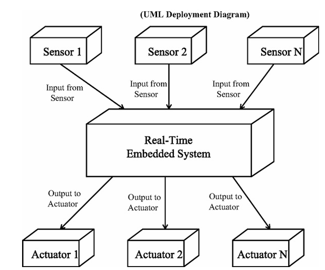

实时系统一般分为硬实时和软实时，二者的区别不在于运行速度，而在于错过截止时间所造成的后果。硬实时系统一旦无法在规定时间内完成处理和控制，就可能造成严重后果，例如汽车制动系统和飞行器飞控系统。这类系统需要保证即使在最坏情况下也能满足截止时间要求。软实时系统则可以容忍一定的处理延迟，但系统性能可能有所下降。在具身智能机器人中，“小脑”一般会以数百赫兹（Hz）的控制频率运行 WBC 程序，Linux 系统也会进行一些实时化配置，以降低调度延迟和抖动。在不少机器人架构中，这类上层运动控制任务属于软实时任务，而实时性要求更加严格的底层伺服控制通常会部署在 MCU、DSP 或专用控制器上。当然，硬实时与软实时最终由具体任务的时间约束和超时后果决定，而不是由运行平台决定。

同时，复杂的具身智能机器人通常也是一个分布式实时嵌入式系统。ROS 2 本身就采用了面向分布式系统的中间件架构。

例如，机器人的计算架构通常分为“大脑”和“小脑”两部分。大脑主要承担视觉感知、VLA/VLM 模型推理和高层任务决策等计算密集型任务，可以采用 Jetson AGX Thor、AGX Orin 等高算力平台；小脑则主要负责状态估计、WBC 和 MPC 等运动控制任务，可以采用 RK3588 或其他嵌入式计算平台。

更底层还会有 MCU、DSP 等控制节点，负责关节控制和数据采集等任务。这些节点可以通过 EtherCAT、CAN 等工业通信协议与上层控制器通信，也可以通过 micro-ROS Client 和 Linux 侧的 micro-ROS Agent 接入 ROS 2 通信系统。

因此，机器人的实时性问题不仅涉及单个 SoC 或 MCU 上的线程调度，还涉及不同计算节点之间的通信延迟、时钟同步、数据传输抖动，以及端到端控制链路的时间约束。

# 2. 设计工具与方法论

书中介绍了COMET/RTE、UML、SysML和MARTE等方法。在具身智能领域，UML主要用于绘制一些状态机；在汽车和航空航天领域进行系统架构设计时，SysML也会被频繁使用。其他方法则用得不多。

设计通信时序时一般会使用序列图，如下图所示。

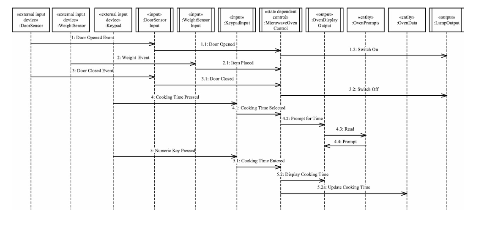

一般来说，这种图会用于系统实现前的方案设计与技术评审。

状态机也很常见，不过实际使用时一般不会画得像下图这样。下图是我从英文原版书籍中截取的。
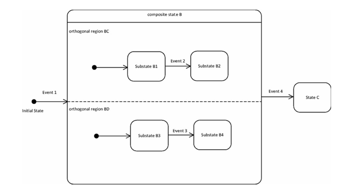

总之，能把设计意图表达清楚即可。在真实的项目实践中，涉及上位机、嵌入式设备、中间件或云端之间的通信时，一定要明确状态转移逻辑和数据接口。

# 3. 实时软件体系结构

书中介绍了一些面向对象的软件设计方法，这部分对我来说比较熟悉，就不展开了。实时软件系统通常会涉及并发任务，以及任务之间的同步和资源共享，常见的设计问题包括互斥、任务同步、生产者—消费者模型等。

在操作系统层面，实时系统通常会采用RTOS或经过实时化优化的Linux系统。相比普通应用系统，实时系统更加关注任务执行和调度行为的可预测性。

为了满足实时性要求，系统可能需要采用基于优先级的抢占式调度、内存锁定和优先级继承等机制。例如，在Linux系统上可以通过锁定关键内存页，减少换页和缺页异常带来的不可预测延迟。

另一个典型问题是优先级反转。假设低优先级任务A持有某个互斥锁，高优先级任务B需要获取这把锁，但此时A又被中优先级任务C抢占，就可能导致B长时间无法继续执行。

优先级继承机制可以缓解这个问题。当B等待A持有的锁时，A可以临时继承B的优先级，减少中优先级任务对A的干扰，直到A释放资源后再恢复原来的优先级。

在任务调度方面，普通操作系统通常需要兼顾吞吐量、响应速度和公平性，而实时系统更加关注任务能否满足截止时间。常见的实时调度方法包括固定优先级调度、基于截止时间的调度等。对于实时任务来说，除了平均执行时间，更重要的是在给定系统负载和调度条件下，能否分析和约束最坏情况响应时间。

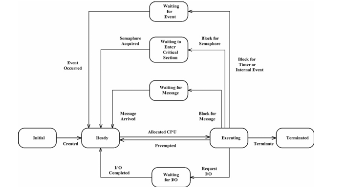

另外，在复杂机器人系统设计中，除了状态机，还经常会使用行为树（Behavior Tree）。比如在机器人任务编排和导航场景中，行为树可以通过组合不同的条件、动作和回退逻辑，组织比较复杂的任务流程。

相比状态机，行为树在一些需要频繁组合、复用任务行为的场景中更加灵活。不过二者并不是替代关系。对于控制器模式切换、故障处理和安全状态管理等场景，状态机依然很合适。

对于复杂系统，即使使用状态机，也可以采用分层设计，不必在一张图中画出所有逻辑。这也是一种常用的工程技巧，绘制电路图时也会进行类似的精简。

下面展示的是书中的一个飞行控制示例。这张图描述了运动执行过程的总状态机，而每个模块内部还有各自的状态机。
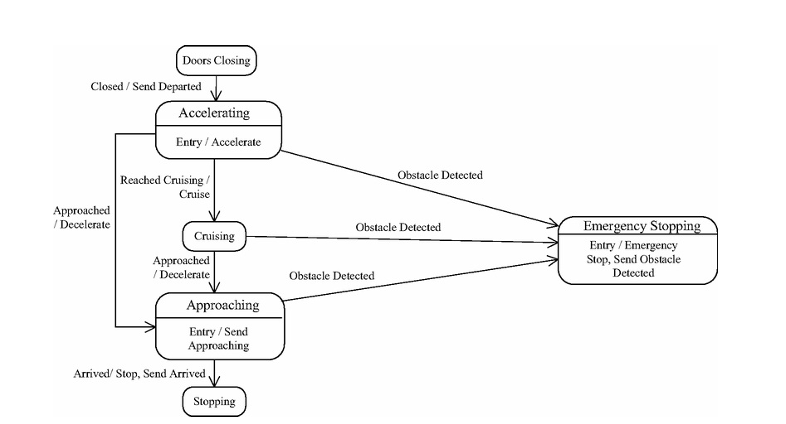

上图是总状态机，下图则展示了对子模块的进一步封装。
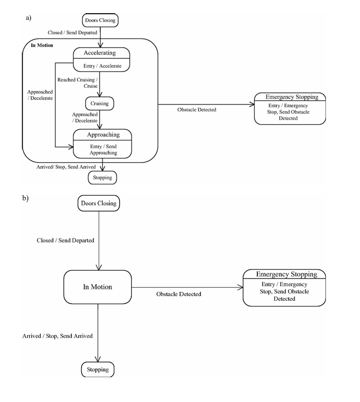

这是工程设计中很常用的技巧。

嵌入式系统通常会涉及许多硬件设备。为了提高软件系统的可移植性，一般会对硬件进行抽象。这一点与系统是否实时没有太大关系，主要属于软件工程和架构设计的范畴。当然，从架构设计的角度来看，我认为下图只是对硬件进行了简单的类封装，抽象程度还不够。由于书中示例中的微波炉结构相对简单，这种抽象程度尚可接受；但对于高速迭代的具身智能机器人，整体架构的设计水平会对产品能力和落地效率产生很大影响。

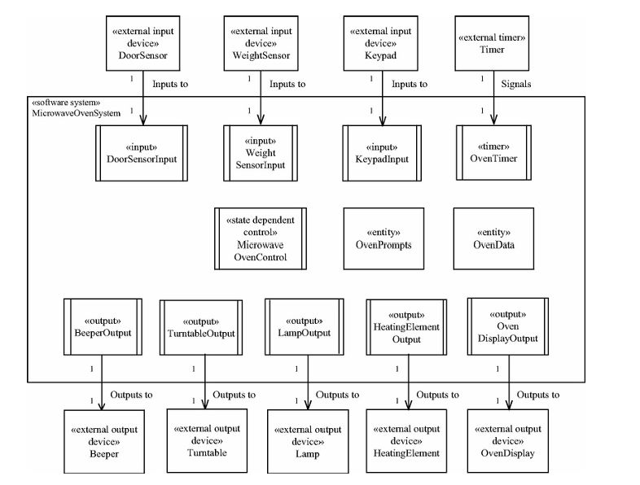

`ros2_control`中的`hardware_interface`就是一个典型参考。关节模组、灵巧手和传感器的供应商更换较为频繁，而硬件抽象的质量决定了每次更换硬件时需要修改多少代码。良好的硬件抽象通常具有以下特点：

- **统一接口**：控制器只面向统一的状态接口和指令接口（位置、速度、力矩），不需要关心底层使用的是哪家厂商的电机。
- **设备协议与总线传输分离**：同一款关节模组既可能使用 EtherCAT，也可能使用 CAN FD，因此协议层和传输层应当解耦。
- **配置驱动**：更换关节型号或灵巧手时，应修改配置文件，而不是修改代码。
- **仿真与真机接口统一**：仿真环境与真实机器人共用一套接口（Sim-to-Real），使控制代码在 MuJoCo、Isaac 中验证通过后，能够以较低成本迁移到真机。这一点对依赖数据和训练的具身智能团队尤其关键。

软件设计模式与实时性的关联不大，常规软件同样需要使用，它也是进行软件架构设计的基础工具。抽象可以降低耦合度，但抽象本身会带来一定的运行时开销。在极端实时系统中，需要评估抽象带来的影响；而在软实时系统中，抽象则被广泛用于大规模软件系统的架构设计，例如自动驾驶的 Apollo 系统和 ROS 2 系统等。

实时控制系统常见的控制模式有以下几种：

下图是集中式控制。传感器组件发送消息或事件，由唯一的控制器进行处理，并控制执行器的行为。这通常适用于比较简单的场景，因为不涉及不同控制器之间的协同。
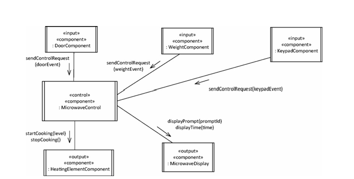

下图是分布式控制。每个控制器都有自己的传感器和执行器，但是不同控制器之间依然需要进行通信和协作。核心难点在于如何在满足实时性要求的前提下进行协作。
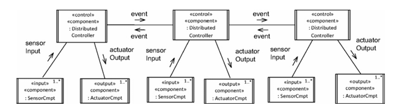

下图是分层控制，相当于在分布式控制系统之上构建了分层体系。真实的人形机器人一般都采用这种架构，自动驾驶系统也是如此。机器人的部分关节通常由域控制器负责管理，主控的小脑与域控制器通信并下发控制指令。
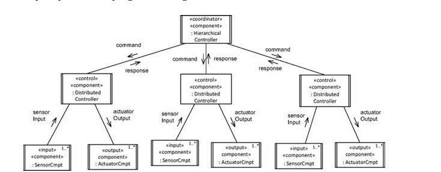

主从架构在嵌入式系统中很常见，但需要区分两个层次。一是总线协议层面的主从：例如 MCU 作为 SPI 主设备访问多个从设备，或者 EtherCAT 主站周期性地与各从站交换过程数据。这时所有通信都由主设备发起，通信节拍也由主设备决定。二是软件架构层面的主从：主任务把工作拆分后分发给多个从任务执行，再汇总结果。两者思想相通，都是由主节点掌握控制权，但关注的层次不同。客户端/服务端架构则更加普遍，在软件中几乎随处可见。与主从架构不同，它的通信由客户端按需发起，服务端被动响应，更适合非周期性的请求，ROS 2 中的 Service 就是这种模式。

书中介绍了几种任务间的通信模式：

同步对象访问：多个并发任务访问同一个共享数据对象，例如最新的传感器状态，由互斥锁等机制保证数据一致性。在实时系统中，临界区要尽量短，并配合优先级继承，否则高优先级的控制线程可能因为等锁而错过周期。对控制回路来说，也常用双缓冲或无锁环形缓冲区来避免加锁。
同步消息通信：发送方发出请求后阻塞等待回复。这种方式逻辑简单，但在实时线程中应尽量避免；确实需要时必须设置超时，不能让控制周期被一次通信拖住。
异步消息通信：发送方把消息放入队列后立即返回，不必等待接收方处理。消息一般带时间戳或序列号，便于接收方判断数据是否过期、是否丢包，以及对齐多路传感器数据。需要注意的是，队列并不是越深越好。控制回路往往只需要最新的一帧数据，排队反而会累积延迟，因此常采用只保留最新值的策略，例如 ROS 2 QoS 中的 KEEP_LAST，且深度为 1。而日志、指令序列这类不能丢失的数据则需要 FIFO 队列，并且要明确队列满时的处理策略：是丢弃最旧的数据、丢弃最新的数据，还是阻塞发送方。
双向异步通信：通信双方都以异步方式收发，任何一方都不阻塞等待。机器人调度系统是典型例子：机器人不可能停下来干等调度命令，服务器也不能为了等待某一台机器人的回复而搁置其他机器人。2026 年开始，随着机器狗、双臂轮式机器人等本体逐渐成熟，机器人系统正在从单体智能走向多机协同，不少初创团队在做集成不同品牌机器人的调度系统。这方面已有一些可参考的标准和框架，例如面向 AGV/AMR 的 VDA 5050 通信协议，以及支持多车队互通的 Open-RMF。不过要注意，这类调度系统的时间要求通常在百毫秒到秒级，与运动控制的实时性不是一个量级，二者只是异步通信的设计思想相通。

服务发现一般有两种方式。一种是基于配置的信息寻找服务，例如设备端根据预先配置的地址寻找 MQTT 服务，然后完成注册并订阅消息。另一种是自动发现，中间件层的 DDS 和 Zenoh 都支持这种方式，底层通常会使用组播或广播。相比 DDS，Zenoh 更方便配置子网和网络管理，从而实现跨子网通信。至于数据订阅这类相对高层的功能，一般由中间件负责。

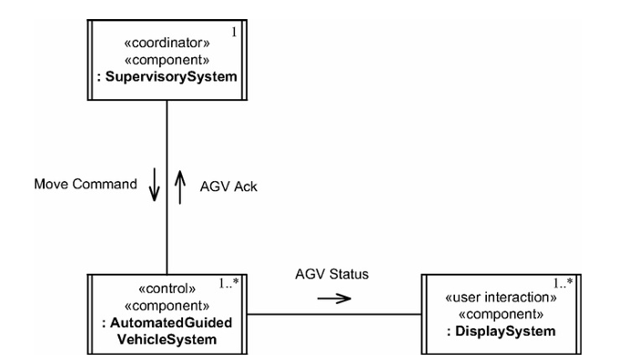

上图展示的是书中 AGV 机器人局部自治的示意图。与现代具身智能机器人相比，它简单得多，但基本原理没有改变。

# 4. 实时软件任务设计

实时任务通常需要与多种 I/O 设备交互，包括传感器、执行器和存储设备等。根据设备产生数据的方式，书中把 I/O 任务大致分为三类：

事件驱动 I/O：设备有新数据时产生中断，主动通知主机。例如，很多 IMU 带有数据就绪（DRDY）引脚，每完成一次采样就触发一次中断。
周期性 I/O：设备不主动通知，由主机按固定周期轮询。例如，EtherCAT 主站在每个控制周期与所有从站交换一次过程数据。
按需 I/O：只在需要时才访问设备，例如读取配置参数或写入日志。

中断处理的基本原则是“短进短出”。中断服务程序中只做最少的工作，例如读取寄存器、清除中断标志、记录时间戳，然后通知任务进行处理，把复杂计算留在任务上下文中。在 Linux 中，这对应中断的上半部和下半部；在 PREEMPT_RT 内核中，大部分中断处理会被线程化，可以像普通线程一样设置优先级和绑定 CPU。

中断也并不总是优于轮询。数据频率很高时，频繁中断带来的上下文切换和抖动反而更大，这时在实时线程中周期性轮询更可控。相机、高密度触觉阵列这类高带宽设备，通常还会配合 DMA，由硬件搬运数据，CPU 只在一批数据就绪后才处理。

轮询的关键在于周期稳定。实时系统更关心的不是平均周期准不准，而是抖动有多大、误差会不会累积。在 Linux 上，常见做法是使用 `clock_nanosleep`，配合 `CLOCK_MONOTONIC` 和 `TIMER_ABSTIME` 按绝对时间唤醒，避免周期漂移；在 MCU 上，控制环通常由硬件定时器中断驱动。

在机器人系统中，这些问题会叠加在一起：

- **时间戳要尽量靠近采集时刻。** 状态估计需要融合 IMU、关节编码器和力传感器等多路数据。如果等数据到达应用层后才打时间戳，中间的传输和排队延迟就会混入，影响估计精度。
- **多设备需要统一时基。** EtherCAT 可以通过分布式时钟（DC）让各从站在同一时刻采样和输出；跨计算节点时，则需要 PTP 等时钟同步机制。
- **实时线程中不能有阻塞操作。** 以 500 Hz 的 WBC 循环为例，每个周期只有 2 ms 的预算，还要扣除总线收发、状态估计和优化求解的时间，任何一次偶发阻塞都可能导致超时。因此，阻塞式 I/O、动态内存分配和日志写盘等操作，都应该放到非实时线程中异步完成。

对于实时系统，一般都会并发运行实时任务和非实时任务。为了区分不同任务的抢占与调度，需要设置任务优先级：时间关键任务的优先级较高，非时间关键任务则应让位于时间关键任务。如果这些任务运行在同一台计算机上，通常还需要设置 CPU 核心绑定、线程优先级和 CPU 亲和性，将时间关键任务安排到指定核心上运行，并把 Web 服务等非时间关键任务调度到其他核心执行。

当然，同一计算平台上的隔离终究是软性的，共享缓存、内存带宽和总线仍可能带来干扰。如果需要更强的确定性，可以在硬件层面进行隔离，例如把硬实时任务放到 MCU 上运行，两个平台通过总线通信。这样做并不能完全消除干扰，而是把问题转移到了通信链路上，因此 MCU 一侧需要具备独立的安全机制，例如通信超时后进入安全状态。在两者之间还有一些折中方案，例如集成了 Cortex-M 或 Cortex-R 实时核的异构 SoC，应用核与实时核之间通过共享内存和 RPMsg 通信；或者使用 Jailhouse 等分区型 hypervisor，在同一颗芯片上划分出独立的实时分区。

嵌入式软件还要满足一些额外的约束和要求，比如可扩展性、可用性、安全性、信息安全、可维护性、可修改性和可测试性。这些都不是纯粹的概念，而是软件产品真正落地时需要考虑的问题。只不过，本文不详细讨论这些方面的内容。作为软件架构师或软件负责人，在产品设计之初考虑得更加周全，甚至为未来预留扩展空间，是衡量架构师能力的重要指标，只是这个指标并不容易验证。

# 5. 实时软件性能分析
书中介绍了一些用于理论分析实时任务的数学理论。
最简单的是速率单调算法，即周期越短的实时任务，静态优先级越高。在此基础上，可以进一步使用利用率上限定理和完成时间定理。这些定理可以用来分析在速率单调算法假设条件下的任务 CPU 利用率上限，以及更准确地确认具体任务到底能否按时完成。

真实的实时任务要比这个假设更加复杂。例如，任务的优先级不再仅由任务周期决定，也存在中断驱动的非周期任务。因此，理论分析还需要扩展到非周期任务和任务同步等实时调度问题，进一步则会涉及更广义的实时调度理论。这些理论和算法都有相关论文支撑，想真正弄懂它们，仅靠读书是不够的，还需要认真研究论文并进行仿真。此外，要进一步扩展这些理论，还需要研究多核调度、更加复杂的任务模型、概率实时分析以及动态优先级调度等内容。

需要说明的是，在常规机器人研发中，通常不需要自行研究复杂的实时调度理论。运行在 SoC 上的不少控制任务属于软实时任务，而实时性要求更加严格的底层伺服控制通常部署在 MCU 或专用控制器上。因此，在实际工程中，可以结合已有经验进行任务划分、调度策略配置和硬件选型，再通过性能测量和压力测试验证系统是否满足实时性要求。

例如，在 Linux 平台上，可以使用 `cyclictest` 测量实时线程的调度延迟，结合不同负载条件观察延迟分布和最大值。对于实际控制程序，还需要进一步测量控制周期抖动、任务执行时间和截止时间违约情况。对于汽车、航空航天等安全关键系统，则可能需要更加严格的静态分析、系统级时序分析与验证工具，例如 AbsInt aiT、SymTA/S 等。

实时任务之间共享资源时，可能出现优先级反转。例如，低优先级任务持有互斥锁时，高优先级任务如果需要访问同一资源，就必须等待。为了限制这种阻塞，可以采用优先级继承协议（PIP）或优先级天花板协议（PCP）等机制。其中，优先级天花板协议通过约束任务对共享资源的访问，在满足相应调度模型假设的情况下，可以避免死锁，并将共享资源引起的阻塞时间限制在可分析的范围内，从而便于进行最坏情况响应时间分析。

对于并发执行多个实时任务的场景，尤其是涉及硬实时系统时，需要在设计任务时就对实时任务的调度性能进行分析和仿真，而不是等嵌入式程序运行起来出现问题后再排查，否则调试效率会很低。如果实时任务方案本身不合理，越早通过模拟仿真发现问题，修改成本就越低。

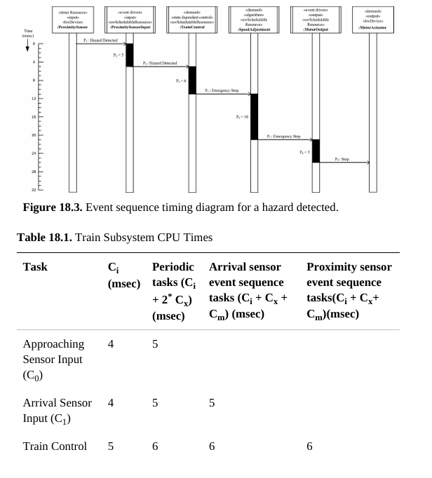

最后再说一下，实时调度理论的一些奠基性论文发表在《Journal of the ACM》（JACM）上。这个期刊理论性较强，不像CVPR等偏重实验验证的会议论文，读起来有一定难度，尤其是对于像我这样大部分时间都在工业界、并非专门从事计算机理论研究的工程师来说。

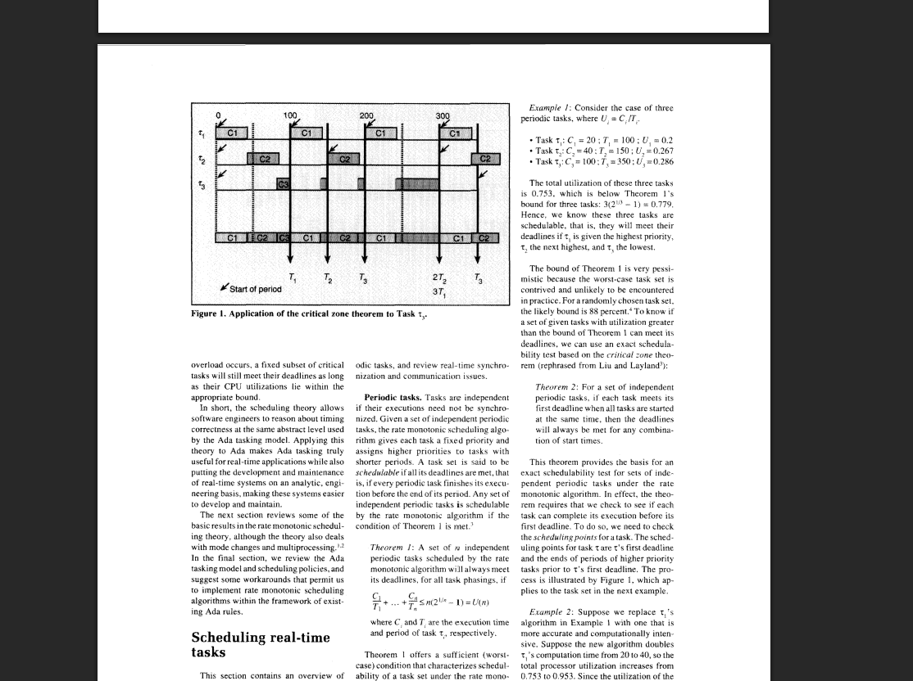
