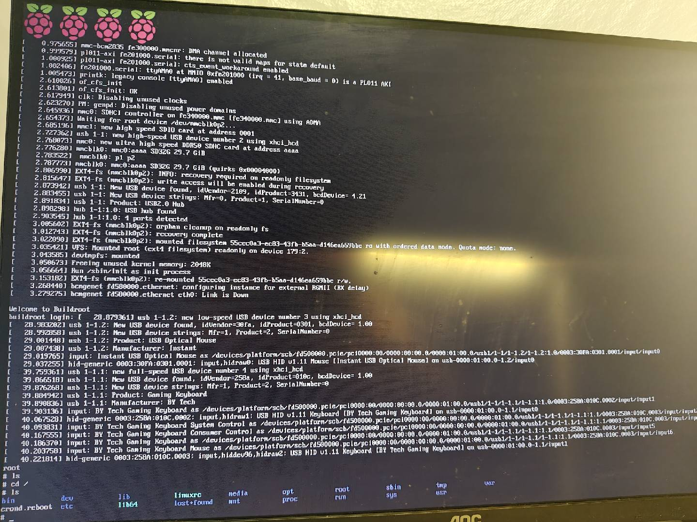

这本书其实我买了后从来没看过，只是近期想送出去才看了一遍。我刚开始碰嵌入式 Linux 用的是别的书，买这个的时候我的技术水平应该是看不懂这本书的。不知道为啥就买了，放在那里吃灰。这本书和 Karim Yaghmour 的《Building Embedded Linux Systems》、Christopher Hallinan 的《Embedded Linux Primer》并列为该领域三大经典参考书之一（只是听说）。

由于这本书写的时间还是有点久了，书里面用的开发板是 BeagleBone Black。我用的是 RK3588，而且已经在系统层打了 RT 补丁，还装了一个 EtherCAT 主站，后面打算做家庭陪伴机器人主控。RK3588 由于超高的性价比，目前很多人形机器人或者具身智能机器人都用来做量产机型的小脑。除了硬件平台，软件上我是用 QEMU 作为模拟器，对于一些 RK3588 的应用层软件，直接在板子上开发调试也没什么问题，部分 kernel/driver 逻辑可以先在 QEMU 验证，硬件相关部分仍需板端测试。

QEMU 支持 Linux 和 Windows 环境，不过比较建议使用 Linux。因为板子的软件绝大多数都是 Linux 环境，相关交叉编译工具链协同更方便。

我是在 WSL2 中配置的 QEMU

```shell
sudo apt update
sudo apt install qemu-system qemu-utils
```
添加 KVM 加速
```shell
sudo apt install qemu-kvm libvirt-daemon-system libvirt-clients bridge-utils virtinst
sudo usermod -aG kvm,libvirt $USER
```
设定完用户权限后重新登录

测试 KVM 以及 QEMU 安装情况
```shell
gaoming2@gaoming:~$ kvm-ok
INFO: /dev/kvm exists
KVM acceleration can be used
gaoming2@gaoming:~$ qemu-system-x86_64 --version
qemu-system-arm --version
QEMU emulator version 8.2.2 (Debian 1:8.2.2+ds-0ubuntu1.17)
Copyright (c) 2003-2023 Fabrice Bellard and the QEMU Project developers
QEMU emulator version 8.2.2 (Debian 1:8.2.2+ds-0ubuntu1.17)
Copyright (c) 2003-2023 Fabrice Bellard and the QEMU Project developers
```

说句题外话，Fabrice Bellard 是我在心中认为非常符合我审美的程序员，也是我一直追求的目标。QEMU 就是他发起的一个软件项目。而我目前缺少的就是这种有影响力且真能提升生产力的软件项目。除了 QEMU（系统相关），他还领导开发了 FFmpeg（音视频）、TCC（编译器）、QuickJS（前端语言编译器）。

# 1.工具链
这里讲的主要是编译工具链。一般有两种方式，一种是像我现在这样，由于 RK3588 性能已经很好，对于一些应用软件的开发编译运行直接通过 ssh 到板子上开发编译部署测试。好处就是非常方便，就像在自己电脑上开发应用程序一样。这种比较适合人数较少的开发者。问题在于一些开发环境和库如果没有隔离，会污染环境，尤其是在有多个库版本的时候。另外一种方式是交叉编译，因为源码编译这个事情本质就是翻译，嵌入式的可执行文件又不需要在 Windows 或者 x86 上运行，只要用相关的编译工具链编译就行。只不过运行需要把相关的二进制文件和依赖库拷贝部署到板子上才能进行真机测试。这样做的好处是可以进一步拓展软件编译相关的工作，可以把编译集成到 CI/CD 中，让 DevOps 平台可以支撑不同的软件平台。这在当前智驾或者机器人行业非常重要。因为很多软件算法供应商在不同项目中使用不同平台的开发板子，这就需要在中间件设计上对平台进行抽象，然后在 DevOps 平台中加入各种测试，比如在编译中进行插桩，来检测软件系统中的缓冲区溢出、内存泄漏、多线程死锁等问题。这属于静态/动态检测，也可以搭建软件测试台架，把从源码管理到编译测试部署链条全部打通，软件部署到板子上后进行动态测试，跑真实测试用例。甚至可以搭建硬件在环环境来构建质量体系。

实际上工具链是一个非常广泛的词语，可以是不同平台的源代码编译相关的编译器工具链，也可以是软件开发部署调试的工具链。

比如在公司中，我基本使用的都是公司从外面采购的开发板子，比如在机器人团队中一般会有做 BSP 的工程师来对接供应商提供的开发环境。有时候 BSP 工程师会结合自身需求在供应商的基础上魔改，需要注意的是这就不是纯软件的问题了，一些涉及底层硬件的改动需要查硬件手册。我主要做应用层软件，BSP 工程师会把改好的一套交叉编译工具链提供给应用软件工程师用于开发。早些年是直接给一个压缩包，自己在 Linux 上配置开发环境。我记得我第一个使用的开发板是全志，那个时候真是啥也不懂全程抱大腿。现在的话一般都会直接封装成 Dev Docker 镜像。这样做版本隔离非常简单方便，不容易出现版本干扰。换言之，我是交叉工具链的使用者而非构建者。

这本书里讲了自己构建交叉工具链。我之前写了一个自制 OS，不过还不太成熟，规模很小。到了一定的规模，就应该自己配一个交叉编译工具链，在 OS 上层去开发一些应用，真正把 OS 跑起来。在早期开发 OS 的时候我就直接使用的 aarch64-linux-gnu-gcc。书里面介绍了一种用于生成交叉编译工具链的工具 crosstool-ng，类似的工具还有 Buildroot、Yocto、musl-cross-make、LLVM/Clang 等等（反正我都不熟）。这本书是 Yocto 的作者推荐的。

写个 hello world，使用 Linux 安装的默认交叉编译工具编译一下 arm64 的
```c
#include <stdio.h>

int main(void)
{
    printf("Hello, World!\n");
    return 0;
}
```
交叉编译
```shell
aarch64-linux-gnu-gcc hello.c -o hello-arm64
```

查看文件格式
```shell
gaoming2@gaoming:~/projects/test_arm64$ file hello-arm64
hello-arm64: ELF 64-bit LSB pie executable, ARM aarch64, version 1 (SYSV), dynamically linked, interpreter /lib/ld-linux-aarch64.so.1, BuildID[sha1]=7e2be61387edec022573416d27faa42c8a52cb00, for GNU/Linux 3.7.0, not stripped
```

把二进制文件拷贝到 RK3588 上可以直接运行。我之前在树莓派上写裸机 OS 也是这么做的。

书里面也介绍了，实际开发中也很坑的一点就是 libc。我常见的就是 glibc。在不同的开发板上，不一定只用 glibc。不过在目前做智驾和机器人这块的 SOC，我就没见过不是使用 glibc 的情况，可能是这些板子使用的操作系统都是 Ubuntu，毕竟 Ubuntu 对于 AI 应用生态支持好一些。glibc 的版本问题很容易造成程序移植时出现崩溃。包括在 Docker 容器中，不同系统版本自带的 glibc 版本不一样，经常就出这种问题。

至于 C/C++ 代码的编译组织工具，我主要就用 CMake 和 Bazel，因为我主要做应用层软件。系统层很多用 Makefile 或者 Autotools。编译这块其实还涉及静态库和动态库的编译，链接等。尤其对于大型的机器人软件、智驾软件，性能相关的都是使用 C++ 开发，在进行软件集成的时候，会出现库版本冲突，这是没有办法避免的。因为集成使用的第三方库用的是什么库不在自己控制之下。因此需要在应用层做隔离、解冲突，第三方依赖版本管理等。除此之外大型多进程 C++ 软件工程往往存在大量源码编译，举个例子，机器人中间件 Zenoh 实际上是用 Rust 开发的，源码编译这个中间件需要在构建体系中引入 Rust 工具链，而 Cyclone DDS 使用的是纯 C++（Cyclone DDS 源码编译还是比较简单），libwebrtc 就非常重了。这就会造成开发构建这种复杂系统软件需要非常好的编译基础设施。比如说优化编译速度，合理利用缓存技术加速编译，甚至并行编译或者在 C++ 语言层做一些优化来提升编译速度等等。像 ROS2 所使用的 colcon 是在 CMake 上改的，在开源社区层面目前在尝试使用 Bazel 构建，Bazel 的优势就是内部集成了一些编译缓存优化的技术。我估计最快也得等下一个长期支持版本能上。

# 2.引导与加载程序
引导与加载程序做的事情是在计算机重新上电后，对操作系统进行初始化并加载，进入操作系统。这部分一般都是开发板硬件公司或者做操作系统的公司，芯片公司等做这部分。我平时开发电脑一般使用 ubuntu 的 x86 桌面版，使用 grub2 作为引导程序。偶尔我要改一些配置项，因为 ubuntu 系统跟 nvidia 显卡总有一些 bug，导致有时候进不去系统，就得各种配置。反正新系统，新显卡，新版本基本每次都得踩坑。嵌入式的引导程序主流是使用 u-boot。这本书里面讲了一些引导程序的原理，就是从 ROM 中的代码去载入到 SRAM 中，SRAM 本身也很小，就需要去初始化内存管理器等硬件，然后把操作系统的程序加载到内存中。但是这个过程在不同的硬件板子上是不完全一致的，有的板子需要去弄一些时钟等等的硬件，甚至有的还可以用串口或者网络设备。我自己在树莓派上写裸机操作系统的时候，就要去加载 GPU 的时钟。换一个平台就另外一种方式。

在 [u-boot](https://github.com/u-boot/u-boot/tree/main) 中 config 路径下就存着各种开发平台的配置。这块不太熟，大概就这样了。

我使用的 RK3588 就是使用 u-boot 生成的引导
```shell
RK3588% cat extlinux.conf
## /boot/extlinux/extlinux.conf
##
## IMPORTANT WARNING
##
## The configuration of this file is generated automatically.
## Do not edit this file manually, use: u-boot-update

default l0
menu title U-Boot menu
prompt 1
timeout 50
```

设备树基本上是目前 Linux 管理设备的主流方法了。通过引导程序加载后传递给内核。内核使用的是二进制版本。语法有点像 json 但是不完全一致，因为它还可以用 include 做一些类似于 C 语言那种包含展开的操作。设备树有专门的编译器 dtc，安装
```shell
sudo apt install device-tree-compiler
```
就是用来把设备树源文件转化为二进制文件

DTS->DTB

```shell
RK3588% ls /proc/device-tree
 adc-keys                        iommu@fdbef000              qos@fdf40400                  serial@feb90000
'#address-cells'                 iommu@fdc38700              qos@fdf40500                  serial@feba0000
 aliases                         iommu@fdc48700              qos@fdf40600                  serial@febb0000
 arm-pmu                         iommu@fdca0000              qos@fdf40800                  serial@febc0000
 av1d@fdc70000                   iommu@fdcb7f00              
```

## 2.1 QEMU 模拟环境配置

安装依赖库
```shell
sudo apt update
sudo apt install -y \
    qemu-system-arm qemu-utils \
    gcc-aarch64-linux-gnu \
    build-essential git bc bison flex \
    libssl-dev libelf-dev libncurses-dev \
    device-tree-compiler \
    dosfstools mtools cpio rsync unzip file wget \
    libgnutls28-dev
```

验证一些软件版本
```shell
gaoming2@gaoming:~$ qemu-system-aarch64 --version
aarch64-linux-gnu-gcc --version
dtc --version
QEMU emulator version 8.2.2 (Debian 1:8.2.2+ds-0ubuntu1.18)
Copyright (c) 2003-2023 Fabrice Bellard and the QEMU Project developers
aarch64-linux-gnu-gcc (Ubuntu 13.3.0-6ubuntu2~24.04.1) 13.3.0
Copyright (C) 2023 Free Software Foundation, Inc.
This is free software; see the source for copying conditions.  There is NO
warranty; not even for MERCHANTABILITY or FITNESS FOR A PARTICULAR PURPOSE.

Version: DTC 1.7.0
```

下载 u-boot 并且配置交叉编译工具链，并行编译这个项目
```shell
cd ~/qemu-lab
git clone https://source.denx.de/u-boot/u-boot.git
cd u-boot

make CROSS_COMPILE=aarch64-linux-gnu- qemu_arm64_defconfig
make CROSS_COMPILE=aarch64-linux-gnu- -j"$(nproc)"
```

编译大概一分钟，我是在 WSL2 下面编译的。

## 2.2 QEMU 使用 u-boot 引导程序
先浅浅地使用一下

先启动一个模拟环境
```shell
 qemu-system-aarch64 \
    -machine virt \
    -cpu cortex-a57 \
    -m 512M \
    -nographic \
    -bios u-boot.bin
```
使用 QEMU 创建一个虚拟机器，cpu 是 A57，内存是 512MB，没有图形界面，bios 的引导使用刚才编译好的 u-boot.bin

```shell
U-Boot 2026.10-rc1-00192-gd0615e4a67c8 (Aug 08 2026 - 13:39:12 +0800)

DRAM:  512 MiB
using memory 0x5e44d000-0x5f48d000 for malloc()
Core:  51 devices, 14 uclasses, devicetree: board
Flash: 64 MiB
*** Warning - bad CRC, using default environment

In:    serial,usbkbd
Out:   serial,vidconsole
Err:   serial,vidconsole
No USB controllers found
Net:   eth0: virtio-net#32

Hit any key to stop autoboot: 0
Scanning for bootflows in all bootdevs
Seq  Method       State   Uclass    Part  Name                      Filename
---  -----------  ------  --------  ----  ------------------------  ----------------
Scanning global bootmeth 'efi_mgr':
Cannot persist EFI variables without system partition
Missing TPMv2 device for EFI_TCG_PROTOCOL
Missing RNG device for EFI_RNG_PROTOCOL
Scanning bootdev 'fw-cfg@9020000.bootdev':
fatal: no kernel available
scanning bus for devices...
Scanning bootdev 'virtio-net#32.bootdev':
BOOTP broadcast 1
DHCP client bound to address 10.0.2.15 (2 ms)
*** Warning: no boot file name; using '0A00020F.img'
Using virtio-net#32 device
TFTP from server 10.0.2.2; our IP address is 10.0.2.15
Filename '0A00020F.img'.
Load address: 0x40400000
Loading: *
TFTP error: 'Access violation' (2)
Not retrying...
No more bootdevs
---  -----------  ------  --------  ----  ------------------------  ----------------
```
还是启动成功了。由于没有配置操作系统内核，所以会打印 fatal: no kernel available

这个实验本身干不了什么，就是熟悉一下书里面说的 u-boot 到底是个什么玩意。可以打印一些信息看一下

比如看设备信息
```shell
=> dm tree
 Class     Seq    Probed  Driver                Name
-----------------------------------------------------------
 root          0  [ + ]   root_driver           root_driver
 rsa_mod_ex    0  [   ]   mod_exp_sw            |-- mod_exp_sw
 firmware      0  [ + ]   psci                  |-- psci
 sysreset      0  [   ]   psci-sysreset         |   `-- psci-sysreset
 simple_bus    0  [   ]   simple_bus            |-- platform-bus@c000000
 qfw           0  [ + ]   qfw_mmio              |-- fw-cfg@9020000
 bootdev       0  [ + ]   qfw_bootdev           |   `-- fw-cfg@9020000.bootdev
 virtio        0  [   ]   virtio-mmio           |-- virtio_mmio@a000000
 virtio        1  [   ]   virtio-mmio           |-- virtio_mmio@a000200
```
看一下设备树信息
```shell
=> bdinfo
boot_params = 0x0000000000000000
DRAM bank   = 0x0000000000000000
-> start    = 0x0000000040000000
-> size     = 0x0000000020000000
flashstart  = 0x0000000000000000
flashsize   = 0x0000000004000000
flashoffset = 0x0000000000170d20
baudrate    = 115200 bps
relocaddr   = 0x000000005f48d000
reloc off   = 0x000000005f48d000
Build       = 64-bit
current eth = virtio-net#32
ethaddr     = 52:54:00:12:34:56
IP addr     = <NULL>
fdt_blob    = 0x000000005e34cd80
lmb_dump_all:
 memory.count = 0x1
 memory[0]      [0x40000000-0x5fffffff], 0x20000000 bytes, flags: none
 reserved.count = 0x3
 reserved[0]    [0x5d000000-0x5d000fff], 0x1000 bytes, flags: no-notify, no-overwrite
 reserved[1]    [0x5d32bff0-0x5fdfffff], 0x2ad4010 bytes, flags: no-overwrite
 reserved[2]    [0x5ffd5000-0x5fffffff], 0x2b000 bytes, flags: no-notify, no-overwrite
devicetree  = board
serial addr = 0x0000000009000000
 width      = 0x0000000000000004
 shift      = 0x0000000000000002
 offset     = 0x0000000000000000
 clock      = 0x0000000000000000
arch_number = 0x0000000000000000
TLB addr    = 0x000000005fde0000
irq_sp      = 0x000000005e32bff0
sp start    = 0x000000005e32bff0
Early malloc usage: e88 / 2000
```
fdt_blob    = 0x000000005e34cd80，这是设备树的二进制地址
进到这个地址，就可以查看设备树的信息
```shell
=> fdt addr 0x000000005e34cd80
```

```shell
=> fdt header
magic:                  0xd00dfeed
totalsize:              0x100000 (1048576)
off_dt_struct:          0x40
off_dt_strings:         0x1a44
off_mem_rsvmap:         0x30
version:                17
last_comp_version:      16
boot_cpuid_phys:        0x0
size_dt_strings:        0x193
size_dt_struct:         0x1a04
number mem_rsv:         0x0
```
打印具体设备树信息
```shell
fdt print /
/ {
        interrupt-parent = <0x00008002>;
        model = "linux,dummy-virt";
        #size-cells = <0x00000002>;
        #address-cells = <0x00000002>;
        compatible = "linux,dummy-virt";
        psci {
                migrate = <0xc4000005>;
                cpu_on = <0xc4000003>;
                cpu_off = <0x84000002>;
                cpu_suspend = <0xc4000001>;
                method = "hvc";
                compatible = "arm,psci-1.0", "arm,psci-0.2", "arm,psci";
        };
        memory@40000000 {
                reg = <0x00000000 0x40000000 0x00000000 0x20000000>;
                device_type = "memory";
        };
        platform-bus@c000000 {
                interrupt-parent = <0x00008002>;
                ranges = <0x00000000 0x00000000 0x0c000000 0x02000000>;
                #address-cells = <0x00000001>;
                #size-cells = <0x00000001>;
                compatible = "qemu,platform", "simple-bus";
        };
        fw-cfg@9020000 {
                dma-coherent;
                reg = <0x00000000 0x09020000 0x00000000 0x00000018>;
                compatible = "qemu,fw-cfg-mmio";
        };
        virtio_mmio@a000000 {
                dma-coherent;
                interrupts = <0x00000000 0x00000010 0x00000001>;
                reg = <0x00000000 0x0a000000 0x00000000 0x00000200>;
                compatible = "virtio,mmio";
        };
        virtio_mmio@a000200 {
                dma-coherent;
                interrupts = <0x00000000 0x00000011 0x00000001>;
                reg = <0x00000000 0x0a000200 0x00000000 0x00000200>;
                compatible = "virtio,mmio";
        };
        virtio_mmio@a000400 {
                dma-coherent;
                interrupts = <0x00000000 0x00000012 0x00000001>;
                reg = <0x00000000 0x0a000400 0x00000000 0x00000200>;
                compatible = "virtio,mmio";
        };
```
这样内容基本就跟书里面对上了。也算是自己的一种解读吧。毕竟如果我直接抄书，感觉做不出来的样子...

# 3.移植与配置内核
由于嵌入式的应用场景太广泛了，不只是做机器人系统，手机，微波炉，各种小家电，卫星火箭导弹，wifi反正就是肉眼可见的一些带通信或者智能功能的硬件，除了服务器和电脑基本就是嵌入式。相比较而言嵌入式的功耗低，做产品化的时候需要对操作系统进行移植和裁剪。

操作系统内核的内容太过庞大，我当前也不是操作系统内核专家。我在这里使用 QEMU 在 ubuntu 上做一些引导载入和内核相关的模拟实验。具体真正上硬件我估计得等我自己做的那个操作系统完善一些后我再去学习更系统的方法。就不在这里写了。这篇文章就逐步转变为 QEMU 小教程，我也是本着学习的态度。光看书我还是有点蒙，没太看懂，我觉得工程的东西再怎么得操作一下才行。

系统内核载入进来想真正运行还需要根文件系统，所以本部分的 QEMU 操作与下一章一起搞。

# 4.构建根文件系统
Linux 的哲学就是一切皆是文件。操作系统想运行，它得知道运行系统的哪些程序，这些程序也许还有配置文件，所以就需要一个文件系统把这些路径关系和文件存进去，系统根据配置才能去加载运行指定的程序。这就是根文件系统。把这个构建出来后，操作系统才能正式开始运行。

对于经常使用 Linux 系统的人来说，文件系统肯定是非常熟悉的。因为 Linux 系统安装好后有一个默认的路径，比如 bin 存二进制运行文件，lib 存库文件，etc 存配置文件，var 存动态变化文件，tmp 存临时文件等等。这些都是路径，那么就会涉及一个路径权限的问题。就是这个文件夹下面的文件，不同的用户或者不同用户组的用户到底能不能读写执行。这些都比较常规只要熟悉 Linux 就一定都知道的。

操作系统启动后第一个运行的程序是 init。权限肯定是 root 权限了。PID 是 1。这个程序启动后就会运行一些系统脚本和守护进程等。在机器人软件系统中就经常要自定义一些伴随系统启动的系统服务，比如系统检测服务，中间件服务，Web 服务，OTA 服务等等。

BusyBox 我在之前 Docker 的文章中就提到过。这个工具把常用的 Linux 命令都集成到一起，占用的磁盘空间非常小。里面的实现是根据输入的命令进行字符串匹配，来决定调用哪个命令对应的程序。

# 5.选择构建系统
操作嵌入式操作系统，有专门的构建工具。书里面讲了两个，一个是 buildroot，一个是 Yocto。buildroot 门槛低一些使用起来比较简单，Yocto 属于做正式 Linux 发行版使用的工具。一个工具如果做的事情比较精细和复杂，那么实用的门槛就会比较高。这本书跟 Yocto 关联比较密切，但是谁叫我菜呢，如果后面我自己做 Linux 发行版我会考虑使用 Yocto，目前先用 buildroot。不论用什么工具，通过修改配置，然后编译，就可以实现自定义 BSP 的功能。只不过除了软件修改，在真实硬件上还要考虑硬件的支持才能决定修改到底能不能生效。

用QEMU实验一下

## 5.1 QEMU 直接启动 Linux
之前那个实验因为没有加 Linux 内核，只能看一些信息，并没有真的在 QEMU 中启动 Linux 操作系统

下载构建根目录的开源项目代码

```shell
cd ~/projects/qemu_lab

wget https://buildroot.org/downloads/buildroot-2026.05.1.tar.xz
tar -xf buildroot-2026.05.1.tar.xz
cd buildroot-2026.05.1
```

配置并并行编译
```shell
make qemu_aarch64_virt_defconfig
make -j"$(nproc)"
```

这个项目的编译时间会长一些，编译过程还会拉取很多的代码，因为这个过程中包含了编译 Linux 内核以及一些工具链。

编译结束之后
```shell
gaoming2@gaoming:~/projects/qemu_lab/buildroot-2026.05.1$ ls ./output/images/
Image  rootfs.ext2  rootfs.ext4  start-qemu.sh
```
Image 文件就是编译出来的系统镜像，ARM64 架构的。

在 QEMU 中启动 Linux 系统
```shell
./output/images/start-qemu.sh
```
输入用户名 root 就可以进入到系统

```shell
gaoming2@gaoming:~/projects/qemu_lab/buildroot-2026.05.1$ ./output/images/start-qemu.sh
Booting Linux on physical CPU 0x0000000000 [0x410fd034]
Linux version 6.18.7 (gaoming2@gaoming) (aarch64-buildroot-linux-gnu-gcc.br_real (Buildroot 2026.05.1) 14.4.0, GNU ld (GNU Binutils) 2.45.1) #1 SMP Sun Aug  9 13:15:54 CST 2026
random: crng init done
Machine model: linux,dummy-virt
efi: UEFI not found.
OF: reserved mem: Reserved memory: No reserved-memory node in the DT
Zone ranges:
  DMA      [mem 0x0000000040000000-0x0000000047ffffff]
  DMA32    empty
  Normal   empty
Movable zone start for each node
Early memory node ranges
  node   0: [mem 0x0000000040000000-0x0000000047ffffff]
Initmem setup node 0 [mem 0x0000000040000000-0x0000000047ffffff]
psci: probing for conduit method from DT.
psci: PSCIv1.1 detected in firmware.
psci: Using standard PSCI v0.2 function IDs
psci: Trusted OS migration not required
psci: SMC Calling Convention v1.0
percpu: Embedded 20 pages/cpu s43864 r8192 d29864 u81920
Detected VIPT I-cache on CPU0
CPU features: detected: ARM erratum 845719
alternatives: applying boot alternatives
Kernel command line: rootwait root=/dev/vda console=ttyAMA0
printk: log buffer data + meta data: 131072 + 458752 = 589824 bytes
Dentry cache hash table entries: 16384 (order: 5, 131072 bytes, linear)
Inode-cache hash table entries: 8192 (order: 4, 65536 bytes, linear)
software IO TLB: SWIOTLB bounce buffer size adjusted to 0MB
software IO TLB: area num 1.
software IO TLB: mapped [mem 0x0000000047f1e000-0x0000000047f5e000] (0MB)
Built 1 zonelists, mobility grouping on.  Total pages: 32768
mem auto-init: stack:all(zero), heap alloc:off, heap free:off
SLUB: HWalign=64, Order=0-3, MinObjects=0, CPUs=1, Nodes=1
rcu: Hierarchical RCU implementation.
rcu:    RCU restricting CPUs from NR_CPUS=512 to nr_cpu_ids=1.
rcu: RCU calculated value of scheduler-enlistment delay is 25 jiffies.
rcu: Adjusting geometry for rcu_fanout_leaf=16, nr_cpu_ids=1
NR_IRQS: 64, nr_irqs: 64, preallocated irqs: 0
Root IRQ handler: gic_handle_irq
GICv2m: range[mem 0x08020000-0x08020fff], SPI[80:143]
rcu: srcu_init: Setting srcu_struct sizes based on contention.
arch_timer: cp15 timer running at 62.50MHz (virt).
clocksource: arch_sys_counter: mask: 0x1ffffffffffffff max_cycles: 0x1cd42e208c, max_idle_ns: 881590405314 ns
sched_clock: 57 bits at 63MHz, resolution 16ns, wraps every 4398046511096ns
Console: colour dummy device 80x25
Calibrating delay loop (skipped), value calculated using timer frequency.. 125.00 BogoMIPS (lpj=250000)
pid_max: default: 32768 minimum: 301
Mount-cache hash table entries: 512 (order: 0, 4096 bytes, linear)
Mountpoint-cache hash table entries: 512 (order: 0, 4096 bytes, linear)
cacheinfo: Unable to detect cache hierarchy for CPU 0
rcu: Hierarchical SRCU implementation.
rcu:    Max phase no-delay instances is 1000.
EFI services will not be available.
smp: Bringing up secondary CPUs ...
smp: Brought up 1 node, 1 CPU
SMP: Total of 1 processors activated.
CPU: All CPU(s) started at EL1
CPU features: detected: 32-bit EL0 Support
CPU features: detected: CRC32 instructions
CPU features: detected: PMUv3
alternatives: applying system-wide alternatives
Memory: 112176K/131072K available (8640K kernel code, 894K rwdata, 2100K rodata, 1152K init, 510K bss, 17476K reserved, 0K cma-reserved)
devtmpfs: initialized
clocksource: jiffies: mask: 0xffffffff max_cycles: 0xffffffff, max_idle_ns: 7645041785100000 ns
posixtimers hash table entries: 512 (order: 1, 8192 bytes, linear)
futex hash table entries: 256 (16384 bytes on 1 NUMA nodes, total 16 KiB, linear).
29392 pages in range for non-PLT usage
520912 pages in range for PLT usage
DMI not present or invalid.
NET: Registered PF_NETLINK/PF_ROUTE protocol family
DMA: preallocated 128 KiB GFP_KERNEL pool for atomic allocations
DMA: preallocated 128 KiB GFP_KERNEL|GFP_DMA pool for atomic allocations
DMA: preallocated 128 KiB GFP_KERNEL|GFP_DMA32 pool for atomic allocations
thermal_sys: Registered thermal governor 'step_wise'
cpuidle: using governor menu
hw-breakpoint: found 6 breakpoint and 4 watchpoint registers.
ASID allocator initialised with 65536 entries
Serial: AMBA PL011 UART driver
9000000.pl011: ttyAMA0 at MMIO 0x9000000 (irq = 13, base_baud = 0) is a PL011 rev1
printk: console [ttyAMA0] enabled
ACPI: Interpreter disabled.
iommu: Default domain type: Translated
iommu: DMA domain TLB invalidation policy: strict mode
SCSI subsystem initialized
pps_core: LinuxPPS API ver. 1 registered
pps_core: Software ver. 5.3.6 - Copyright 2005-2007 Rodolfo Giometti <giometti@linux.it>
PTP clock support registered
vgaarb: loaded
clocksource: Switched to clocksource arch_sys_counter
pnp: PnP ACPI: disabled
NET: Registered PF_INET protocol family
IP idents hash table entries: 2048 (order: 2, 16384 bytes, linear)
tcp_listen_portaddr_hash hash table entries: 256 (order: 0, 4096 bytes, linear)
Table-perturb hash table entries: 65536 (order: 6, 262144 bytes, linear)
TCP established hash table entries: 1024 (order: 1, 8192 bytes, linear)
TCP bind hash table entries: 1024 (order: 3, 32768 bytes, linear)
TCP: Hash tables configured (established 1024 bind 1024)
UDP hash table entries: 256 (order: 2, 16384 bytes, linear)
UDP-Lite hash table entries: 256 (order: 2, 16384 bytes, linear)
NET: Registered PF_UNIX/PF_LOCAL protocol family
PCI: CLS 0 bytes, default 64
workingset: timestamp_bits=46 max_order=15 bucket_order=0
fuse: init (API version 7.45)
Block layer SCSI generic (bsg) driver version 0.4 loaded (major 249)
io scheduler mq-deadline registered
io scheduler kyber registered
pci-host-generic 4010000000.pcie: host bridge /pcie@10000000 ranges:
pci-host-generic 4010000000.pcie:       IO 0x003eff0000..0x003effffff -> 0x0000000000
pci-host-generic 4010000000.pcie:      MEM 0x0010000000..0x003efeffff -> 0x0010000000
pci-host-generic 4010000000.pcie:      MEM 0x8000000000..0xffffffffff -> 0x8000000000
pci-host-generic 4010000000.pcie: Memory resource size exceeds max for 32 bits
pci-host-generic 4010000000.pcie: ECAM at [mem 0x4010000000-0x401fffffff] for [bus 00-ff]
pci-host-generic 4010000000.pcie: PCI host bridge to bus 0000:00
pci_bus 0000:00: root bus resource [bus 00-ff]
pci_bus 0000:00: root bus resource [io  0x0000-0xffff]
pci_bus 0000:00: root bus resource [mem 0x10000000-0x3efeffff]
pci_bus 0000:00: root bus resource [mem 0x8000000000-0xffffffffff]
pci 0000:00:00.0: [1b36:0008] type 00 class 0x060000 conventional PCI endpoint
pci_bus 0000:00: resource 4 [io  0x0000-0xffff]
pci_bus 0000:00: resource 5 [mem 0x10000000-0x3efeffff]
pci_bus 0000:00: resource 6 [mem 0x8000000000-0xffffffffff]
virtio_blk virtio0: 1/0/0 default/read/poll queues
virtio_blk virtio0: [vda] 122880 512-byte logical blocks (62.9 MB/60.0 MiB)
rtc-pl031 9010000.pl031: registered as rtc0
rtc-pl031 9010000.pl031: setting system clock to 2026-08-09T07:22:15 UTC (1786260135)
hw perfevents: enabled with armv8_pmuv3 PMU driver, 7 (0,8000003f) counters available
NET: Registered PF_INET6 protocol family
Segment Routing with IPv6
In-situ OAM (IOAM) with IPv6
sit: IPv6, IPv4 and MPLS over IPv4 tunneling driver
NET: Registered PF_PACKET protocol family
NET: Registered PF_KEY protocol family
NET: Registered PF_VSOCK protocol family
registered taskstats version 1
clk: Disabling unused clocks
PM: genpd: Disabling unused power domains
check access for rdinit=/init failed: -2, ignoring
EXT4-fs (vda): orphan cleanup on readonly fs
EXT4-fs (vda): mounted filesystem 3833273f-1f20-45be-aae6-9829b239da9e ro with ordered data mode. Quota mode: disabled.
VFS: Mounted root (ext4 filesystem) readonly on device 254:0.
devtmpfs: mounted
Freeing unused kernel memory: 1152K
Run /sbin/init as init process
EXT4-fs (vda): re-mounted 3833273f-1f20-45be-aae6-9829b239da9e r/w.
Saving 256 bits of creditable seed for next boot
Starting syslogd: OK
Starting klogd: OK
Running sysctl: OK
Starting network: udhcpc: started, v1.38.0
udhcpc: broadcasting discover
udhcpc: broadcasting select for 10.0.2.15, server 10.0.2.2
udhcpc: lease of 10.0.2.15 obtained from 10.0.2.2, lease time 86400
deleting routers
adding dns 10.0.2.3
OK
Starting crond: OK

Welcome to Buildroot
buildroot login: root
```

输入点命令看一下

```shell
# uname -a
Linux buildroot 6.18.7 #1 SMP Sun Aug  9 13:15:54 CST 2026 aarch64 GNU/Linux
# uname -m
aarch64
# free -h
              total        used        free      shared  buff/cache   available
Mem:         112.1M       11.6M       96.8M       44.0K        3.6M       96.6M
Swap:             0           0           0
# cd /
# ls
bin           lib           media         root          tmp
crond.reboot  lib64         mnt           run           usr
dev           linuxrc       opt           sbin          var
etc           lost+found    proc          sys
```
当前仅仅是实验操作，比如 buildroot 背后的原理我目前还不太精通。书里面讲的系统文件挂载方式有很多种，比如网络之类的。我在这里没有过多的尝试，等我自己的操作系统做起来一定要玩玩的。

上面这个实验虽然启动起来了 ARM64 的 Linux，但毕竟是在模拟器中的。RK3588 真实板子的配置有点复杂，因为这个板子是异构 SOC，里面有 CPU、GPU、NPU、VPU。所以我打算降低一下难度，用 buildroot 做个树莓派 4B 的操作系统，然后刷到板子上，看一下运行情况。所以一个工程师，真机部署才是实现价值的地方，模拟器仅仅是方便修改调试用的。

## 5.2 使用 buildroot 树莓派 4B 系统镜像编译真机部署
在 buildroot 根目录下创建树莓派 4B 的镜像输出目录
```shell
make O="$PWD/output-rpi4" raspberrypi4_64_defconfig
```
开始并行编译
```shell
make O="$PWD/output-rpi4" -j"$(nproc)"
```
当前是编译一个完整的可以在树莓派硬件上跑的操作系统，中间会下载文件，编译时间会长一些，漫长的过程...

编译完后在 output-rpi4 路径下面的 images 中有一个 sdcard.img。这个就是编译出来的系统镜像。

树莓派 4B 的存储使用的是 SD 卡。用读卡器插在电脑上后，需要下载一个树莓派镜像 SD 卡写入软件 Raspberry Pi Imager
这个软件就是用 Qt6 开发的一个界面工具。Qt 也是我的老熟人了，我之前开发了好多 Qt 的商业应用程序。

用管理员权限打开这个软件，选择自定义镜像，然后载入到 SD 卡中。烧录完，把 SD 卡插在树莓派上，正常启动就行了。只不过树莓派使用的是 miniHDMI，需要一个专门的转接线就行

下图就是我自己编译的树莓派的 Linux 操作系统源码，在树莓派 4B 的硬件上系统启动，一切正常。只不过系统没有界面，功能方面非常简陋。




## 5.3 开发机接USB-TTL串口调试树莓派
启动了操作系统仅仅是起步，为了使用系统方便，我需要把开发机连接到树莓派上。网络 ssh 是常规开发的基本方法，但是我现在的系统太简陋了，我之前自己做操作系统的时候保留了 GPIO 的引脚插入和 USB 转 TTL 的模块，直接插到开发机应该就能走串口。我是在 WSL2 中直接操作。这里需要在 Windows 上先安装 USB 转发的程序，把转换器识别并共享给 WSL。操作方法跟我在自制操作系统的文章中方法一样。把 USB 共享给 WSL2 后，直接连接就可以通过串口接到树莓派上

```shell
sudo picocom \
    --baud 115200 \
    --flow n \
    /dev/ttyUSB0
```

通过串口看一下设备树信息
```shell
# ls /proc/device-tree
#address-cells       compatible           regulator-cam1
#size-cells          cpus                 regulator-sd-io-1v8
__overrides__        emmc2bus             regulator-sd-vcc
__symbols__          fixedregulator_3v3   reserved-memory
aliases              fixedregulator_5v0   scb
axi                  gpu                  serial-number
cam0_clk             interrupt-parent     soc
cam0_regulator       leds                 system
cam1_clk             memory@0             thermal-zones
cam_dummy_reg        memreserve           timer
chosen               model                v3dbus
clk-108M             name                 zone_dma
clk-27M              phy
clocks               pmu
```

把树莓派断电后重新上电，WSL2 上的串口是可以接收到系统重启和交互的打印信息的。这里面说一些机器人整机系统中断电的问题。断电这个事情本身不是机器人系统的常规性的功能性的事情。但是一旦长期运行的机器人由于某种故障真的发生了，软件系统的设计是应该考虑故障回溯性以及断电数据保护的问题。这在车载自动驾驶系统中也是要考虑的，而且是属于跟安全直接相关的核心功能。因为一旦发生了这种严重的意外，别管后面产生什么结果，作为当时记录的线索和后续求证的关键证据，这就是这部分功能的重要性。就类似于飞机的黑匣子了。一般是系统软件或者中间件部门要做这个事情。

## 5.4 在树莓派操作系统中加入自定义设备树 Overlay
自定义一个虚拟设备，定义设备树文件，让系统启动后加载并且做一点校验。整体来讲很简单。

创建一个设备树的定义文件
```shell
vim training-overlay.dts
```

写入一个自定义设备
```shell
/dts-v1/;
/plugin/;

/ {
    compatible = "brcm,bcm2711";

    fragment@0 {
        target-path = "/";

        __overlay__ {
            training {
                compatible = "demo,rpi4-training";
                status = "okay";

                course-name = "buildroot-device-tree";
                board-name = "raspberry-pi-4b";
                lesson-id = <2>;
            };
        };
    };
};
```
接着就用编译器编译就行了
```shell
dtc -@ \
    -I dts \
    -O dtb \
    -o training.dtbo \
    training-overlay.dts
```
training.dtbo 就是设备树编译出来的二进制，给系统内核用的。把 SD 取出来，把这个文件拷贝到 overlays 文件夹下面。我现在用的操作系统还是精简过的，这个文件夹下的设备文件不多。我之前用厂家发过来原装的那个系统 SD 卡里面这个文件夹下面的设备老多了。

在 config.txt 中最后面加入下面配置
```shell
dtoverlay=training
```
把 SD 卡装回去重启系统，在串口中就可以输入命令来验证设备有没有被内核识别

验证一下设备的参数

```shell
# tr -d '\0' \
>   </proc/device-tree/training/board-name
raspberry-pi-4b#
```
系统识别出来的参数跟我们之前在设备树配置文件中配置的参数一样的

# 6.创建存储策略
有了根文件系统，至少可以保证在内存中可以跑起来操作系统了。可是内存的数据伴随下电就没了。我们平时使用各种电脑或者手机，都是让操作系统去挂载一个磁盘或者存储介质。这样可以保证存进去的数据在系统下电后数据不丢。书里面讲的是 NOR 闪存和 NAND 闪存。现在嵌入式系统使用的基本是 NAND 闪存，因为这种闪存的存储空间比较大。比如 SD 卡、eMMC、NVMe 等等。

机器人本体的系统也会带这些东西。比如现在的具身智能机器人，现在部署到场景中后，都要做一些运行数据的存储，然后回流到云端完善模型。在进行数据采集的时候，对于数据落盘的速度和性能会有比较高的要求。因为现在都是多模态数据，高频的关节数据，雷达数据，多路相机数据等等。另外在机器人系统中非常重要的一点就是 OTA 升级。为了升级的稳定，一般会做 A/B 分区，也就是说当前运行的是 A 系统，那么 OTA 过程中把 B 系统进行升级。这样不会干扰现有的运行系统。在 B 系统完成升级后，再让运行系统切换到 B 系统。与此同时保留 A 系统作为备用系统。如果运行 B 系统出了问题，可以配置系统回退到 A 系统。这就意味着磁盘空间还是要大一些才行，否则根本装不下两个分区。这个 OTA 在整机系统中还是很复杂的，因为我前面说的这些只是升级 SOC 本身的 Linux，真实的整机系统还有 MCU，各种分布式传感器。那么这些分布式的元件，要么也得做 A/B 分区，或者直接升级，出了问题再换升级包。这样做有时候就会把设备传感器升级成砖头。尤其升级设备的固件，很容易出这种问题。所以相比较而言纯 SOC Linux 的升级还算简单一些。

另外不同的存储介质本身也是自带文件系统的，比如 U 盘就可以设置不同的文件系统。

# 7.设备驱动程序介绍
驱动程序就是连接硬件和操作系统的软件。并且按照操作系统的接口编写函数接口，给应用层调用。由于硬件设备种类繁多，如果每个硬件都自己维持一套接口代码，操作系统就要给每一个硬件做专门的适配。这样就不利于系统的分发与通用性。所以在操作系统层面对驱动的接口进行了定义限制，设备想接进来 Linux，就按照接口去写。具体内部怎么实现那是设备自己的事情。这样就做到了接口统一。Linux 主要有三种设备驱动，字符设备比如键盘鼠标，块设备比如硬盘、U 盘，网络设备比如网卡等等。

在机器人系统中也是如此的。一般机器人系统是跑在 Linux 系统之上，所以对于硬件层面的驱动，还是按照 Linux 驱动的方式去集成。可是对于整机机器人系统的软件系统，规模和复杂度依然很大，尤其对于量产型号，存在多型号，每个不同的型号都有不同的配件，这就需要去设计上层的机器人操作系统做硬件抽象。ROS2 做了一些，不过在目前大规模量产的具身智能机器人中，一般都是机器人公司自己内部会封装一层硬件抽象，并在硬件抽象上做中间件系统。不完全用 ROS2 的一个原因就是 ROS2 在实时系统包括一些大流量数据的传输处理上还不是最高效的。在机器人量产产品化的过程中，把软硬件的性能压缩到极限意味着更低的成本可以做更多的事情。

书里面介绍了一点通过 sysfs 去获取设备驱动信息的方法。后面的 LED 实验就是用的这种方法来控制树莓派上的显示灯。书里面也介绍了一点常规的外部设备形式和协议。比如 GPIO，就是一个 bool 的 IO 端口，可以配置在系统中产生中断来设置或者查询端口的信息。内核的驱动对于 LED 有更丰富的支持，当前前提是硬件也得支持才行，比如控制亮度等等或者定时闪烁。I2C 协议是低速 SOC 访问外部设备的协议，这是一个总线协议，Linux 都提供了标准的库接口。SPI 是高速的串行外设接口总线。这两个协议都是主从协议，主都在 SOC 上，从是外部设备。这两个协议在机器人系统中非常常见了。不过机器人系统中使用的工业总线协议不止这两个，还要使用 CAN 做高速数据传输和控制，最高 500Hz。如果想做 1KHz 的力控，一般用 EtherCAT。I2C 一般是板级的通信比如去连开发板上其他的传感器，比如温度传感器等。SPI 范围大一些，可以连一些外部的高频的编码器。像具身智能机器人系统，不论是底盘的电机还是各种关节电机，灵巧手电机，都需要使用编码器去获取关节转动的数据。

## 7.1 控制 LED 灯
本来想使用树莓派直接外接电阻 LED 灯之类的，但是现在不太会连电路之类的。接不出来，失败！所以这里直接控制树莓派上板载的小灯吧。不擅长电子...

```shell
# ls -l /sys/class/leds
total 0
lrwxrwxrwx    1 root     root             0 Jan  1 00:45 ACT -> ../../devices/platform/leds/leds/ACT
lrwxrwxrwx    1 root     root             0 Jan  1 00:45 PWR -> ../../devices/platform/leds/leds/PWR
lrwxrwxrwx    1 root     root             0 Jan  1 00:45 default-on -> ../../devices/virtual/leds/default-on
lrwxrwxrwx    1 root     root             0 Jan  1 00:45 mmc0 -> ../../devices/virtual/leds/mmc0
lrwxrwxrwx    1 root     root             0 Jan  1 00:45 mmc0:: -> ../../devices/platform/emmc2bus/fe340000.mmc/leds/mmc0::
```
就用板载的 ACT 的灯做实验吧，也是无奈自己三十多岁了，一点硬件层面的东西都不会。

直接输入命令就行
关闭 ACT 显示
```shell
echo 0 > /sys/class/leds/ACT/brightness
```

显示
```shell
echo 1 > /sys/class/leds/ACT/brightness
```
上面这个示例就直接调驱动来控制灯。

# 8.启动初始化程序
这章讲的是 init 程序。主要有三个，分别是 BusyBox 的 init、System V 的 init 和 Systemd。

前面我自己编译部署的那个树莓派操作系统用的是 buildroot，默认使用的 init 是 BusyBox。那个系统很简略，比树莓派默认带的 GUI 的那个操作系统简略很多。System V 我不了解。Systemd 是非常常用的，我就主要介绍一下这个。

在机器人系统中，目前区分大小脑。小脑目前量产主要用 RK3588，大脑一般用带英伟达显卡的高性能 SOC 跑 AI 大模型。常规一点的使用 Orin Nano。不管是大脑还是小脑，操作系统目前基本以 ubuntu 为主，小脑需要实时性就打 RT 补丁。ubuntu 使用的就是 systemd。在机器人系统中很多的服务都是包装成这些系统服务伴随开机启动的。Systemd 的优点很多，比如配置简单语义明确，依赖关系清晰，方便限制资源等。不仅在嵌入式端，就是在服务器上也是如此，比如我之前搭建软件团队的 Devops，我就要做容灾备份之类的服务，也是用的这种形式。

另外一个在机器人上很常见的就是看门狗。由于服务是长期运行在 SOC 上，但是存在一些异常情况服务会挂了。作为部署出去的机器人系统，挂了之后要检测到并进行重启。看门狗就干这种事的。服务要定时去喂狗，狗就认为服务活着。如果超过设定的时间没有喂狗，狗就认为服务死了，就会进行一些重启操作。

# 9.进程与线程
进程和线程模型是作为程序员非常基础的内容了。如果不懂根本写不了多进程或者多线程并发代码。这也是应用软件开发的基础。

在机器人系统中，一般会涉及多进程架构，因为机器人的传感器，各种算法功能特别多，都放在一个进程中，一旦出现异常可能整个机器就崩溃了。而多进程架构，只是死了某个服务，还可以通过诊断程序进行诊断修复重启配置。进程之间的通信一般本机使用中间件的共享内存和 Unix 套接字。共享内存的好处是避免了常规通信方式经过内核重复拷贝数据的问题。这对于大量频繁的数据传输非常重要，比如多路视频流等等。Unix 套接字一般做一些服务，比如传输传感器数据之类的。使用系统的原始 API 是非常不方便的，一般都是在中间件层进行封装，方便上层应用使用。尤其对于当下的具身智能落地，视觉，触觉，雷达，语音各种多模态数据接入。

多线程在机器人上需要注意的一点就是优先级反转。比如高优先级的任务由于低优先级任务占用被迫等待不确定时间。这对于一些偏实时性控制任务，数据采集或者视频传输时比较麻烦的。实践中一般会专门设计优先级和线程抢占配置实时核来解决。

另外一个问题是配置 Linux 系统调度。分为分时策略和实时策略。其中分时用于处理机器人的常规服务任务，实时任务主要做云控、图传。一般在小脑比如 RK3588 上，会对实时控制任务进行绑定核心和一些实时性配置。然后其他的分时任务会被系统调度到小核和非绑定实时任务的大核上运行。

# 10.内存管理
写 C/C++ 都不可避免会面临内存管理，因为这两个语言没有垃圾回收机制，非常容易写出内存泄漏或者缓冲区溢出等问题代码。

现代的通用的操作系统都会使用虚拟内存技术。Linux 也是如此。这里面涉及一个通用的软件工程概念叫做写时复制（惰性复制），就是在没有对数据进行写入更改前先使用共享的数据来避免直接复制数据造成的性能损耗。这在操作系统或者高性能的软件中都大量使用。虚拟内存通过内存管理单元 MMU 把虚拟的内存空间映射到真实物理内存中。

另外就是 mmap，可以把文件中的数据映射到内存或者内存映射到其他设备节点。比如视频流接口 V4L2，就可以使用 ioctl 函数向驱动申请视频缓冲区，再把缓冲区用 mmap 映射到用户空间，循环使用缓冲区。

进程的占用内存测量可以使用常规工具 top 或者 ps。其中 Vss 参数表明的是虚拟内存空间，Rss 表明的是真实物理内存占用。

内存这块在机器人落地中，比较重要的有几点，比如多进程架构下要保证系统运行时内存够用，这需要进行总体设计，而不是肉身测量；要做系统运行时性能监测，当然也包含内存；内存泄漏检测，简单的可以使用 mtrace，这个只能做比较简单的检测。Valgrind 这个工具非常重要，一个是因为它开源，使用方便；一个是因为它功能强大，可以做内存泄漏检测，也可以计算缓存命中率或者函数调用成本，死锁检测或者数据竞争检测。所以这个工具非常适合集成到 devops 中，在进行分支合并前先跑流水线，配置检测代码这些内存问题。当然现在的工具不止这一个，还可以使用模糊测试技术，也可以在测试阶段发现很多内存隐患和多线程问题。另外要强调的一点是对于整体软件体系建设，上述的一些工具在 Devops 平台上不使用直接部署的板级环境，直接用 Docker 进行隔离测试也可以测出来一些问题，但是最终整机软件集成测试，还是要搭建台架测试体系，并且接入到 Devops 中，甚至对于一些控制程序测试可以做数据回灌来压力测试性能和功能。

# 11.调试测试体系
只要做过古法编程的人肯定都用过调试器，就是设置断点看程序中变量的状态。这是调试程序的基本方法了。C/C++ 就是用 GDB 调试，当然对于嵌入式 Linux 中长期运行的软件系统需要配置自动存储 core 文件的机制，当某个服务挂了，可以保存并上传到云端，使用工具分析崩溃问题。不过现在 AI 编程后，很多人都不手写代码了，自然使用这种调试工具也不像之前那么多了。都是直接让 AI 调用工具分析问题。我就经常这么干也是一种进步吧！

GDB 一般是本地调试，当然使用 server 代码就可以远程调试。像 VS2026，本身就支持了本地开发远程开发嵌入式开发，可以直接远程到板子上开发。这是成型的 IDE 行为，而且 IDE 目前也集成了 AI 功能。如果没有 IDE 支持就得自己配置了。应用层软件的调试相对容易一些，操作系统内核相比之下更难调试。这个在我自己做操作系统的时候就深有体会。在具身智能机器人中，由于系统也很复杂，往往需要开发专门的调试工具。因为机器人系统中存在大量流式数据，比如各种传感器数据以及算法处理结果。尤其很多算法直接打印看是不直观的，需要配置 3D 图形渲染，才能方便一些。在 ROS2 中有 rqt、qviz 等，不过到了实际真正量产部署，这些工具由于性能和功能缺陷不足以完整支撑真正的落地，要么二次开发要么自己开发内部工具。

在机器人整机系统软件集成的过程中，按照一般的团队划分，会把中间件和系统软件合在一起。而且中间件除了完成基本的数据转发之外，一般还要集成一些业务需求的支撑和测试调试工具。性能测试调试是一个非常关键的方向。一般简单的查看就用 top 命令看一下哪些进程占用资源高。如果想分析某个模块进程，可以使用 perf，这个是内核提供的测量工具。同时支持内核测试和应用软件测试。这个工具主要用来分析 CPU 占用、缓存占用等问题。纯内核跟踪测试可以使用 Ftrace，这个主要用于内核测试。更丰富的测试功能可以使用 LTTng。上面提的这些工具直接使用起来都比较繁琐。在真正机器人落地项目中一般是在系统或者中间件团队的软件中进行集成，并且工具链团队开发简洁易用的前端界面来配套使用。甚至把一些功能合并进入 DEVOPS。

# 12.实时编程
实时任务是要求任务的完成时间必须在某个时间点之前。我接触过的主要是几类，一类是音视频。这类任务一般在 30Hz 左右，所以要求一次任务的延迟要在几十毫秒内解决。比较相近的还有实时渲染，比如一些游戏的渲染操作要在指定时间内完成，否则延迟感明显，非常影响体验。另外就是运动控制。比如在人形机器人的小脑设计中，WBC 的频率在 500Hz 上下。而对于力控，则要求 1000Hz。一般在小脑上也就这个频率了，更高频的电流环、速度环、位置环会下放到 MCU 中进行控制。视频类处理核心是多路视频编解码，一般是使用硬件编解码。主要是数据量大。渲染类的任务主要是 3D 实时渲染，类似于游戏或者 VR 或者机器人里面的遥操作，核心其实在图形渲染上，也是依赖显卡并行处理多边形计算和着色计算这些。最后是实时运动控制，云控的数据量不大，频率是最高的，对于稳定性要求也是最高的。对于一些灵巧任务卡顿几十毫秒就意味着一些灵巧动作做不成，甚至直接把机器人摔报废。所以这块需要做很多的实时性配置设计来保证。

一般的视频流和渲染是不需要给操作系统打实时核补丁的。运控场景需要打实时补丁。在机器人系统中，不确定性的延迟抖动来源非常多，比如操作系统调度，调度延迟，优先级反转，定时器精度差，页面错误，处理器高速缓存，内存总线竞争等等。需要强调的一点就是说在小脑运控方面不论是 500Hz 还是 1000Hz，都是软实时系统。真正的硬实时系统需要使用 SDP 或者 FPGA 直接用硬件电路来保证实时性，甚至都不需要使用 Linux。比如在卫星控制或者火箭导弹这些平台上面，都是用 FPGA 做控制。FPGA 能做当然不只是运控，其大规模并行高速数据处理能力可以做雷达处理芯片或者卫星遥感的处理芯片。我以前搞航天的时候，真正上天的项目都是这么做的。

前面说的一些在 Linux 系统层面存在的系统抖动不确定性，其实在真实项目落地的时候都有对应的解决方法，比如说页面错误，这是操作系统很常规的东西，解决方案就是在控制进程启动的时候，就提前设定好把页面分配出来锁定。这种用空间解决时间抖动的方案在嵌入式领域非常常见。比如说动态分配内存会造成抖动就直接预分配一块大内存，甚至浮点数频繁计算浪费时间就把三角函数直接计算出一个线程的数据表格，直接常数时间获取结果。比如中断会影响实时，就把实时控制的进程绑定到某个 cpu 上，比如 RK3588 的大核上，然后做核心隔离来屏蔽一般的中断信号。中断的信息由其他非实时核来处理。

如果小脑打了 PREEMPT_RT 补丁的话，这个实时补丁的优化就是提供高精度定时器，内核互斥和线程化中断处理程序，允许抢占锁。这么做对于通用的任务肯定是不利的，所以对于像当下具身智能机器人行业量产的小脑选型，使用 RK3588 也是只配置少数核心给最关键的实时任务，其他的核心照常处理其他的常规任务。

在配置线程优先级时可以参考下面的规则，优先级从高到低分别是：高精度定时器，最高优先级相关的硬件中断，最高优先级实时线程，低优先级实时线程硬件中断，非实时硬件中断。

实时性的测试工具 cyclitest。我之前在人形机器人系统配置实时核心的时候就是用这个工具测试配置结果。因为最开始实时核并没有配置成功，但是相关 BSP 工程师就说已经做好了，我就是用这个工具测试验证 BSP 的错误，让他重新编译操作系统，改了很多才最后做成的。

# 13.总结
后面几章内容写的比较水，没上实操。主要的考虑在于我目前的确很忙，很多的研发项目都在并行推进，有机器人，灵巧手的，也有 AI、Agent 的。要学习的东西很多，要做的事情也很多。很多的细节没有在这篇文章中展开。比如实时控制。举个例子，在 RK3588 上想把整机机器人系统做好，不是仅仅配置实时核，设置点绑定核心或者 CPU 亲和性就行的。当整机的软件系统规模和复杂性垒起来之后，各种服务抢占系统资源的冲突才会暴露出来，或者在进行复杂任务的时候才能暴露出来。再比如异构系统不同的处理单元抢占内存，尤其对于大数据量数据传输和处理，是需要配置 RK3588 上一些专有的软硬件才能做好的。我最开始本来想加一部分内容，AI 模型部署与推理，受限于时间也没写。我当初本来是想在 Nvidia Orin 和 RK3588 上分别部署不同的模型。Orin 上可以直接使用 Cuda，而 RK3588 上只有专门的 NPU。这仅仅还只是推理的硬件模块差别，像整个系统的一些优化其实内容也很多，我后面专门写文章介绍吧。


