这本书应该是我刚接触嵌入式开发时买的，那个时候我就把它看完了。相比而言，《嵌入式 Linux 编程》那本书的门槛比这本书高不少，我当时根本看不懂。

这本书涉及的内容特别杂，从基本的半导体电路原理到硬件、软件，甚至中间件和 Web，都有所讲解，跨度很大。MCU 层及以上的软件我或多或少接触过，但缺乏硬件层面的经验。这本书算是一本教科书，讲了很多原理。第一次阅读时，我对很多内容理解得并不深刻。比如书中提到的中间件，那个时候我完全没有接触过，只是粗略地看了看，直到后来开始开发智能驾驶或机器人软件时才真正有所了解。

对于一些纯粹讲解技术操作的书籍，我只要按照书中的逻辑写些笔记，基本就算对得起自己了。毕竟没几个人会在看完一本书后，强迫自己手写一篇至少几千字的读书笔记。因此，我没有办法非常详细地复述这类教科书的内容，只会结合一些项目经历进行讲解和引申。这本书的主体内容偏重概念，而非实际操作。总体而言，两类书各有各的好处，我们不论是读书还是带团队用人，都要取其长处、避其短处。

我之所以会接触嵌入式，也是因为当时做项目时被带入了这个领域，否则我很可能在很长一段时间内都不会接触它。我在大学时会做一些单片机开发，后来基本就再也没碰过这方面的内容了。工作后再次接触嵌入式，已经是在做嵌入式 Linux 上的应用软件和算法工程化开发了。从那时起，由于频繁参与机器人软件项目，我就想找一本从电路一直讲到应用层的书，把自己零散的知识串联起来。这样做的好处是，当自己独立领导一个涉及边缘嵌入式技术的团队时，可以清楚地了解各个技术部分的职责。在只做纯算法工作的阶段，我完全驾驭不了这部分内容。即使是现在，如果让我画 PCB 板，我也做不出来。不过，我大致了解硬件工程师的工作内容，也知道如何与他们配合，共同完成一个项目。

还有一点是，如今 AI 在软件领域的渗透程度已经相当惊人了。我认为它在硬件领域也可以发挥很大的作用，只是目前在实践层面还没有足够好用的工具。我相信，近几年嵌入式行业的两个重大变化都与 AI 相关。一个是嵌入式 AI 的端侧部署和推理能力不断提升，例如可以用一块很便宜的板子运行目标识别、目标跟踪，甚至简化版的大语言模型，并将其集成到机器人系统中，打造家庭陪伴机器人。这也是我打算下半年做一个为自己提供服务的机器人的初衷。另一个变化体现在开发模式上：传统的嵌入式软硬件开发模式正受到 AI 的冲击，软件领域对此应该已经有了很深的感受。不过，目前 AI 在硬件研发领域的渗透程度并不理想。因此，我在想，虽然自己并不是一个很懂硬件的人，但是否也可以做一些事情，推动这方面的发展。

最终的理想效果是：一个综合技术能力很强的人，在 AI 的加持下，可以获得足以与一个团队相抗衡的产出能力，甚至达到与团队相当的产出质量。这样做不是为了加剧内卷，而是为了重塑一种研发模式。我始终坚信，发掘尚未被人认识但能给人带来很大帮助的方向，远比在一个相对成熟且由别人设定好的框架下内卷更有价值，也更有吸引力。在这个方向上，嵌入式软硬件系统的 AI 研发工具链是一个很有意思的项目。我打算下半年投入一些时间，做几个开源项目试试水。

# 1. 划水

本章讲了一些关于嵌入式系统基本概念的内容。嵌入式系统涉及的领域实在太多：硬件包括单片机、MCU、FPGA、SoC、DSP 等，软件的类型就更多了，包括 RTOS、Linux，甚至裸机程序。书里的内容确实很像教科书。第一次阅读时，我觉得受益匪浅，每一行都会仔细阅读和领会，因为书里讲的那些内容我平时接触不到，也没人教我。几年过去了，随着阅历的增长，回过头再看时，很多东西已经不太愿意花时间细说了，因为都是基础内容。

所谓系统化方法其实也没什么特别的，都是平时在项目中用过、经历过的。而且在实际操作中，大家也不会完全按照教科书讲的那样规范执行，往往都是干到哪里算哪里。大厂也是如此，只不过流程更多一些。流程虽然烦琐，但凭借大厂的人才密度，确实可以起到一定的兜底和保障作用，仅此而已。

这位作者在美国从事电视机一类嵌入式设备的开发，所以他很喜欢在书中加入电视机的案例。现在家里的电视通常具备各种交互功能，其应用层可以使用 Java 开发。嵌入式行业涉及的领域非常广泛，每个行业都会根据自身需求制定相应的嵌入式系统标准。比如，医疗器械行业很关注性能和安全性，而路由器行业则更关注数据转发和路由能力。

我觉得，一般的嵌入式开发主要使用偏底层的编程语言，比如 C/C++，新一些的项目也会使用 Rust。我在旷视的时候，很多新的安防项目还真是用 Rust 写的。书中提到的 Java 一般用于较上层的应用，例如开发 Android 应用；以前的网络应用也很喜欢使用 Java。我对 Java 这门语言一直没有什么好感，因为从我离开学校、进入产业界时起，Java 就已经很火了。当时我觉得自己不想被局限在 Web 这一个方向上，所以第一份工作没有选择做 Java 开发，而是去做了 AI 机器人。那个时候，Java 开发在互联网行业可谓如日中天。即使后来我也开始开发 Web 应用，使用的也是现学的 Go，而不是 Java。

我不太理解作者为什么在这里插入了一些关于计算机网络 OSI 模型的内容。不过，嵌入式设备通常也需要联网，以连接局域网为主。现在很多 IoT 设备也具备连接公网的能力，但一般都会先连接指定的云端服务，再将数据转发到 App。对于不同层次的协议，一般只有通过不断使用才能逐渐熟悉；另一种学习方式是自己实现一个协议栈。只看书很难做到真正理解。通信协议都有相应的 RFC 标准，也有很多开源代码可供参考，自己动手实现一个比什么都强。

电路这部分讲的是模拟电路和数字电路的原理。我以前学过这方面的课程，不过现在忘得差不多了。平时不接触的知识很容易忘记。接下来讲的是电阻、电感、电容和 PCB 等内容。我目前不会画 PCB 板。以前实验室里有人做这方面的工作，常规的设计还比较简单，但多层高速板卡的设计很依赖经验。我以前看到学长设计的板子，成本动辄十几万元，却可能因为一点设计缺陷而报废，只能重新设计。一般是电子工程师负责画板和打板等工作。我以前开会时，经常与机械、光学、流体、嵌入式和控制等不同专业的人一起讨论。偏算法的内容即使不是我的主业，我多少也能听懂一些；硬件方面的内容我则基本听不懂。一场会议动辄一两个小时，我在会上基本没什么存在感。他们讨论硬件问题时，我也插不上嘴。

# 2. 嵌入式处理器、存储、I/O、总线

整个嵌入式计算系统都是围绕处理器展开的，处理器本质上负责处理指令和数据。处理器有不同的体系结构，比如 ARM、x86 等。不同的体系结构不仅在硬件设计上差异巨大，在指令集支持方面也相对独立。它们所做的事情在本质上是一致的，都是让处理器进行数学运算、移位运算、数据存取和各种逻辑操作。为什么没有统一的体系结构？我的理解是：一方面，不同公司之间存在商业竞争，都会维持各自的设计；另一方面，处理器的应用场景太广泛，同一种指令集难以同时兼顾复杂的高级逻辑与低能耗等需求，因此必然会产生分化。所以，购买不同品牌的处理器时，需要注意其体系结构。这一点在编译器及其工具链上体现得非常明显。为了使编译器能够为不同体系结构的处理器生成代码，目前主流的编译器架构通常分为前端、中间表示层和后端。其中，后端会针对不同的硬件体系结构生成相应的汇编代码。

## 2.1 ISA 模型

专用 ISA 模型分为以下几种：

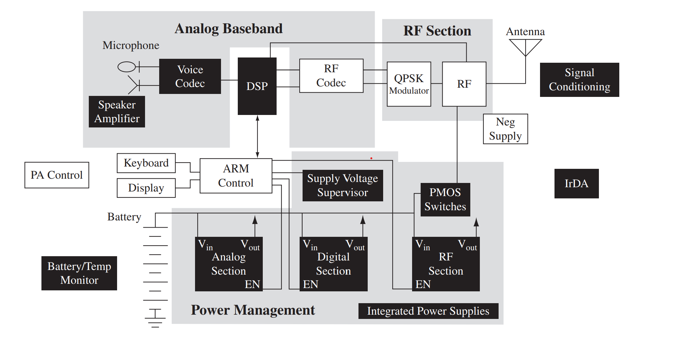

上图中包含一个 ARM 处理器和一个 DSP 处理器。ARM 作为嵌入式系统的主控，负责核心业务逻辑、状态管理、常规外设接入以及对从处理器的控制。DSP 作为专门用于处理语音信号的从处理器，负责实时处理语音信号。在这个系统中，ARM 处理器属于控制器模型，DSP 属于数据通路模型。可以认为，这种系统架构也是一种主从模式。主从模式在嵌入式系统中非常常见，比如 I²C、SPI 等总线也采用这种模式：主处理器是主设备，外部设备是从设备。

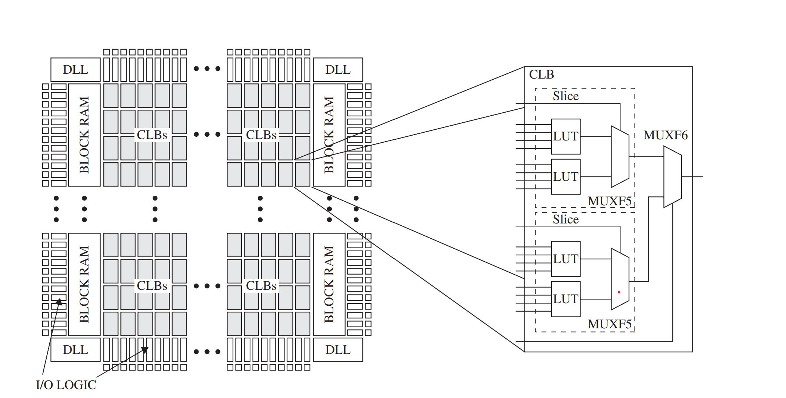

上图是使用 FPGA 实现的、带数据通路的有限状态机模型。这种模型的特点是在器件中实现一些逻辑，但其逻辑通常不像 ARM 主控中的逻辑那么复杂。例如，我在项目中经常使用 FPGA 实现高速、并行的大数据实时处理，如信号处理或图像的初级处理。采集到的原始数据经过初步处理后，再被发送到计算机上进行更高层次的处理或存储。FPGA 的一个优点是并行处理和实时处理能力特别强，例如卫星或导弹中会使用 FPGA 作为主控板。除此之外，还可以直接使用 Verilog 实现逻辑，同一块板子烧录不同的固件便能实现不同的功能。其缺点是软件生态不如 ARM 主控板完善，调试也不方便。要在项目中实现高速、可靠的数据传输，通常需要购买专门的 IP 核，否则自行实现的工程量会非常大。我想引入 AI 设计工具的一个出发点也在这里。我相信，AI 可以为这一领域带来很大的改变。

指令集一般分为复杂指令集和精简指令集。x86 属于复杂指令集，ARM 和 RISC-V 属于精简指令集，其中 RISC-V 还是一种开放的指令集架构。复杂指令集为了实现一些复杂功能，包含了一些多周期操作，而精简指令集通常采用较简单、规整的指令。因此，精简指令集往往可以实现更低的功耗，更有利于在边缘设备上部署。复杂指令集则可以用于大型服务器、超级计算集群等。不过，现在很多情况也在发生变化。尤其是在 AI 产业中，训练集群非常耗电，很多创业公司也在尝试使用精简指令集设计服务器以降低功耗，并由此设计出许多专用处理器，打破固有的边界和认知。

单指令多数据（SIMD）目前也是非常常用的 CPU 计算优化方式。在嵌入式设备中，如果整个系统需要承担很重的计算任务，通常会配备专门的计算协处理器。例如，可以使用上面示例中的 DSP 实时处理语音信号，使用支持 CUDA 的 GPU 进行 AI 推理运算，或者像 RK3588 那样配置 NPU、VPU，分别作为神经网络处理单元和视频处理单元。除此之外，现代 CPU 通常也具备多核和 SIMD 功能。对于一些任务，也可以使用 CPU 进行并行计算。例如，ARM 的 NEON、SVE 等指令集扩展可以通过一条指令并行处理多个数据元素。

## 2.2 架构

从某种角度来说，处理器设计是一门艺术，很考验设计者的能力，并非纯粹的工程问题。不同品牌的处理器在设计上存在巨大差异。不管怎么说，就体系结构而言，冯·诺依曼结构和哈佛结构依然是目前应用最广泛的两种结构。

下图是冯·诺依曼结构：

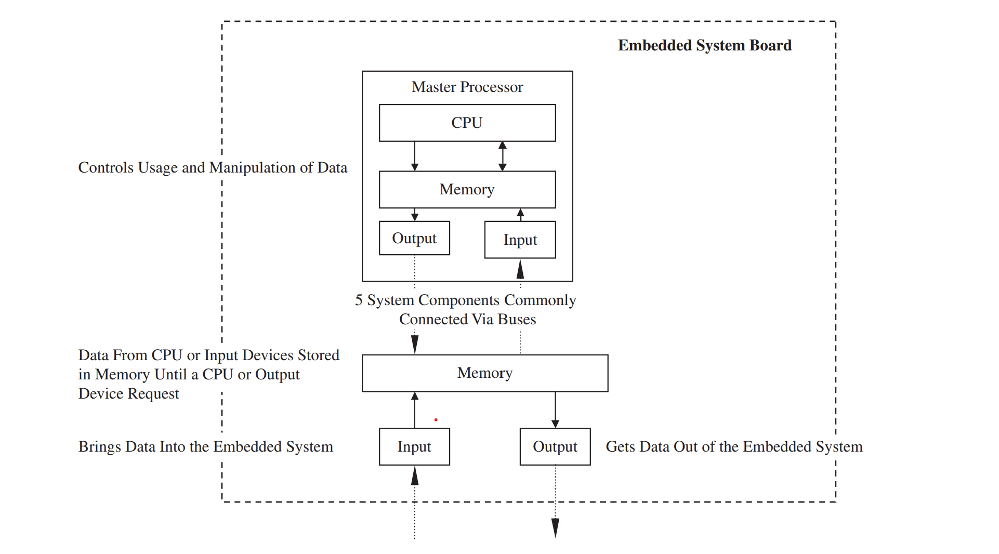

下图是哈佛结构：

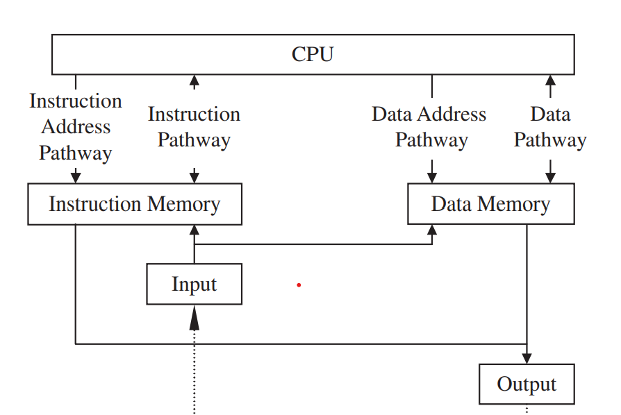

两种结构的主要区别在于：冯·诺依曼结构使用同一存储空间存放指令和数据，哈佛结构则将二者分开，以避免因共用通路而产生的冲突。

CPU 所做的事情本质上就是获取指令、处理数据和存储数据。CPU 内部包含算术逻辑单元、寄存器、控制单元和总线等。详细内容可以参考计算机体系结构方面的书籍，这里不再细说。需要说明的是，这些基础概念对于编写高性能、高稳定性的软件十分关键。例如，在进行多核并行编程时，数据同步需要考虑数据一致性和时序；什么时候使用无锁编程，什么时候使用内存屏障同步数据，本质上都需要以理解 CPU 体系结构为基础，才能设计好软件。

在存储方面，板卡通常都会配备 ROM。一般认为其中的程序不可修改，但实际情况主要取决于器件选型，只要硬件支持就可以修改。ROM 中通常存放系统上电后首先运行的程序。此时，板卡还没有进入正式的操作系统，需要由这些程序初始化部分硬件，随后载入引导程序，并将操作系统加载到内存中。

RAM 分为 SRAM 和 DRAM。二者底层物理电路的实现原理不同，因此使用方式存在很大差异；其共同点是断电后数据都会丢失。SRAM 一般用作高速缓存，DRAM 一般用作主存，因为其存储容量较大且相对便宜。在现代计算机体系结构中，无论是 CPU 还是 NVIDIA GPU，在设计上都大量使用多级缓存机制来提升系统处理速度。用好多级缓存，本质上就是利用好数据的局部性。这对于编写高性能代码也非常重要。例如，可以根据数据的存储特点设计遍历方案；设计数据结构时，也需要考虑其尺寸与缓存行大小之间的关系。对于存储管理，板卡上通常会配备内存管理单元（MMU），用于将虚拟地址映射到物理地址，并负责内存保护和缓存控制等工作。

处理器要真正发挥作用，还需要接入各种 I/O 设备。这样，处理器才能接收和处理外部设备的数据，并控制外部设备。设备的类型非常多，例如网络通信设备、输入设备、图像设备、存储设备、调试设备和实时设备等。处理器上一般都要运行操作系统，单片机有时也可以不使用操作系统，或者运行一个 RTOS。对于功能复杂、资源较丰富的应用处理器或 SoC，Linux 很常见。在这种情况下，操作系统会将外部设备抽象为字符设备、网络设备和块设备等类型，并在操作系统层面提供相应的驱动接口，各类设备都需要适配这些接口。

在 I/O 通信中，比特率和波特率是两个非常常用的概念。比特率是每秒传输的比特数，波特率是每秒传输的符号数。二者的关系为：比特率 = 波特率 × 每个符号所携带的比特数。例如，一个传输符号可以表示四种状态，也就是携带 2 bit 信息。如果波特率为 1,000 Baud，则比特率为 1,000 × 2 bit/s，即 2,000 bit/s。串口通信通常需要设置波特率，因此理解这个参数十分重要。

在 I/O 通信中，经常会区分同步通信和异步通信。二者的核心区别在于通信双方是否共享或显式传输用于数据采样的时钟信号。例如，SPI 属于同步通信，通信过程中会单独提供时钟线 SCLK，收发双方按照该时钟对数据进行采样；UART 则属于典型的异步通信，通信链路中没有额外的时钟线，通信双方需要预先约定波特率，并通过起始位建立每一帧数据的同步关系。UART 串口在嵌入式系统中非常常见，很多调试接口、传感器、模组和外部控制设备都会使用 UART 进行通信。典型的 UART 数据帧通常包括起始位、数据位、可选的校验位以及停止位。常见的 8N1 配置表示 8 个数据位、无校验位和 1 个停止位。UART 控制器通常还会提供一定容量的硬件 FIFO，用来缓冲待发送或已经接收到的数据。发送数据时，CPU 或 DMA 将数据写入发送 FIFO，UART 控制器再按照设定的波特率依次完成串行发送，并自动加入起始位、停止位等帧结构。接收过程则相反：UART 控制器首先完成串并转换，再将收到的数据放入接收 FIFO，等待 CPU 或 DMA 进一步处理。波特率表示每秒传输的符号数。在普通的二进制 UART 中，一个符号通常对应一个比特，因此波特率在数值上通常与线路上的比特率相同。但实际能够传输的有效业务数据还需要扣除起始位、停止位以及校验位等额外开销。例如，UART 使用 115,200 Baud、8N1 配置时，每发送 8 bit 有效数据，实际在线路上需要传输 10 bit，因此理论上的有效字节吞吐率约为 11,520 byte/s。如果外部设备产生数据的速率长期高于 UART 链路的传输速率或软件的数据处理速率，接收 FIFO 和软件缓冲区最终可能被填满，从而导致数据丢失或被覆盖。在实际工程中，可以通过提高波特率、增大缓冲区、优化中断处理或使用 DMA 等方式降低数据丢失的风险。

处理器和外部设备之间还需要一种机制来通知事件的发生。例如，当 UART 接收到数据、定时器到期或某个外设完成一次操作时，都可以通过中断向 CPU 发出事件通知。与 CPU 不断轮询设备状态相比，中断可以减少无效的 CPU 占用。不过，对于高速或大批量数据传输，仅依靠 CPU 在每次中断中搬运数据，效率通常不高，因此很多嵌入式系统还会使用 DMA。DMA 可以在外设和内存之间直接搬运数据，CPU 主要负责配置传输任务，并在一批数据传输完成后处理相应事件。这样可以显著降低 CPU 在数据搬运方面的开销。这种方式在高速串口、网络、图像采集和高速 ADC 等场景中都很常见。在 FPGA 高速数据采集场景中，一般会让 FPGA 先完成采集和初步处理，再通过 PCIe、光纤或高速网络把数据送到主机侧。以 PCIe 为例，通常会直接使用 DMA 把大块数据写入主机内存。CPU 不需要逐份搬运数据，只负责配置传输任务和处理完成事件。数据进入内存后，再交给 CPU 或 GPU 做后续处理，或者直接写入磁盘。这种设计在高速图像和信号采集系统中很常见，本质上是把大吞吐量的数据搬运任务交给专门的硬件通路，把 CPU 留给控制和更高层的计算。FPGA 中常用的方案包括 XDMA、RDMA 等。

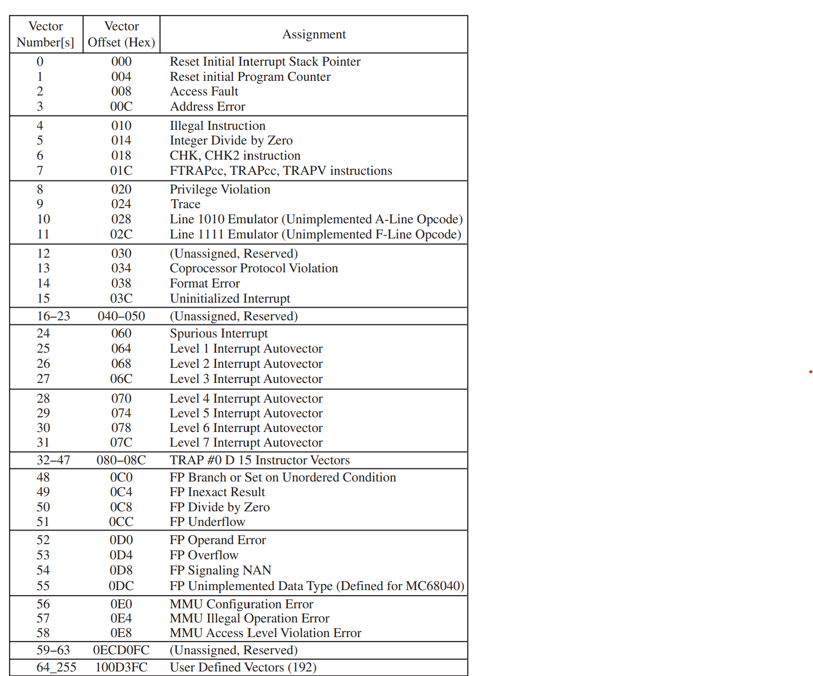

中断机制属于硬件或系统底层机制。如上图所示，一般会对中断进行编号和分级。在某些情况下，高优先级中断可以抢占低优先级中断并优先得到处理。这种机制在操作系统层面有很多实现方案。

在进行处理器选型时，通常需要综合比较多方面的参数，例如 CPU 核心数量、主频、指令集扩展、缓存容量、内存带宽、功耗、散热能力以及外设接口等。有些处理器资料中还会给出 MIPS、DMIPS 等指标，用来描述一定测试条件下的指令执行能力。不过，这类指标与具体指令集、编译器优化方式和测试程序关系很大，因此不能简单拿来横向比较不同架构处理器的实际性能。对于真实项目来说，只看芯片手册上的理论参数通常是不够的。处理器到手后，一般还需要结合实际业务负载进行基准测试和压力测试。例如，可以分别测试 CPU 计算性能、内存带宽、缓存效率、I/O 吞吐、并发性能，以及长时间高负载运行时的温度、功耗和是否会发生降频。如果是机器人、边缘 AI 或图像处理这类系统，还需要进一步关注端到端性能，例如模型推理延迟、图像处理帧率、CPU/GPU/NPU 利用率、内存占用和带宽、功耗，以及系统持续运行后的稳定性。最终的处理器选型，本质上并不是比较某一个孤立参数，而是在计算能力、实时性、功耗、成本、外设资源、软件生态和开发复杂度之间做综合权衡。

板载存储、I/O 和总线的原理与处理器内部的相关机制很相似，很多内容有所重复，因此这里合并补充。

多级缓存示意图如下。该图很直观，但细节不够丰富。

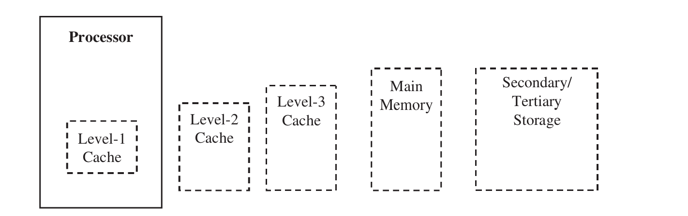

下图是以 CUDA 为例的现代 GPU 体系结构示意图。

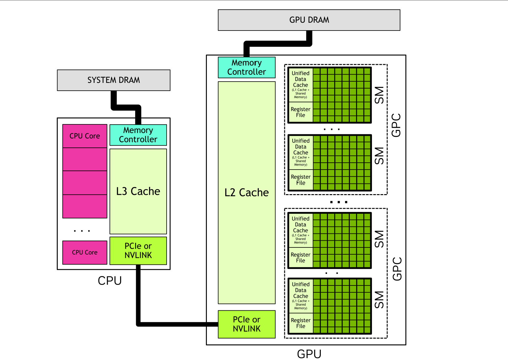

计算机系统有自己的 DRAM，GPU 也有自己的显存。CPU 内部有 L3 缓存，CPU 核心内部也有缓存。CPU 通过内存控制器访问内存，通过 PCIe 或 NVLink 访问显存，在云端训练集群中尤其如此。显卡除了配有显存，也有容量较大的 L2 缓存；每个计算单元内部还有通用数据缓存或共享内存。也就是说，目前先进的 AI 高性能计算系统依然大量依赖缓存技术。在进行 AI 训练和推理时，只有结合硬件资源来设计软件系统，才能获得较高的执行效率。这就是我作为一名软件工程师重视软硬件协同的原因。

缓存替换策略属于系统软件层面的设计，方案有很多，例如最佳替换算法、最近最少使用算法、先进先出算法、最近未使用算法、第二次机会算法和时钟页面替换算法等。我觉得操作系统很有意思的一点，就是可以采用各种不同的设计来满足不同场景的需求。

书中介绍的串口通信标准是 RS-232，目前项目中则经常使用 RS-485。无线局域网中的 Wi-Fi 模块目前也是机器人的标配，毕竟移动机器人无法一直连接网线，需要接入内部局域网或公网。在机器人项目落地后，长期运行的机器人可能会出现 Wi-Fi 模块软硬件故障。因此，在机器人系统设计中通常也要加入诊断模块，并在必要时使用 tcpdump、Wireshark 等网络抓包工具进行分析和诊断。除了 Wi-Fi，使用蓝牙模块连接手柄或其他控制设备，在目前的机器人、尤其是人形机器人中也非常常见。这部分涉及 BSP 的工作，需要将这些软硬件集成到系统中。有些嵌入式设备产品甚至可以通过蓝牙直接与手机相连，然后通过手机中的 App 查看系统状态或操作设备。

设备和计算单元一般会挂载在总线上进行数据收发，这就涉及总线仲裁协议。这类协议在硬件层面本质上仍由电路时序实现。常见方案包括动态集中式并行仲裁、集中式串行（菊花链）仲裁和分布式自选择仲裁等。

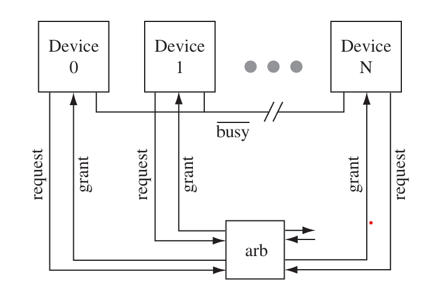

动态集中式并行方案如上图所示。连接总线的所有主设备都与仲裁器相连，仲裁器根据仲裁算法分配总线访问权。

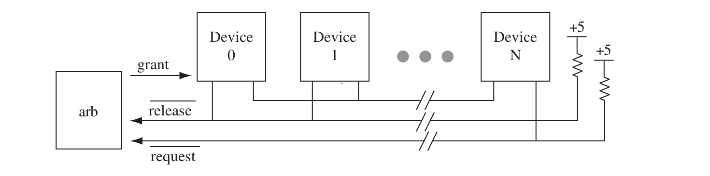

菊花链方案如上图所示。连接总线的主设备按顺序排列。无论哪个主设备发起总线请求，访问权都会沿链路依次传递。例如，设备 1 不需要使用总线时，会将访问权传递给设备 2，以此类推。

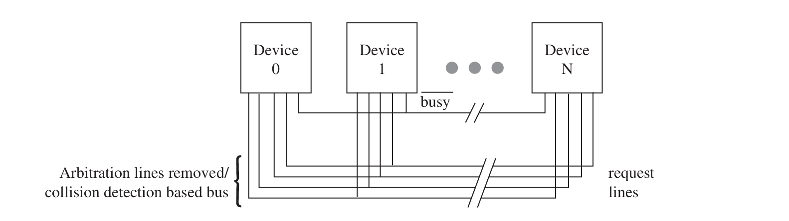

上图为分布式仲裁方案。该方案没有专门的仲裁器和仲裁电路，主设备通过交换优先级信息，确认是否有优先级更高的主设备正在请求总线。当多个主设备同时尝试使用总线时，需要通过仲裁来决定总线访问权。在机器人系统中，CAN 总线采用动态分布式仲裁。

# 3. 设备驱动程序

从这里开始，就进入嵌入式软件部分。坦率地讲，硬件部分让我学得非常吃力。软件分为系统软件和应用软件两大类。系统软件包括设备驱动程序、操作系统和中间件；应用软件是指实现嵌入式设备功能与用途的上层软件，例如 Web 服务等。作者在书中也提到，系统化方法是理解嵌入式系统体系结构与设计最有效的方法之一。这意味着我们需要了解嵌入式软件底层所需的硬件组件。也就是说，想要做好嵌入式软件，就一定要懂一些硬件知识。这是本书强调软硬件协同的目的，也是我阅读本书、撰写这篇文章的初衷。

硬件驱动一般包含以下操作：硬件启动与关闭、启用与禁用、获取与释放、读取与写入、安装与卸载，以及映射与解除映射等。

硬件设备发生某种事件并需要 CPU 处理时，一般会通过中断发出通知。前面介绍了中断分级和优先级。当系统根据这些策略判断某个中断应当打断 CPU 当前执行的任务并插入新的事件处理流程时，就会涉及上下文切换。在这种情况下，系统一般会将 CPU 当前任务的中间状态保存到指定寄存器或压入栈中，然后让 CPU 执行中断处理程序。中断处理完毕后，系统再恢复先前保存的状态并继续执行原来的任务。

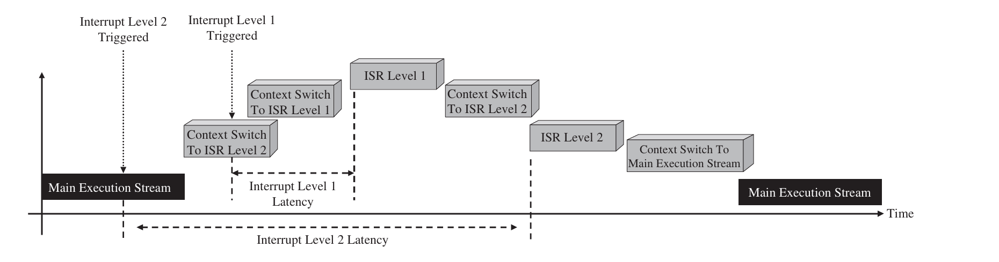

上下文这一概念在计算机领域应用得非常广泛。除了这里的中断处理，一些异步通信库也会对上下文进行抽象，例如 Asio 中的 I/O 上下文；Python 提供了上下文管理器；AI 领域则有提示词上下文等概念。

无论是内存还是外部存储设备，都需要相应的驱动程序。外部存储设备在 Linux 驱动层面一般被定义为块设备。系统通常会配置存储控制器，相关驱动的作用就是让不同的存储控制器适配操作系统规定的接口。除了存储设备驱动，还有总线驱动、以太网驱动等。

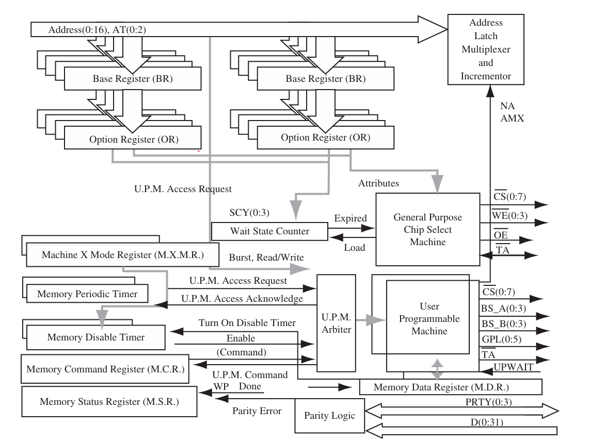

驱动一般由硬件厂商提供。将硬件集成到嵌入式系统时，要么由厂商直接支持所使用的软硬件系统，要么自行编译驱动源代码并将其移植到系统中。如果硬件厂商不提供源代码，通常就无法自行移植，只能通过商务合作获取技术支持。

# 4. 嵌入式操作系统

在嵌入式系统中，操作系统并不是必需的。例如，单片机可以不使用操作系统，直接运行裸机程序。即使是我之前用于开发操作系统的那块树莓派，理论上也可以不安装操作系统而直接运行程序。不过，在实际项目中一般不会这样做，因为操作系统已经提供了完善的接口和功能。与自行操作硬件相比，使用操作系统可以少走很多弯路，也能降低软件难以移植的风险。MCU 如果涉及实时控制等功能，一般会运行 RTOS。

嵌入式领域的操作系统有很多。除了 Linux，还有许多 RTOS，例如 VxWorks、μC/OS、FreeRTOS、RT-Thread 和 QNX 等。

与操作系统进程相关的内容都比较基础，这里不再赘述，主要谈谈实时操作系统（RTOS）。实时性是指任务必须在规定的截止时间前完成。能够满足这类实时性要求的操作系统称为实时操作系统。为了让高优先级任务及时运行，RTOS 通常支持可抢占调度。不同 RTOS 的具体机制差异很大。

内存管理也比较常规。绝大多数 RTOS 没有自动内存管理机制，需要程序员自行管理和释放资源，也有一些 RTOS 带有即时回收机制。美国火星车的嵌入式系统使用 VxWorks，不过火星车对嵌入式软件的要求比常规设备严格得多。如果不同的系统都各自设计 API，上层应用移植起来就会很麻烦；POSIX 标准的作用之一就是统一相关接口。

以常规机器人系统为例，机器人操作系统 ROS 2 本质上也是一种中间件，因为它的底层还有真正负责资源管理和硬件抽象的操作系统。

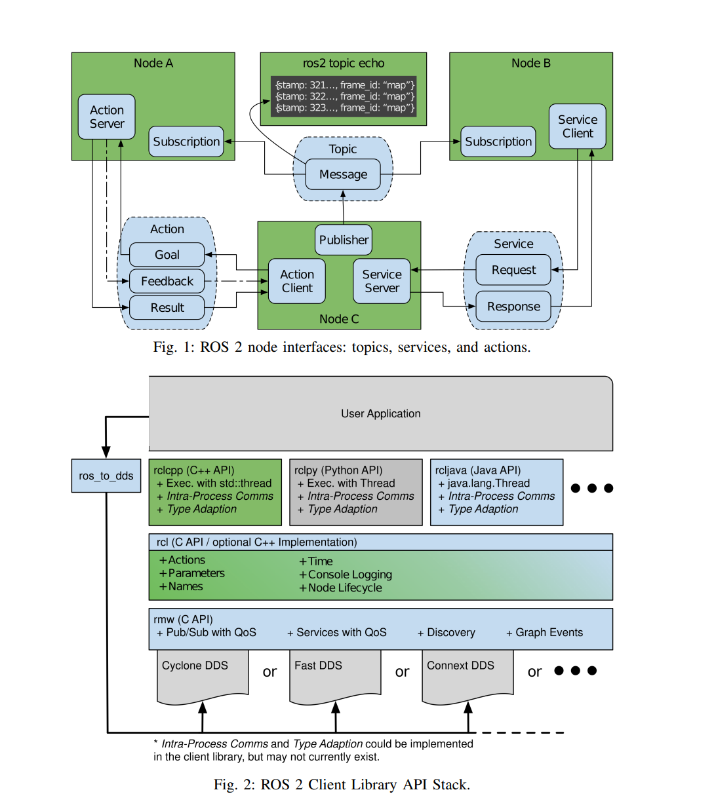

图中展示的都是 ROS 2 中较为常规的内容，这里不再赘述。ROS 2 在真实的机器人产品中有时会显得过于臃肿，在实时场景下也可能存在性能不足等问题。不过，它提供了良好的接口，并拥有丰富的生态。因此，很多机器人本体厂商会在机器内部使用自研或开源中间件，并在此基础上封装 ROS 2 节点供用户调用。至于上层通信服务，类型就更多了。为了满足各种需求，通常还需要加入 HTTP、MQTT、WebRTC 等协议或服务。

书中关于嵌入式研发、测试、部署和项目管理的内容，我就不再展开了。一方面，这些内容比较陈旧，不太符合当前的 AI 发展趋势；另一方面，我主导过不少研发项目，对实际情况已经比较熟悉，而书中的介绍又相对简略。

