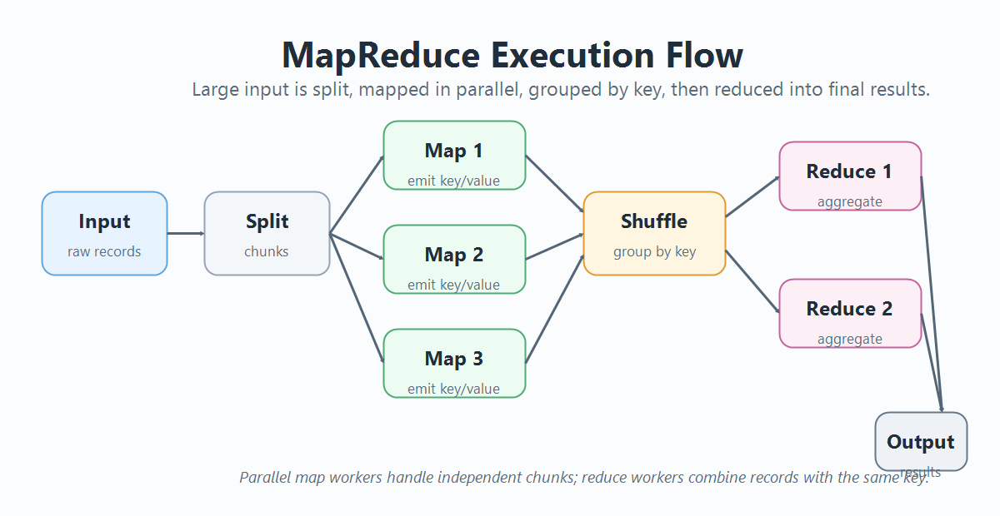
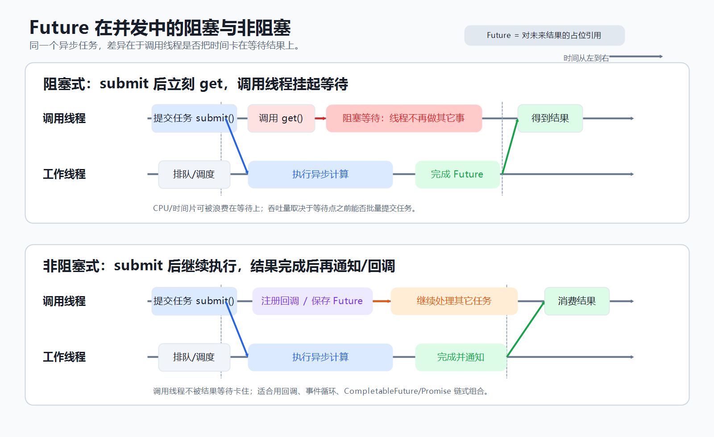
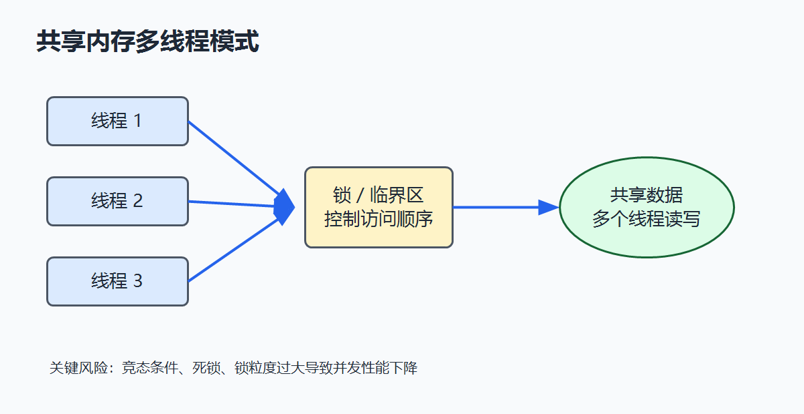
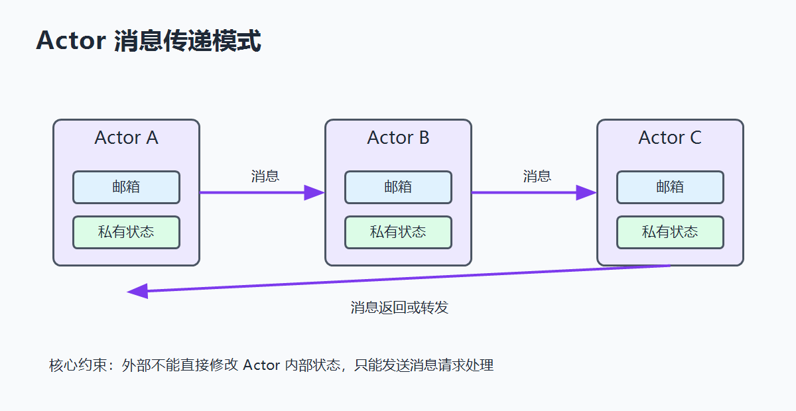

这本书是 2019 年买的，那个时候我开始承接一些研发工作，需要开发一些多线程的功能。比如在嵌入式开发板上开发图像数据处理算法，需要接入多个摄像头。我当时主要负责算法开发，自己是在 OpenCV 源码的基础上修改和优化算法。多路图像数据接入是由负责底层软件的同事编写的，当时使用的是“生产者-消费者”模式，一路视频对应一个线程。后来我从事自动驾驶软件开发，也基本沿用了这种设计思路。整体架构没有太大变化，只是不同的嵌入式平台所使用的编解码硬件和软件 SDK 会有所不同。例如，NVIDIA Orin 平台可以直接使用 CUDA，而一些国产芯片平台则各有各的配套方案。

当时我的工作虽然不涉及多路相机接入，但本着“多学一点是一点”的原则，我买了一些多线程开发的书籍。那时候刚参加工作不久，周围环境对技术并没有提出过高的要求，不过自己多学一些总归能有更多施展的机会，学完之后也确实能在实际项目中得到练手和验证。

在设计模式领域，最经典的当属《Design Patterns: Elements of Reusable Object-Oriented Software》，书中讲解了 23 个经典的设计模式，它们是大型软件开发中必不可少的基石，整本书可以说全是重点。但美中不足的是，该书并未涉及并发条件下的设计模式。而本书正好弥补了这一空缺，讲解的正是并发设计模式。而且，这些都是通用的并发设计模式，在嵌入式应用软件、系统软件以及 Web 后端开发中都会被广泛采用。虽然书中的示例是用 Java 编写的，且设计模式本身与具体编程语言无关，但一些工程实践和语言特性绑定的实现方式仍具有较强的语言相关性。例如，Java 中的 `volatile` 关键字是用来保证 CPU 缓存与主存之间数据一致性的，而 C++ 中的 `volatile` 则主要用于防止变量被编译器过度优化。

# 1. 并发简介

并行与并发虽然有很大的重叠，但它们并不完全是一回事。并行类似于在公路上并排设置了三个收费站，可以同一时间处理三辆车，这是真正意义上的“同时进行”。而并发则类似于一个人正在刷牙，这时突然来了电话，他接听电话并进行通话，通话结束后再继续刷牙；虽然在任意微观时刻他只能做一件事，但从宏观上可以看作他在“并发”地进行刷牙和打电话。在现代计算机体系下，系统会划分时间片，线程被 CPU 调度执行。即使是在单核 CPU 上，多个任务也可以通过交叉执行，在用户看来就如同多个任务在同时运行。如果将并行与并发结合起来，那就是多核 CPU：它既可以在不同核心上并行地处理任务，又可以在每个核心上并发地运行多个程序。

一个很经典的模式是 MapReduce：把一个计算量比较大的问题先拆分成相对独立的部分，然后让独立的计算集群分别计算各自的部分，计算完成后再将结果汇总到输出节点。使用该模式的前提条件是，问题本身能够被拆分且支持并行处理。



并发编程模型主要有两种：消息传递（Message Passing）和共享内存（Shared Memory）。消息传递模型的一个典型例子就是 Linux 管道，比如：

```shell
echo "hello linux pipe" | tr a-z A-Z | wc -c
```

上述 Linux 命令行命令会创建三个子进程，数据由上游进程传递给下游进程：

```
[echo] ---> [tr] ---> [wc]
```

共享内存模型（这里说的不是操作系统底层的共享内存接口，但基本原理类似），例如同一个进程内的多个线程共享该进程的虚拟地址空间，因而能够直接共享内存数据。当有线程对共享内存中的数据进行修改时，就必须引入锁机制，利用临界区（Critical Section）来确保数据的一致性与线程安全。

在多线程环境下存在一个竞态条件（Race Condition）问题，即程序的正确性取决于多个线程被调度的相对时序。在我的实际工作中，最近就经常遇到此类问题。此前我负责修复 RK3588 平台的一些 Bug，那些多线程 Bug 基本上都是因为在设计阶段对数据时序的假设不合理而埋下的隐患。多线程 Bug 的一个典型特征是极度依赖特定的执行时序，这意味着它们往往难以稳定复现，只有在极其偶然的特定时序条件下才会暴露。这给实际项目中的调试与排查带来了极大挑战。因此，在架构设计阶段就需要充分考虑并发安全性，并在开发过程中配置一些工具来尽可能提前检测。

# 2. 并发模式初探

以前我很不理解为什么 Go、Python 或 curl 的 C 源码调用中都有“上下文”这个概念。从高层次的角度看，这个概念的确不太好理解，需要把思路转到系统底层的汇编和硬件寄存器上才行。在并发环境下，系统的线程包含上下文，这个上下文就是寄存器数据信息和堆栈。线程在被系统调度时，会把 CPU 的堆栈信息切换给新的被调度线程使用，旧的线程上下文信息则需要保留下来，等到下次被调度进入 CPU 时继续执行。

书里面说了一下单例类在多线程环境下可能存在竞态的问题，核心原因在于单例类中的静态成员变量在多线程条件下并不安全，需要设计专门的保护措施。不过这些方案目前都比较成熟，使用 AI 时把限定条件说清楚，基本上就可以生成可用的实现。但是如果约束不强，AI 也可能会写出存在多线程隐患的 Bug。

对于共享数据，保护其在多线程条件下安全的最基本方法就是加锁。只不过如果对一个数据结构加锁的粒度太大，会导致很多线程被阻塞，进而影响系统并发性能。书里面举了个例子：第一个原始版本是对整个链表加锁，并发性能比较差；第二个版本改成对每个节点加锁，但是这样会引发死锁问题，因此需要在设计代码时按照一个固定的顺序获得锁和释放锁。

在多线程应用中，生产者消费者模式是非常常见的。像我前面提到的相机数据获取就是一个例子。一般这种都是使用互斥元加条件变量来做，只是说由于操作系统设计的时候，为了提升系统的性能以及降低操作系统内核设计难度，往往在系统提供的底层多线程编程模型中，不会去限制虚假唤醒的情况，这就需要使用这种模式的应用开发者自己在代码中做检测，避免虚假唤醒。

另外一点就是对共享数据加锁的代价比较大。现代编程语言一般都会提供原子编程接口，原子操作是多线程安全的，代价比加锁小得多，而且不会阻塞等待线程。对于一些高性能场景，可以使用这种原子编程模式。比如我之前做高速数据采集软件时，就是使用原子编程加共享内存来设计数据临时存储。

# 3. 更多的线程模式

有界缓冲区是多线程数据传输最基本的方式，像生产者消费者模式基本就用这个来传递数据。线程进行轮询来检测有界缓冲器中数据情况是一种比较简单的方法，但并不高效。更系统的方法是使用条件变量，只不过需要在线程被唤醒后检测是否是虚假唤醒。

读写锁的设计主要是面向读的次数比较多，写没有那么频繁。此处需要考虑线程配置策略，比如说如果让读优先，可能会造成写入线程饥饿。

计数信号量是用于一些有数量限制的共享资源，比如线程池或者连接池之类的，只要有剩余的就给调用线程使用，没有的话新的线程就需要等待。

循环屏障要求所有参与线程都等待到同步条件满足后才可以继续执行，它是一种同步手段。这个过程类似于很多人一起游玩，首先要到集结点集合，等人凑齐后才能开始下一步旅行动作。内存屏障或者 CUDA 中的屏障，本质上也都是同步手段。它们要保证的事情是：到达这个屏障位置之前的操作都要完成，不能越过这个屏障。因为编译器或者底层硬件有时候为了优化性能会对代码进行重排序，但是在一个逻辑中需要保证数据状态的同步。

Future 是异步编程中非常核心的功能。在使用线程池这类方式进行异步编程时，任务会被委托给线程池中的线程执行，而 Future 表示一个未来才能获得的结果。当调用线程通过 `get()` 获取这个结果时，如果线程池已经计算完成，就返回结果；如果还没有计算完成，就需要等待。我看 Web 前端中也有这些概念，前后端都这么干。

# 4. 线程池

线程池也是非常常用的并发设计模式。进一步说，池化也是大型系统设计中非常常用的方法，比如内存池、连接池、对象池等等。本质上，这些方法都是根据系统性能对资源调用做限制，避免整个系统被大量请求拖垮。

在多路视频处理的系统中，我前面说的每路视频手动创建一个线程进行视频编解码/渲染/算法处理是可以的，更系统的方法是使用线程池。比如在自动驾驶项目中，不同的车型配置的相机数量并不固定，如果在代码中全部手动写死，对于多车型适配和快速项目落地并不友好。如果使用配置文件加上线程池对系统进行配置，就可以复用代码，加快项目部署交付速度。

很多 Web 异步框架底层都会使用线程池结构，把任务包装成 Runnable，交给线程池处理，进而提升服务的并发处理能力。如果只是使用调用线程池的框架，操作还是比较简单；如果自己实现一个线程池，则需要比较扎实的并发设计基础。我以前待的一个团队面试时就直接让候选人从零手写一个线程池，感觉有点残酷。

# 5. 提升并发性

这部分主要就是用原子编程来实现无锁数据结构，从而提升并发性。链表、队列、哈希表都可以做无锁设计，只是设计复杂度会更高一些。比如锁条纹设计模式，就是把整个哈希表上的单个锁拆分为更多的小锁，用到哪个取哪个，不会对其他区域造成锁定，从而提升并发能力。这块的基本思路大致都是这样。所谓无锁也不是真正的无锁，只是锁的粒度更低，并被系统直接封装了而已。

# 6. 函数式并发模式

Future 是函数式并发和异步组合中常见的基础抽象。它既可以用 `get()` 这类方式阻塞等待结果，也可以通过回调、事件循环或链式组合继续执行后续任务。



Rust 的设计目标之一就是在不依赖垃圾回收的前提下提供内存安全和并发安全，尤其是减少共享可变状态带来的数据竞争问题。因此，Rust 默认让变量不可变；如果需要修改变量，必须显式声明为 `mut`。更核心的是，Rust 通过所有权和借用检查，在编译期约束“共享”和“可变”不能随意同时存在，从而降低并发编程中的安全风险。Rust 的设计团队有浏览器研发背景，浏览器本身又是典型的高并发、高复杂度系统，因此正好适配这种场景。

# 7. Actor 模式

使用多线程去修改共享数据时，不论锁的粒度大小，都会存在一定的并发风险，设计和调试也会比较困难。Actor 模式的核心思路是：不要让多个线程直接共享和修改同一份状态，而是把状态封装在一个个 Actor 内部，Actor 之间只通过消息通信。

一个 Actor 可以理解为一个拥有私有状态和消息邮箱的并发对象。外部不能直接访问它内部的数据，只能向它发送消息。Actor 从自己的邮箱中按顺序取出消息，然后根据消息内容修改内部状态、执行计算，或者继续向其他 Actor 发送消息。这样一来，同一个 Actor 内部的状态在逻辑上是串行处理的，不需要像共享内存模型那样到处加锁。





两种模式最大的区别在于状态归属不同。共享内存多线程模式是多个线程共同访问同一份数据，因此必须使用互斥锁、读写锁、条件变量或者原子操作来保护共享数据。Actor 模式则把状态限制在 Actor 内部，其他 Actor 或线程不能直接读写这份状态，只能通过消息请求它做事。

共享内存模型的优点是直接、高效，适合一些性能敏感且数据结构比较清晰的场景，例如底层系统开发、实时数据处理、图像处理流水线等。但它的问题也很明显：锁的粒度不好设计，锁太大会降低并发性能，锁太小又容易引入死锁、竞态条件和复杂的时序 Bug。很多多线程问题之所以难排查，就是因为程序正确性依赖于非常偶然的线程调度顺序。

Actor 模式通过消息传递把这种复杂度转移到了消息队列和 Actor 调度上。每个 Actor 只处理自己的邮箱，内部状态变化更容易推理。一个 Actor 收到消息后，可以更新自己的状态，也可以把新消息发给其他 Actor。这种方式天然适合事件驱动系统、分布式系统、聊天系统、订单状态流转、任务编排、游戏服务器和 IoT 设备管理等场景。

不过 Actor 模式也不是没有代价。首先，消息传递通常会带来额外的队列、序列化、调度和上下文切换开销。其次，如果消息设计不好，系统会变成大量 Actor 之间互相发送消息，调用链路反而不如普通函数调用直观。再者，Actor 之间没有共享调用栈，错误处理和超时处理也需要单独设计，比如消息丢失、重复投递、Actor 崩溃后的恢复策略等。

从工程角度看，可以把共享内存多线程模式理解为“多个执行单元直接争用同一份数据”，而 Actor 模式则是“每份数据都有明确的负责人，其他执行单元只能通过消息和负责人交互”。前者关注如何安全地共享数据，后者关注如何通过消息避免直接共享数据。

如果放到我前面提到的多路相机处理场景中，共享内存模式可能是多个线程共同访问一个图像缓冲区，然后通过锁或原子变量控制读写状态。而 Actor 模式可以把每一路相机、解码器、算法模块、渲染模块都看作独立 Actor：相机 Actor 采集图像后发送帧消息给解码 Actor，解码 Actor 再把结果发送给算法 Actor，算法 Actor 最后把检测结果发送给渲染 Actor 或融合 Actor。这样数据流和职责边界会更清晰，也更适合扩展到多设备、多节点或者分布式部署。

简单总结一下：共享内存模型的核心问题是“谁能同时访问这份数据”，Actor 模式的核心问题是“这条消息应该交给谁处理”。两者不是谁完全替代谁的关系，而是适合不同层次的并发设计。底层高性能模块里，共享内存和原子操作仍然很重要；而在业务状态复杂、模块之间交互频繁、系统需要扩展和容错的场景中，Actor 模式往往会让整体结构更容易维护。

书里面用 Scala 作为例子，不过这个语言我没用过，不是很懂。不过背后的并发原理跟具体语言没有强绑定。像 Go 语言的设计哲学，其实也是推崇使用消息传递来进行线程间通信。

