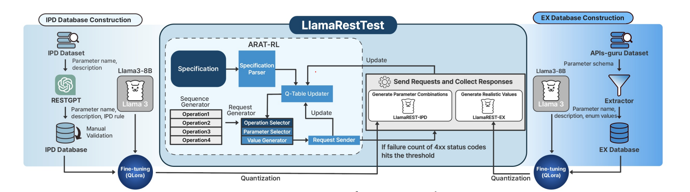
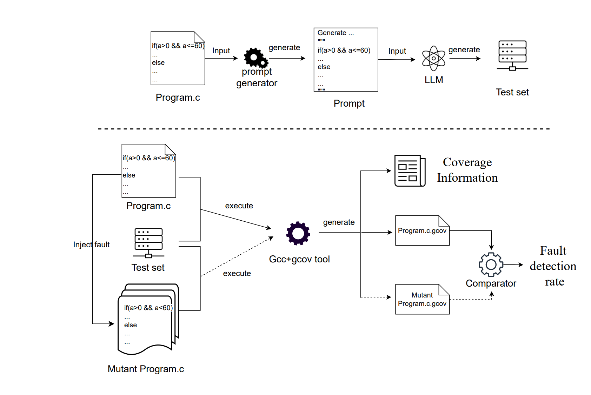

我依稀记得，在我刚开始工作的时候，由于之前没有接触过机器人，也没有接触过工业级编程，我的工作内容是做机器人应用和技术支持，后面补了一点 Python，又做软件测试和机器人测试。那时候属于一边学习一边给研发做测试。后面做一些机械臂的操作和编程、相机内外参标定、模型训练测试等工作，写一些简单的 Python 脚本做点自动化测试。从那个时候的体感来讲，基本上做测试的人的技术水准是低于研发的，我在那个时期也是如此。不过我比较好学，也不甘心只做很低水平的事情，在工作中经常去参考一些清华技术大佬的做法，回家拼命看书、看开源项目，补全自己的技术能力，逐步就转去做软件研发和算法研发。纵观我身边接触的人的发展轨迹来看，能从技术支持 -> 软件测试 -> 项目经理 -> 软件研发 -> 算法研发 -> 算法工程化 -> 软件架构这条路径完整做下来的人是非常少见的。做任何事情都有代价，我的代价是多年时间基本没有假期，阅读了大量国内外专业著作和开源项目，并亲自参与非常多的实际项目落地去踩坑。

就测试这个岗位而言，一般的软件测试人员的技术能力普遍低于研发。就我看到的身边做测试的同事的很多例子而言，也是如此。因为就薪资而言，最近十几年都是算法岗 > 研发岗 > 测试岗，所以如果一个测试人员的技术水准已经达到研发的门槛或者超越了，那么用不了多久就大概率会转岗走。但是这并不意味着所有的测试技术都差。尤其一些大厂目前把很多低端测试岗位给了外包，让他们点点点做一些人肉测试，把技术含量高一点的岗位设置成测试开发，然后招聘很多做过研发的工程师来做测试开发，所以这部分人的技术水平整体还算不错，很多人后来都转研发或算法了。

这本书是我 2021 年买的，当时要去做一些测试开发的工作，就参考了一下。这本书的作者是软件领域的技术大佬，书比较经典，里面很多概念性理论在当下仍然具有很高的价值，不过在现代测试体系的构建与现代软件测试工具方面没有太多实操介绍。这意味着如果仅仅看书中的内容，却缺乏现代软件工程体系的洗礼，是很难真正搭建好一套软件测试体系的。比如缺乏 DevOps 体系与测试体系的融合介绍，缺乏基于 AI 的现代智能软件工程体系，缺乏现代的自动化测试工具链，缺乏质量工程与测试左移的一些介绍，缺少适配软硬件测试体系的搭建介绍，等等。

就像我前面说的，软件测试本身并不是一个没技术含量的事情，只是这个岗位很多人做的事情内容是使用工具而已。举个例子，我之前跟清华软件学院的老师以及一些创业者合作，使用产学研的方式做了很多测试工具，这些测试工具都需要进行核心算法设计，工程优化等，很多都是清华硕博的研究生课题，比如做操作系统内核测试工具来检测内核的安全隐患就需要非常懂内核的知识以及Rust，比如做工业协议测试就要同时很懂嵌入式和硬件。在底层系统软件测试中使用的内存测试工具Valgrind，Clang工具链的AddressSanitizer，底层软件性能测试工具ftrace，perf，磁盘与文件系统性能测试工具fio，各种语言的单元测试gtest，gbenchmark，pytest等等，使用这些工具往往就设置一些命令行参数就行，这在有AI辅助的条件下非常容易。可是根据实际情况自己魔改这些工具，甚至开发出更优秀的测试工具，对技术门槛和能力要求就比较高了，甚至技术难度要高于一般的研发。

另外，当下 AI 正在重构软件工程范式。包括一些模式，最简单的就是直接使用 AI 的 Harness 框架让 AI 自动调用测试工具，因为常见的测试工具，AI 早就学过网络上的相关资料了，配上 Harness 工具，就可以根据输入自动调用工具链。更进一步，可以把相关的 AI 功能集成到 CI/CD 流水线中，进一步提升整个体系的自动化和智能化水平。这属于比较基础的。相对前沿一点的可以参考一些会议，比如 ACM SIGSOFT International Symposium on Software Testing and Analysis（ISSTA）。写点好玩的，比如说使用强化学习加速运行期验证；使用多智能体协作将代码适配到新的平台，智能地进行 API 替换和重构，并自动分析修改后的代码是否正确；AI Agent 的上下文注入风险检测；对智能体推理调用链进行测试分析；基于 LLM 的自动硬件在环测试系统设计；优化构建过程中的依赖关系，加速构建速度并提升质量。

我觉得还有一点很重要的就是测试系统的架构设计。这个架构设计既要跟整体软件系统的架构设计相协调，也要嵌入到整个 DevOps 体系中。比如在机器人系统中，软件非常依赖不同的嵌入式平台、传感器和算法，这意味着要让软件系统长期稳定、正确地运行，在测试系统的搭建上就需要考虑平台与适配差异，做好抽象，并搭建起软硬件测试环境，支持并行测试，等等。在具身智能方向上，还涉及模型的仿真与评测，而目前具身智能领域的大语言模型，需要配套 GPU 集群进行并行仿真与评测。而且现代软件工程推崇测试提前介入，在需求评审阶段，测试就要介入，评审产品需求、软件架构设计与功能设计。

这本书的作者是软件领域的非常资深的专家，我看过他写的很多书籍。

# 1.基本的概念
软件本身就是一个工程，因此软件测试也是工程。一个通过测试的程序不能证明其一点问题都没有，仅仅是说明它通过了测试，这点很重要。对于一个软件产品，Bug 是伴随产品整个生命周期的，而不是仅仅在产品发布前的测试阶段才出现的。只不过，测试体系应该保证已经发生过的错误能够被纳入测试体系，并且当产品再次出现这些问题时，可以被测试体系发现。除此之外，还要追求使用有限的资源，尽可能多地把错误拦截在产品发布之前。这里只是尽可能，没有办法保证一定都能拦截住。同时也应该意识到，没有人可以把一个大型软件的所有运行状态全部枚举出来，这就需要设计巧妙的测试方案来提升测试效率。

测试用例一般研发和测试都要写。研发一般会做一些单元测试，比如写一个重要的软件功能，需要使用工具检测单元测试的代码覆盖率，如果覆盖率不满足比如70%以上的要求，连代码合并都会被禁止。一个在开源软件非常经典的例子就是数据库SQLite，这个数据库应用十分广泛，测试代码比正式功能代码还多。

黑盒测试是指在不知道内部源码的情况下，直接使用测试用例作为输入，并将获得的输出与预期输出进行对比的测试。白盒测试是指可以拿到程序源码，甚至可以检查程序的内部结构。需要明确的是，无论是测试用例的穷举还是测试路径的穷举，对于大型软件都没有办法穷举完，或者说就算穷举完也不能保证程序的完全正确性。

软件测试有一些原则：测试用例中需要包含对预期输出结果的定义（这是编写测试用例的基本原则）；程序员应该避免测试自己编写的程序（这不是绝对的原则，程序员要对自己写的程序进行测试的，只是自己测试属于最开始的自测环节，后面需要其他人再测试一下，避免一些惯性思维之类的事情）；应该彻底检查每个测试结果（一般会把测试用例集成到自动化测试框架中）；测试用例的编写不仅应当包含有效的输入和预期输出，也应该包含无效的输入和未预料的输入（也就是说在编写测试用例的时候，需要设计一些非法输入查看程序预期处理结果）；除了要测试程序做没做应该做的事情，还要测试程序是否做了不应该做的事情；避免测试用例用后即废弃（将测试用例集成到测试框架和 CI 流水线中，伴随每次新代码构建就直接使用已有测试用例保证软件质量）；计划测试工作时不应该默许不会发生错误；程序某部分存在更多错误的可能性与该部分已经发生错误的数量成正比；软件工作需要创造性（软件测试这件事情本身并不水，一般来讲我觉得水的是人，软件测试可以做得非常厉害，只是不厉害的人做不出厉害的事情）。

# 2.代码评审
这部分书中一些具体方法都过时了。软件开发如果是比较规范的技术团队，是需要做Code Review的。现在像Claude Code都自带Review功能，可以把需要提交的代码先让AI过一遍，顺便过一些单元测试。另外Review的内容也在发生变化，以前都是Review代码，现在代码生成的成本很低了，而代码生成的速度非常快，人的速度是跟不上的，因为Review的内容也逐步从代码转为方案和设计文档，比如使用SDD开发范式，我一般都是把产品设计和架构设计放在指定文件夹，然后让AI读取指定的设计文档自动生成代码。另外这种源码级别的测试很多可以跟编译器工具链结合，比如LLVM等，在源码编译阶段生成用于测试的代码插桩，然后让代码在运行中不断生成新的语料输入来测试软件中的缺陷。

换言之，曾经大量需要人做的事情，AI 已经可以做得非常好了。除此之外，AI 可以调度测试工具，自动分析代码中的问题，生成问题列表，甚至可以自动修复一些问题。

# 3.测试用例设计
在白盒测试中，由于可以拿到源码，可以针对源码级别的进行非常细化的测试用例编写。比如进行分支覆盖，把每一个条件分支判断的正确与错误的情况都编写测试用例生成对应结果。更细化的可以做条件覆盖，就是对代码中每一个条件判断编写测试用例，每个判断中每个条件都有一次测试用例执行。这些测试的判断基准是可以集成到专门测试工具中实现的。

黑盒测试由于没有源码，没办法像白盒那样做很多针对性的细致测试，同时也没办法穷举所有测试用例，对测试用例的设计要求会更高。首先需要严格控制测试用例的数量，设计测试用例需要尽可能覆盖核心使用场景。黑盒测试中有一个方法叫作有效等价类，比如说接口设计输入范围是 1～199，那么输入 32 是一个有效等价类的代表值，而 0、-1、200 是无效等价类的代表值。从这里可以看出来，这种测试用例生成本质上是基于逻辑学的形式化方法。现在的 AI 有能力理解代码语义信息，这意味着上述黑盒测试思想可以结合 AI 设计出全新的测试工具。
EvoMaster是一个WebFuzzing工具, https://github.com/WebFuzzing/EvoMaster。对于一些测试思路可以参考IBM的论文LlamaRestTest: Effective REST API Testing with Small Language Models。

上图是使用LLM进行REST接口智能测试那篇论文的一个流程图，大模型用的是开源大模型Llama-8B，在核心架构设计上使用了强化学习结合解析器的方法，让 LLM 理解 REST API 参数的语义与参数间依赖关系，再结合强化学习（RL）探索 API 调用序列和参数组合，从而自动生成更“像真实请求”、更容易深入程序状态空间的 API 测试。这个方法真正用的时候不一定直接照搬论文，模型可以换，另外使用强化学习的调度策略在论文中并不是最有，还有解析器的算法设计都可以根据自己实际需求更改。

做软件测试一个非常重要的内容就是需要测试软件各种条件下的边界，包括边界值处理，越界处理是否正确等等。这部分现在也可以用LLM做。上面那篇文章使用的其实是用LLM生成REST测试用例，因为本身是测试Web自定义协议。而下面的测试方案是直接把源码发给LLM模型，让模型结合Harness自行生成测试边界条件，参考Boundary Value Test Input Generation Using Prompt Engineering with LLMs: Fault Detection and Coverage Analysis。实际上边界条件是存在一些特征的，如果设计Agent来更加精细描述特征，我觉得边界检测的精度会比参考论文的要好很多。

单元测试大部分场景是研发自己编写。单元测试由于需要跟源码结合，所以不同的编程语言使用的单元测试框架不同。C++ 的如 gtest、Catch2；Python 的如 pytest、unittest；Java 的如 JUnit；Golang 的如 testing，等等。使用方法都比较类似，就是 mock 测试数据，然后传入函数中运行，看函数的输出结果是不是预期的。

测试体系是分层次的，就像软件架构设计那样，一般都会将一个复杂软件划分为不同层次的模块。测试体系的系统架构也是如此，跟软件是配套的。分为单元级别测试，模块级别测试，场景测试，性能测试，压力测试，集成测试，系统测试，功能测试等等。像功能测试时软件产品最接近用户使用的，所以在公司研发测试体系中，这部分的测试人员往往不需要特别高的技术水准，只要能懂产品的功能，尽可能去验证产品功能就行。系统测试对技术能力要求高一些，需要编写系统的自动化测试脚本比如python脚本或者shell脚本，测试系统功能性能等。

根据不同的测试类型，有很多不同的测试内容。比如能力测试、容量测试、强度测试、可用性测试、安全性测试、性能测试、存储测试、配置测试、兼容性测试、可靠性测试，等等。除此之外，由于现在 AI 模型应用十分广泛，模型的数据集设计、测试专项设计、算法评测体系、仿真体系都是非常重要的。尤其是现在的大模型算法，需要搭建数据飞轮，对 Infra 工具的依赖非常重要。举个例子，大模型在做评测的时候，需要设计不同的领域测试基准，来评价大模型系统的能力。这部分测试数据体系中，有一部分是人类测试专家精选出来的，但是这部分数据成本非常高，不可能所有数据都这样生成。这时候，更大数据量的测试数据就会使用 AIGC 来生成，某种意义上算是仿真数据；数据量很大时，就涉及分布式存储、调度，等等。如果是机器人具身智能模型，还涉及机器人端的遥操作数据采集和数据质量验证。尤其是这种涉及物理 AI 的数据，时空对齐准确度直接决定数据可用性。

# 4.调试
调试一般都是测试工程师发现与预期不一致的行为后，让研发自己过来调试，毕竟功能不是测试开发的，甚至有的测试都没有代码权限。

比较体系化的方式是对于复杂软件系统，都要设计调试日志子系统。那么一般的问题可以直接查看日志。或者在代码中针对一些场景做数据埋点，一旦触发会把当时的数据dump出来，后面用专门的调试工具分析问题。对于一个成熟的软件技术团队，一般都需要自研一些调试工具。像我做机器人，几乎都是这么做的，因为机器人涉及的传感器数据和类型都特别多，还涉及嵌入式和实时控制，AI大模型，所以整个软件系统比较复杂，需要专门设计实现工具链来提升调试效率。很多机器人软件系统喜欢用ROS2，在异构嵌入式平台和高吞吐、低时延场景下，ROS 2 系统可能暴露 executor 调度、DDS 通信、QoS 配置、操作系统实时性和平台适配等多层问题，这类问题通常具有较强的时序相关性，在高速数据流体系下不容易调试。像我以前做人形机器人，机器人偶尔会发生摔倒，只是偶尔发生，那么到底是IMU偏移造成的，还是全身控制算法造成的，还是电机的问题，或者中间件实时性卡顿，还是计算的板子硬件存在问题，如果没有很完善的测试调试体系在，非常难确定。这时非常依赖系统的可观测性体系设计。换言之，测试体系已经延伸进入业务软件架构设计中了。

在调试过程中有一些思路，比如归纳调试法，演绎调试法，回溯法等等。太理论的就不写了，其实我觉得挺好玩的，就跟打游戏一样斗智斗勇。一个人一台机器在那里激情死磕。

对于敏捷开发，想做得又快又有质量，就需要把测试体系配套进 DevOps 体系中，包括使用测试驱动开发、行为驱动开发等一些开发范式。这些在目前互联网大厂都算比较常规的。而且现在 AI 做得非常好，只要把步调调小一点，跟着 AI 逐步检查生成的代码，整体的开发效率相比以前都有数倍提升。需要注意的是，AI 非常容易在代码中写出多线程竞态 Bug。根据我的实践经验，最好在 Harness 体系中配置一些专业的检测工具，或者在 AI 生成代码的过程中就把测试工具配置进去。用一些 Hook 做好兜底，生成代码的质量可以提升很多。

需要说明的是AI目前正在重塑软件工程，目前还处于初期阶段，对就业一定会有很大的冲击，因为生产力爆炸后真的不需要那么多人了。这是一种危机。所以固守以前旧的思维去做事，我认为没有前途。就像我在文章前面介绍的，做有前途的事情，不是玩命的加班燃烧自己，而是要选择对的方向，做别人没有的创造。比如智能的AI测试系统，目前还没有真正改变行业的产品出来，这也是机会。作为现实的人，意识到风险是兜底行为，风险中探索机遇，才有意思！
