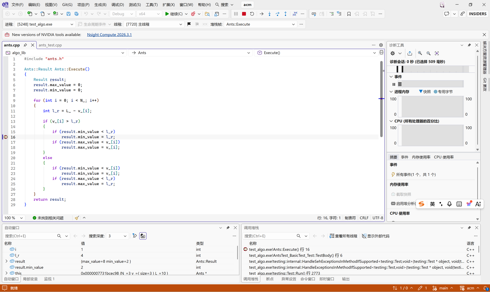
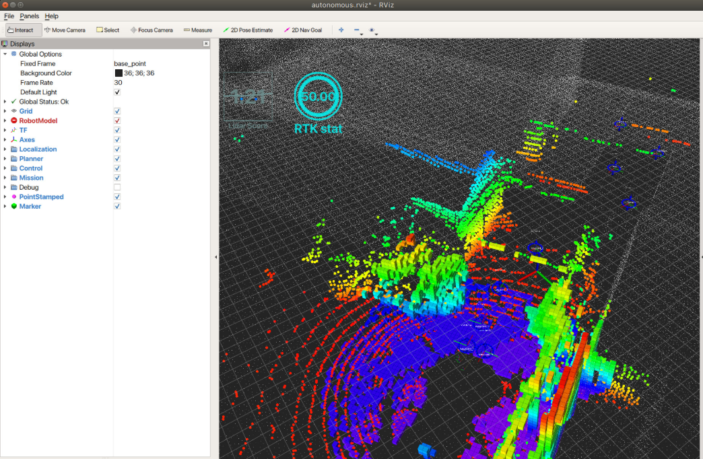

这本书是去年买的，主要讲一些C++调试的方法和内容。整体还是很有实践价值的。不过现在大家代码都不怎么手写，更别说调试了，全部甩给AI干。很明显，不加任何约束地这么做，尤其在产品开发中，是极其不靠谱的。

举个最简单的例子，云端的AI大模型能力越来越强，可是真正到了物理世界，这些大模型做最基本的家务都非常费劲。就像老话说的，读万卷书不如行万里路，现在的AI由于疯狂地拿所有人类的网络资源做训练，它读的书岂止万卷，可是它没有实践，书里的东西是对还是不对，是不是有什么隐藏的条件，对于大模型很难说清。所以构建可靠的复杂系统，需要人学习很多东西，实践很多东西，而不是把AI当成许愿箱。

# 1.调试符号与调试器
在AI出来以前，大部分时间做程序调试我是使用IDE中集成的可视化调试器。如下图所示


这是在VS中进行可视化调试的截图。设置完断点后可以逐步查看每一步执行时变量的值，包括函数的跳转等等。这种方式只能做一些相对简单的调试，如果是持续的数据流，而且是大数据量或者很复杂的数据结构甚至是一些偏算法的，这样调试也不够直观。在ROS中可以使用一些rqt或者rviz之类的工具进行调试或者在上面做二次开发。在具身智能机器人这块，这种调试工具基本上是落地的标配，更完善的还要带仿真的工具。



C++项目一般可以配置debug模式和release模式等，debug模式通常关闭优化（`-O0`）并加上 `-g` 生成调试符号，所以编译出来的文件更大，运行速度也会慢一些。慢主要是因为没有优化，调试符号本身不会加载到运行内存中。调试符号和优化级别其实是两个独立的选项，release版也可以带调试符号（比如 `-O2 -g`）。这些调试符号就是机器码地址、内存数据与程序源代码（行号、变量、类型等）之间的一种复杂映射关系。调试符号没有唯一标准，因此不同编译器和操作系统平台会有差异。Linux下一般用DWARF格式，Windows下MSVC用PDB（MinGW和Clang在Windows上也可以生成DWARF）。

```cpp
int gInt =1;

int GlobalFunc(int i)
{
    return i+gInt;
}
```
上面是一个简单的函数，用Linux的g++编译，生成debug版本的汇编文件

```shell
g++ -g -S foo.cpp
```

```asm
	.file	"foo.cpp"
	.text
.Ltext0:
	.file 0 "/home/devops/projects/debugger" "foo.cpp"
	.globl	gInt
	.data
	.align 4
	.type	gInt, @object
	.size	gInt, 4
gInt:
	.long	1
	.text
	.globl	_Z10GlobalFunci
	.type	_Z10GlobalFunci, @function
_Z10GlobalFunci:
.LFB0:
	.file 1 "foo.cpp"
	.loc 1 4 1
	.cfi_startproc
	endbr64
	pushq	%rbp
	.cfi_def_cfa_offset 16
	.cfi_offset 6, -16
	movq	%rsp, %rbp
	.cfi_def_cfa_register 6
	movl	%edi, -4(%rbp)
	.loc 1 5 13
	movl	gInt(%rip), %edx
	.loc 1 5 14
	movl	-4(%rbp), %eax
	addl	%edx, %eax
	.loc 1 6 1
	popq	%rbp
	.cfi_def_cfa 7, 8
	ret
	.cfi_endproc
.LFE0:
	.size	_Z10GlobalFunci, .-_Z10GlobalFunci
.Letext0:
	.section	.debug_info,"",@progbits
.Ldebug_info0:
	.long	0x78
	.value	0x5
	.byte	0x1
	.byte	0x8
	.long	.Ldebug_abbrev0
	.uleb128 0x1
	.long	.LASF2
	.byte	0x21
	.long	.LASF0
	.long	.LASF1
	.quad	.Ltext0
	.quad	.Letext0-.Ltext0
	.long	.Ldebug_line0
	.uleb128 0x2
	.long	.LASF3
	.byte	0x1
	.byte	0x1
	.byte	0x5
	.long	0x44
	.uleb128 0x9
	.byte	0x3
	.quad	gInt
	.uleb128 0x3
	.byte	0x4
	.byte	0x5
	.string	"int"
	.uleb128 0x4
	.long	.LASF4
	.byte	0x1
	.byte	0x3
	.byte	0x5
	.long	.LASF5
	.long	0x44
	.quad	.LFB0
	.quad	.LFE0-.LFB0
	.uleb128 0x1
	.byte	0x9c
	.uleb128 0x5
	.string	"i"
	.byte	0x1
	.byte	0x3
	.byte	0x14
	.long	0x44
	.uleb128 0x2
	.byte	0x91
	.sleb128 -20
	.byte	0
	.byte	0
	.section	.debug_abbrev,"",@progbits
.Ldebug_abbrev0:
	.uleb128 0x1
	.uleb128 0x11
	.byte	0x1
	.uleb128 0x25
	.uleb128 0xe
	.uleb128 0x13
	.uleb128 0xb
	.uleb128 0x3
	.uleb128 0x1f
	.uleb128 0x1b
	.uleb128 0x1f
	.uleb128 0x11
	.uleb128 0x1
	.uleb128 0x12
	.uleb128 0x7
	.uleb128 0x10
	.uleb128 0x17
	.byte	0
	.byte	0
	.uleb128 0x2
	.uleb128 0x34
	.byte	0
	.uleb128 0x3
	.uleb128 0xe
	.uleb128 0x3a
	.uleb128 0xb
	.uleb128 0x3b
	.uleb128 0xb
	.uleb128 0x39
	.uleb128 0xb
	.uleb128 0x49
	.uleb128 0x13
	.uleb128 0x3f
	.uleb128 0x19
	.uleb128 0x2
	.uleb128 0x18
	.byte	0
	.byte	0
	.uleb128 0x3
	.uleb128 0x24
	.byte	0
	.uleb128 0xb
	.uleb128 0xb
	.uleb128 0x3e
	.uleb128 0xb
	.uleb128 0x3
	.uleb128 0x8
	.byte	0
	.byte	0
	.uleb128 0x4
	.uleb128 0x2e
	.byte	0x1
	.uleb128 0x3f
	.uleb128 0x19
	.uleb128 0x3
	.uleb128 0xe
	.uleb128 0x3a
	.uleb128 0xb
	.uleb128 0x3b
	.uleb128 0xb
	.uleb128 0x39
	.uleb128 0xb
	.uleb128 0x6e
	.uleb128 0xe
	.uleb128 0x49
	.uleb128 0x13
	.uleb128 0x11
	.uleb128 0x1
	.uleb128 0x12
	.uleb128 0x7
	.uleb128 0x40
	.uleb128 0x18
	.uleb128 0x7a
	.uleb128 0x19
	.byte	0
	.byte	0
	.uleb128 0x5
	.uleb128 0x5
	.byte	0
	.uleb128 0x3
	.uleb128 0x8
	.uleb128 0x3a
	.uleb128 0xb
	.uleb128 0x3b
	.uleb128 0xb
	.uleb128 0x39
	.uleb128 0xb
	.uleb128 0x49
	.uleb128 0x13
	.uleb128 0x2
	.uleb128 0x18
	.byte	0
	.byte	0
	.byte	0
	.section	.debug_aranges,"",@progbits
	.long	0x2c
	.value	0x2
	.long	.Ldebug_info0
	.byte	0x8
	.byte	0
	.value	0
	.value	0
	.quad	.Ltext0
	.quad	.Letext0-.Ltext0
	.quad	0
	.quad	0
	.section	.debug_line,"",@progbits
.Ldebug_line0:
	.section	.debug_str,"MS",@progbits,1
.LASF3:
	.string	"gInt"
.LASF2:
	.string	"GNU C++17 13.3.0 -mtune=generic -march=x86-64 -g -fasynchronous-unwind-tables -fstack-protector-strong -fstack-clash-protection -fcf-protection"
.LASF5:
	.string	"_Z10GlobalFunci"
.LASF4:
	.string	"GlobalFunc"
	.section	.debug_line_str,"MS",@progbits,1
.LASF0:
	.string	"foo.cpp"
.LASF1:
	.string	"/home/devops/projects/debugger"
	.ident	"GCC: (Ubuntu 13.3.0-6ubuntu2~24.04.1) 13.3.0"
	.section	.note.GNU-stack,"",@progbits
	.section	.note.gnu.property,"a"
	.align 8
	.long	1f - 0f
	.long	4f - 1f
	.long	5
0:
	.string	"GNU"
1:
	.align 8
	.long	0xc0000002
	.long	3f - 2f
2:
	.long	0x3
3:
	.align 8
4:

```
上面这个汇编代码包含很多的节（section），里面有大量的调试符号。这还是很短的高级代码，如果是一个使用iostream的简单hello world，生成的带调试信息的汇编文件动辄就有几千到上万行（具体取决于编译器版本和 `-g` 级别）。其中 `.debug_info` 里的调试信息条目（DIE）是按照树的数据结构组织的。比如说 `.debug_abbrev` 中存储描述DIE标签和属性编码格式的缩略表，用来压缩调试信息的体积，`.debug_info` 节包含核心的调试信息，`.debug_line` 中存储指令与源码行号映射表（这就是在IDE里面进行单步调试用的底层原理。汇编里这一节是空的，行号表是汇编器根据 `.loc` 指令生成的）。`.debug_frame` 中存储调用帧信息（CFI），描述在每个指令地址上如何恢复栈帧和被调用者保存的寄存器，调试器就是用这些信息来回溯调用栈。x86-64 Linux上GCC默认生成的是由 `.cfi_*` 指令产生的 `.eh_frame`，作用相同。变量存放在哪个寄存器或栈位置，则记录在 `.debug_info` 和 `.debug_loclists` 中。

书里面讲了一个示例是服务器的程序随机崩溃，其实我在设计中间件的时候也遇到过这样的bug，原因也是一样的。同一份数据结构，没有复杂的操作，在不同模块会被构造成不同的尺寸大小和内存布局。很显然把大尺寸的数据传输到小尺寸的内存布局中，就会发生越界访问和内存损坏。原因就是一个模块里结构体按默认规则对齐，而另一个模块由于头文件包含顺序问题受到了 `#pragma pack` 的影响（或者编译选项、宏开关不同），没有按同样的规则对齐，导致同一个结构体在两个模块中内存布局不一致，本质上属于违反了ODR（单一定义规则）。这样数据一更新就会破坏周围的对象，造成随机崩溃。内存对齐这个事情对于计算效率是有帮助的，同一平台上的对齐规则由ABI规定，但是 `#pragma pack`、编译选项等都会改变它，尤其在大型C++项目中不同的模块是不同团队开发的，很多设计信息没办法保证及时对齐。

在Linux平台一般使用GDB调试器，GDB调试运行中的进程时会使用操作系统内核提供的ptrace（分析core dump文件只是读取文件，不需要ptrace）。在机器人本体或者一些智驾项目中，经常会出现产品发布出去后发生了运行时崩溃，如果事先配置好（比如 `ulimit -c unlimited`、`core_pattern` 或systemd-coredump），就会生成core dump文件，调试器可以分析这种文件。这种文件保存了崩溃发生时进程的快照。我以前就经常在这种文件中寻找各种蛛丝马迹，诊断系统崩溃原因。core dump文件只包含 `coredump_filter` 选中的内存映射，默认不包含只读的代码段。它对应的是被选中的虚拟内存映射而不是实际占用的物理内存（RSS），从未访问过的匿名页会以稀疏文件空洞的形式写出，所以 `ls -l` 看到的文件大小可能远大于RSS和实际占用的磁盘空间。

# 2.内存问题

C++开发的程序，内存错误占比非常高，而内存错误也非常容易产生安全漏洞。书里面讲了两种内存管理器，一个是Linux下glibc默认的ptmalloc，另外一个是Google推出的用于支持构建高性能并发程序的TCMalloc。了解一点这些内存管理器的原理和数据结构，对于排查一些内存问题是有帮助的。说实话我目前来讲没怎么遇到过这种，这属于比较资深的C++技术问题。

软件内存损坏，行为是未定义的，什么事情都可能发生。比如随机崩溃，数据错配，计算异常等等。内存损坏的原因有以下几种，比如缓冲区上溢或者下溢（这种会带来很严重的安全问题，很容易被专业黑客当作靶点执行任意代码，如果进程以root运行或者再配合提权漏洞，就能获取系统最高权限），访问释放的内存（这种在大型软件多线程多模块条件下尤其常见，单线程中悬空指针、迭代器失效也会导致，现代C++还是有一些方法应对的），重复释放（double free）以及 `new`/`delete[]` 不匹配，使用未初始化的值（这种问题可以把 `-Wuninitialized` 等编译期警告集成到CI中发现一部分，但跨函数或经过指针的情况需要MemorySanitizer、Valgrind等运行时工具才能查全，栈上的局部变量也可以用 `-ftrivial-auto-var-init=zero`（GCC 12+ 或Clang）规避，但它管不到 `malloc`/`new` 出来的堆内存）。调试这种内存缺陷直接打印或者使用GDB调试对于比较复杂的程序和对象是很麻烦的。一般使用一些专业的调试工具比较好。比如开源的Valgrind，这个工具可以对软件进行动态二进制分析，在运行时对程序指令进行插桩，配合Memcheck工具，使用影子内存对内存行为进行监测，就可以发现很多内存问题。内存数据的覆写除了可能发生在堆上，其实也可能发生在栈上，比如在栈空间上的缓冲区溢出。需要注意Memcheck基本查不出栈数组和全局数组的越界，这类问题要用AddressSanitizer（`-fsanitize=address`），它比Valgrind快很多，现在也更常用。作者举的例子也是文件描述符数据尺寸不匹配导致的bug。

C++涉及类对象的封装、继承、虚函数多态等。书里面写了一个多重继承的示例，并把C++编译成汇编代码分析具体的编译器执行行为。比如带虚函数的类（多态类）在编译时就确定了对象布局，每个对象中有一个隐藏的指针（vptr）指向虚函数表，vptr的值是在构造函数中运行时写入的。虚函数表中主要存放虚函数指针，此外还有offset-to-top和RTTI（typeinfo）指针，在运行期可以实现多态行为。多重继承时一个对象中可能有多个vptr，通过非首个基类调用虚函数时还会经过thunk来调整this指针。除此之外还讲了一些字节对齐以及字节序比如大端小端等。字节序在通信中很重要，字节序如果不对，通信的信息就完全没法解析。现代CPU上字节序对计算效率基本没有影响，更多是一种约定。网络字节序（TCP/IP协议头）规定使用大端，这是历史约定。大端的好处是在十六进制转储中更直观，调试时读起来方便。但现在主流主机（x86、ARM）都是小端，用大端协议每个字段都要做 `ntohl`/`htonl` 转换，所以很多现代协议和序列化格式反而用小端，比如Protobuf的定长字段、FlatBuffers，ROS2用的CDR则带字节序标志、默认按发送方的主机字节序。

软件发布一般会分为调试版和发布版，调试版本一般关闭优化并带大量调试符号，用于开发测试期间调试，而发布版是面向最终用户的，为了极致运行效率，编译期间会给编译器加很多优化选项（比如 `-O2`、`-O3`、LTO）。发布版通常也会带调试符号编译，再把调试符号剥离出来单独保存（比如 `objcopy --only-keep-debug`、Windows下的PDB文件），交付给用户的二进制里没有调试符号，客户发回core dump后再配上这份符号来分析。这些优化会导致程序的真实执行与源码中存在差异。客户反馈回来的问题都是在发布版上，这就意味着发布版不好调试！比如代码执行顺序，或者局部变量、传入参数的存储位置，在调试版和极致性能优化的发布版中是不一样的。这块想弄得很清楚就要懂编译器优化技术、汇编、指令集等，需要很懂编译器。

ABI即应用程序二进制接口，是为了不同编译器供应商编译出来的二进制可以协作做的一些标准化约定。C++标准本身并不规定ABI，Linux上GCC和Clang都遵守Itanium C++ ABI，在使用同一个标准库（比如都用libstdc++）时可以混用，但libc++和libstdc++中 `std::string`、`std::vector` 等的布局不同，不能混用。MSVC和MinGW之间的C++ ABI也不兼容（纯C接口可以互通），库版本升级时也容易破坏ABI（比如GCC 5的 `std::string` 双ABI）。二进制兼容包含两个层面：一是函数调用约定，比如参数传递方式、调用者/被调用者保存寄存器、栈帧布局等，这由平台的psABI（比如System V AMD64 ABI）规定；二是C++层面的类型内存布局、符号名修饰、虚表布局、异常处理等，这才是Itanium C++ ABI规定的内容。需要说明的是编译器也不是没有bug的，偶尔调试到最后会发现罪魁祸首在编译器里面。不过更常见的情况是“开了 `-O2` 就出错”，根源其实是代码里的未定义行为（严格别名、有符号整数溢出、未初始化变量等），优化器只是把它暴露了出来，所以怀疑编译器之前应该先排查UB。我想说的一点就是，目前在具身智能行业，很多人觉得把开发板或者ROS2之类的编译安装上去直接用就万事大吉了，其实差得远。大部分常规的case肯定是可以跑出来的，但是对于一些很隐蔽的bug很难直接发现。因为整个系统非常复杂，出了问题很不容易排查。我见过很多做机器人的团队，最终把问题归结于玄学，重启一下就好了，其实涉及比较深入底层的技术问题根本不是这么回事。团队中没有这种能在底层调试发现问题的人，这问题几个月也调试不出来。ROS2可能存在bug，操作系统源码编译也存在bug，驱动也存在bug。

进程镜像之所以要讲，最核心的原因在于core dump文件保存的就是程序崩溃时的进程镜像。程序如果在Linux下运行，可执行程序是ELF格式，core dump文件本身也是ELF格式（类型为 `ET_CORE`）。所以想调试core dump文件就要了解文件格式。这块属于操作系统层面的内容，有一些书讲这个，比如《程序员的自我修养》等等。这里不写了。调试core dump文件光直接解析出来也很难看出问题，最常用的是 `gdb ./prog core`，还可以配合专门的工具，比如书中介绍的Core Analyzer。

程序的多线程问题是个通用的问题。多线程的bug存在难以复现、随机性强的特性，不好调试。一般多线程问题就是没保护好共享数据被偷摸改了，这种数据竞争在C++中属于未定义行为。排查时可以用ThreadSanitizer（`-fsanitize=thread`）、Helgrind等工具，也可以做一些数据埋点并且用日志保存信息查看，不过加日志会改变线程时序，有时bug就不出现了。通过日志中打印的时间顺序排查前因后果。多线程也容易出死锁的问题，尤其模块多了之后，一些调用没做好协调，很容易写出这种bug。C++也有一些死锁检测工具，长期测试运行能查出来一些，TSan也能发现锁顺序反转这类潜在死锁。程序已经卡死时，可以用 `gdb -p <pid>` 附加进程，执行 `thread apply all bt` 查看每个线程卡在哪里。

# 3.调试方法论
解决错误的前提是可以重现错误，软件发布出去之后，能发生的错误一般也不是很轻易出现的，否则正常情况会被测试拦截。尤其是复杂的软件甚至软硬结合的，复现成本也是很高的。一般来讲想快速复现问题，需要搜集错误发生时的环境信息，比如说硬件信息，当时活动进程信息，配置信息，磁盘信息，日志信息等等。很多时候都是需要对这些信息进行比对寻找异常现象。一般需要把发生错误时刻的系统信息收集打包传输到远程服务器上，相关开发人员把core dump文件对比这些环境信息，进行分析。作为预防性的编程措施，可以在关键函数的入口处对数据和环境进行校验，设置断言，这样更方便诊断上下游问题。

在调试方法上，有分治法。它更接近二分查找（比如 `git bisect`、注释掉一半代码看问题是否还在），调试的过程就是要不断地缩减范围，跟推理小说之类的很像。还有逆向调试，也就是让程序状态在时间上往回走（reverse-step、reverse-continue），用来查看某个值之前是怎么一步步变成现在这样的。对于机器人这种流式的数据系统，record和replay在调试算法和一些业务逻辑上很重要。ROS会带一些record工具，但是ROS的这种工具更多地基于消息流。除此之外一般性的C++调试，可以参考rr工具，地址：<https://github.com/rr-debugger/rr>，这个工具的原理来自论文Engineering Record And Replay For Deployability Extended Technical Report。这个工具自己负责录制和确定性回放应用程序的执行过程，GDB只是通过gdbserver协议连接上去作为前端，从而获得高效的逆向执行能力，替代GDB内置的、非常慢的 `record full`。rr也有限制：只支持Linux，需要CPU性能计数器（虚拟机里经常用不了），录制时会把所有线程串行跑在单核上，一些依赖真实并行的竞态可能复现不出来。

除了使用GDB，也可以基于Python做一些GDB扩展，来优化调试体验，比如美化输出，自动化工作，高效调试等等。现在有了AI，我认为一些工具的开发以及自定义Agent的开发仍然是十分有意义的。AI默认的那些Agent调用的是通用工具，如果我们针对一些自己业务范围内的工具做更优化的设计，并且调整Agent的工具调用链逻辑，实际上会获得更高效的调试体验。举个简单例子，一般让Claude Code排查一些问题，这种编程harness工具是可以在运行环境自己跑的，默认情况下往往是自己生成一些Mock数据之类的然后调用工具来做一些验证。虽然它也能通过SSH、`gdb -p` 附加进程、读取日志和core dump接触到真实系统，但在机器人系统中很多问题是整机运行起来才会暴露，缺少整机运行时的上下文和业务专用工具，这种通用的Harness并不能很好地适用于运行期问题排查。而且这种运行期的系统还存在大量上下文信息，是直接跟AI对话没办法提供的。所以机器人的Harness系统设计，我觉得当下是一个相对的空白，不论是让机器人更好地完成任务还是让AI更方便排查机器人的问题，都有很多创新性工作可以做。

# 4.调试工具

## 4.1.ptmalloc MALLOC_CHECK_
MALLOC_CHECK_是一个环境变量

| | |
| --- | ---|
|0 | 忽略检查到的错误|
|1 | 打印错误信息继续执行|
|2 | 直接abort|
|3 | 打印错误信息并abort|

一些内存越界或者释放已经释放过的内存等问题就可以检测出来

```cpp
#include <iostream>
#include <cstring>

int main() {
    char *p = new char[16];
    std::memset(p, 'A', 16); 
    delete[] p;

    char *q = new char[32];
    delete[] q;
    delete[] q;                // double delete

    std::cout << "end" << std::endl;
    return 0;
}
```
上面的代码有一个错误，双重释放。

执行编译完的可执行文件
```shell
LD_PRELOAD=/lib/x86_64-linux-gnu/libc_malloc_debug.so.0 MALLOC_CHECK_=3 gdb ./test
```

进入到gdb中执行run然后bt查看堆栈信息

```shell
root@docker-desktop:/home/debug# LD_PRELOAD=/lib/x86_64-linux-gnu/libc_malloc_debug.so.0 MALLOC_CHECK_=3 gd
b ./test
GNU gdb (Ubuntu 17.1-2ubuntu1) 17.1
Copyright (C) 2025 Free Software Foundation, Inc.
License GPLv3+: GNU GPL version 3 or later <http://gnu.org/licenses/gpl.html>
This is free software: you are free to change and redistribute it.
There is NO WARRANTY, to the extent permitted by law.
Type "show copying" and "show warranty" for details.
This GDB was configured as "x86_64-linux-gnu".
Type "show configuration" for configuration details.
For bug reporting instructions, please see:
<https://www.gnu.org/software/gdb/bugs/>.
Find the GDB manual and other documentation resources online at:
    <http://www.gnu.org/software/gdb/documentation/>.

For help, type "help".
Type "apropos word" to search for commands related to "word"...
Reading symbols from ./test...
(gdb) run
Starting program: /home/debug/test 
warning: Error disabling address space randomization: Operation not permitted
[Thread debugging using libthread_db enabled]
Using host libthread_db library "/usr/lib/x86_64-linux-gnu/libthread_db.so.1".
free(): invalid pointer
Program received signal SIGABRT, Aborted.
0x0000797954cba42c in pthread_kill () from /usr/lib/x86_64-linux-gnu/libc.so.6
(gdb) bt
#0  0x0000797954cba42c in pthread_kill () from /usr/lib/x86_64-linux-gnu/libc.so.6
#1  0x0000797954c59b7e in raise () from /usr/lib/x86_64-linux-gnu/libc.so.6
#2  0x0000797954c3c8ec in abort () from /usr/lib/x86_64-linux-gnu/libc.so.6
#3  0x0000797954c3d979 in ?? () from /usr/lib/x86_64-linux-gnu/libc.so.6
#4  0x0000797954cac000 in __libc_fatal () from /usr/lib/x86_64-linux-gnu/libc.so.6
#5  0x00007979550dc242 in ?? () from /lib/x86_64-linux-gnu/libc_malloc_debug.so.0
#6  0x00007979550dee25 in free () from /lib/x86_64-linux-gnu/libc_malloc_debug.so.0
#7  0x00005f2e985ec240 in main () at main.cpp:11
```
检测成功

## 4.2.Google Address Sanitizer
这是Google开发的用于检测内存错误的工具，g++自带

```cpp
int main()
{
    int *array = new int[100];
    array[100] = 0;
    delete[] array;
    return 0;
}

```

上面代码的错误是内存越界。

构建代码，直接在编译中加入参数设置就可以使用这个工具，`-g` 是生成调试信息，`-fsanitize=address` 是运行出错的时候打印详细错误报告

```shell
g++ -g -fsanitize=address main2.cpp -o test2
```

运行结果
```shell
root@docker-desktop:/home/debug# ./test2
=================================================================
==177663==ERROR: AddressSanitizer: heap-buffer-overflow on address 0x7037555e01d0 at pc 0x5876733fc225 bp 0x7ffe8c4153c0 sp 0x7ffe8c4153b0
WRITE of size 4 at 0x7037555e01d0 thread T0
    #0 0x5876733fc224 in main /home/debug/main2.cpp:4
    #1 0x72f756252600  (/usr/lib/x86_64-linux-gnu/libc.so.6+0x2a600) (BuildId: 240c8909736b31f963346aca80667fd00c551e32)
    #2 0x72f756252717 in __libc_start_main (/usr/lib/x86_64-linux-gnu/libc.so.6+0x2a717) (BuildId: 240c8909736b31f963346aca80667fd00c551e32)
    #3 0x5876733fc104 in _start (/home/debug/test2+0x1104) (BuildId: d4e1c1d715f6ca3f1e8529dce92d998238dc96c6)

0x7037555e01d0 is located 0 bytes after 400-byte region [0x7037555e0040,0x7037555e01d0)
allocated by thread T0 here:
    #0 0x72f7569698cf in operator new[](unsigned long) ../../../../src/libsanitizer/asan/asan_new_delete.cpp:111
    #1 0x5876733fc1de in main /home/debug/main2.cpp:3
    #2 0x72f756252600  (/usr/lib/x86_64-linux-gnu/libc.so.6+0x2a600) (BuildId: 240c8909736b31f963346aca80667fd00c551e32)
    #3 0x72f756252717 in __libc_start_main (/usr/lib/x86_64-linux-gnu/libc.so.6+0x2a717) (BuildId: 240c8909736b31f963346aca80667fd00c551e32)
    #4 0x5876733fc104 in _start (/home/debug/test2+0x1104) (BuildId: d4e1c1d715f6ca3f1e8529dce92d998238dc96c6)

SUMMARY: AddressSanitizer: heap-buffer-overflow /home/debug/main2.cpp:4 in main
Shadow bytes around the buggy address:
  0x7037555dff00: 00 00 00 00 00 00 00 00 00 00 00 00 00 00 00 00
  0x7037555dff80: 00 00 00 00 00 00 00 00 00 00 00 00 00 00 00 00
  0x7037555e0000: fa fa fa fa fa fa fa fa 00 00 00 00 00 00 00 00
  0x7037555e0080: 00 00 00 00 00 00 00 00 00 00 00 00 00 00 00 00
  0x7037555e0100: 00 00 00 00 00 00 00 00 00 00 00 00 00 00 00 00
=>0x7037555e0180: 00 00 00 00 00 00 00 00 00 00[fa]fa fa fa fa fa
  0x7037555e0200: fa fa fa fa fa fa fa fa fa fa fa fa fa fa fa fa
  0x7037555e0280: fa fa fa fa fa fa fa fa fa fa fa fa fa fa fa fa
  0x7037555e0300: fa fa fa fa fa fa fa fa fa fa fa fa fa fa fa fa
  0x7037555e0380: fa fa fa fa fa fa fa fa fa fa fa fa fa fa fa fa
  0x7037555e0400: fa fa fa fa fa fa fa fa fa fa fa fa fa fa fa fa
Shadow byte legend (one shadow byte represents 8 application bytes):
  Addressable:           00
  Partially addressable: 01 02 03 04 05 06 07 
  Heap left redzone:       fa
  Freed heap region:       fd
  Stack left redzone:      f1
  Stack mid redzone:       f2
  Stack right redzone:     f3
  Stack after return:      f5
  Stack use after scope:   f8
  Global redzone:          f9
  Global init order:       f6
  Poisoned by user:        f7
  Container overflow:      fc
  Array cookie:            ac
  Intra object redzone:    bb
  ASan internal:           fe
  Left alloca redzone:     ca
  Right alloca redzone:    cb
==177663==ABORTING
```
检测出了内存溢出

像这种工具可以集成到CI中，在代码构建时运行一些测试用例来检测代码安全。书里面作者自己也做了一个工具，这里就不介绍了。

## 4.3.Core Analyzer
这个工具用于分析Core Dump文件，GDB也可以做，这个工具是对GDB做的扩展。

这个工具的使用需要额外编译源码进行安装

```shell
sudo apt install -y build-essential git texinfo bison flex \
                    libgmp-dev libmpfr-dev python3-dev libgmp-dev libmpfr-dev  python-is-python3
git clone https://github.com/yanqi27/core_analyzer.git
cd core_analyzer
./build_gdb.sh        # 下载 gdb 源码，打补丁后编译出带 core_analyzer 的 gdb
```

需要编译一会。

安装glibc调试符号
```shell
apt install -y libc6-dbg
```
源码编译完会在类似于这样的相对路径中
```shell
/home/debug/core_analyzer/build/gdb-16.3/build/gdb/gdb
```

要使用这里面编译出的GDB而非系统默认的GDB。这个编译版本中加了一些扩展命令和对应的调试功能。

比如我当前路径下有两个Core Dump文件
```shell
root@docker-desktop:/home/debug# ls
core_analyzer  test2
main.cpp       wsl-crash-1791705388-8781-_home_debug_test-6.dmp
main2.cpp      wsl-crash-1791705414-9409-_home_debug_test-6.dmp
test
```

选择一个进行调试，需要把对应的可执行文件和Core Dump文件一起传给自己编译的GDB
```shell
root@docker-desktop:/home/debug# /home/debug/core_analyzer/build/gdb-16.3/build/gdb/gdb test wsl-crash-1791732682-384738-_home_debug_test-6.dmp
GNU gdb (GDB) 16.3
Copyright (C) 2024 Free Software Foundation, Inc.
License GPLv3+: GNU GPL version 3 or later <http://gnu.org/licenses/gpl.html>
This is free software: you are free to change and redistribute it.
There is NO WARRANTY, to the extent permitted by law.
Type "show copying" and "show warranty" for details.
This GDB was configured as "x86_64-pc-linux-gnu".
Type "show configuration" for configuration details.
For bug reporting instructions, please see:
<https://www.gnu.org/software/gdb/bugs/>.
Find the GDB manual and other documentation resources online at:
    <http://www.gnu.org/software/gdb/documentation/>.

For help, type "help".
Type "apropos word" to search for commands related to "word"...
Reading symbols from test...
[New LWP 384738]
[Thread debugging using libthread_db enabled]
Using host libthread_db library "/usr/lib/x86_64-linux-gnu/libthread_db.so.1".
Core was generated by `./test'.
Program terminated with signal SIGABRT, Aborted.
#0  __pthread_kill_implementation (threadid=<optimized out>, signo=6, no_tid=0)
    at ./nptl/pthread_kill.c:44

warning: 44     ./nptl/pthread_kill.c: No such file or directory
(gdb) bt
#0  __pthread_kill_implementation (threadid=<optimized out>, signo=6, no_tid=0)
    at ./nptl/pthread_kill.c:44
#1  __pthread_kill_internal (threadid=<optimized out>, signo=6) at ./nptl/pthread_kill.c:89
#2  __GI___pthread_kill (threadid=<optimized out>, signo=signo@entry=6) at ./nptl/pthread_kill.c:100
#3  0x00007d4912930b7e in __GI_raise (sig=sig@entry=6) at ../sysdeps/posix/raise.c:26
#4  0x00007d49129138ec in __GI_abort () at ./stdlib/abort.c:77
#5  0x00007d4912914979 in __libc_message_impl (vma_name=vma_name@entry=0x7d4912ac6569 "glibc: fatal", 
    fmt=fmt@entry=0x7d4912ac9bbe "%s\n") at ../sysdeps/posix/libc_fatal.c:138
#6  0x00007d491299b8ac in __libc_message_wrapper (vmaname=0x7d4912ac6569 "glibc: fatal", 
    fmt=0x7d4912ac9bbe "%s\n") at ../include/stdio.h:203
#7  malloc_printerr (str=str@entry=0x7d4912accd40 "free(): double free detected in tcache 2")
    at ./malloc/malloc.c:5341
#8  0x00007d49129a05c8 in tcache_double_free_verify (e=<optimized out>) at ./malloc/malloc.c:3159
#9  0x00005bd6eadba240 in main () at main.cpp:11
(gdb) heap /v
glibc/ptmalloc version: 2.43
        Tuning params & stats:
                mmap_threshold=131072
                pagesize=4096
                n_mmaps=0
                n_mmaps_max=65536
                total mmap regions created=0
                mmapped_mem=0
                sbrk_base=0x5bd72aa85000
                tcache_small_bins=64
                tcache_max_bytes=1056
                tcache_count=16
        Main arena (0x7d4912afdac0) owns regions:
                [0x5bd72aa85010 - 0x5bd72aab8000] Total 203KB in-use 4(72KB) free 1(131KB)

        There are 1 arenas Total 203KB
        Total 4 blocks in-use of 72KB
        Total 1 blocks free of 131KB

        ========== In-use Memory Histogram ==========
        Size-Range     Count       Total-Bytes
        16 - 32        1(25%)      24(0%)
        32 - 64        1(25%)      40(0%)
        512 - 1024     1(25%)      760(1%)
--Type <RET> for more, q to quit, c to continue without paging--
```
这个工具本身是很强大的，不过我觉得这种交互方式和展示形式过于原始。这个工具本身是很容易集成的，所以其实可以在服务器上开发一些后端服务把这个集成进来对常规问题的Core Dump文件进行自动诊断或者结合AI进行智能诊断。

## 4.4.strace
strace是用来跟踪系统调用以及信号的工具。这个工具可以用来查可执行文件的配置文件，因为对于部署出来的二进制有时候是不知道其配置文件到底放在哪里的；诊断性能问题，查看进行了哪些系统调用，系统调用的时间；确定文件依赖，查看缺少哪些版本的库文件；解决权限问题，确定是否因为权限问题导致无法访问某个文件。

上述这些功能在日常机器人开发调试中非常常见。比如改配置文件，诊断性能问题，做机器人系统集成查看版本库缺失或者版本不匹配，由于没有超级用户权限导致无法通信等等。

在Ubuntu下安装依赖
```shell
apt install -y g++ strace zlib1g
```

用于测试的cpp示例
```cpp
// strace_demo.cpp
#include <dlfcn.h>
#include <fcntl.h>
#include <unistd.h>

#include <cerrno>
#include <cstdlib>
#include <cstring>
#include <fstream>
#include <iostream>
#include <string>
#include <vector>

// 场景1：按优先级查找配置文件，strace 能看到每一个尝试过的路径
static void load_config() {
    const char* home = std::getenv("HOME");
    std::vector<std::string> candidates = {
        "./demo.conf",
        std::string(home ? home : "") + "/.demo.conf",
        "/etc/demo/demo.conf",
    };

    for (const auto& path : candidates) {
        std::ifstream in(path);
        if (!in) continue;

        std::cout << "[config] using " << path << '\n';
        std::string line;
        while (std::getline(in, line)) std::cout << "  " << line << '\n';
        return;
    }
    std::cout << "[config] no config file found, using defaults\n";
}

// 场景2：运行时加载动态库，strace 能看到动态链接器的搜索过程
static void load_plugins() {
    const char* libs[] = {"libdemo_plugin.so", "libz.so.1"};

    for (const char* name : libs) {
        void* handle = dlopen(name, RTLD_NOW);
        if (!handle) {
            std::cout << "[lib] failed: " << dlerror() << '\n';
            continue;
        }
        std::cout << "[lib] loaded " << name << '\n';
        dlclose(handle);
    }
}

// 场景3：同样写 N 字节，逐字节写会产生 N 次系统调用
static void slow_write(const char* path, int n) {
    int fd = open(path, O_WRONLY | O_CREAT | O_TRUNC, 0644);
    if (fd < 0) return;
    for (int i = 0; i < n; ++i) write(fd, "x", 1);
    close(fd);
}

static void fast_write(const char* path, int n) {
    std::string buf(n, 'x');
    int fd = open(path, O_WRONLY | O_CREAT | O_TRUNC, 0644);
    if (fd < 0) return;
    write(fd, buf.data(), buf.size());
    close(fd);
}

static void run_perf() {
    const int n = 10000;
    slow_write("/tmp/demo_slow.txt", n);
    fast_write("/tmp/demo_fast.txt", n);
    usleep(300 * 1000);  // 模拟一次阻塞，用 -T / -r 能看出时间花在哪
    std::cout << "[perf] wrote " << n << " bytes twice\n";
}

// 场景4：访问没有权限或只读的文件
static void try_open(const char* path, int flags) {
    int fd = open(path, flags);
    if (fd < 0) {
        std::cout << "[perm] " << path << ": " << std::strerror(errno) << '\n';
        return;
    }
    std::cout << "[perm] " << path << ": ok\n";
    close(fd);
}

static void check_permissions() {
    try_open("/etc/shadow", O_RDONLY);                     // 非 root 用户会得到 EACCES
    try_open("/proc/sys/kernel/core_pattern", O_WRONLY);  // 非特权容器会得到 EROFS
    try_open("/root/.bashrc", O_RDONLY);                   // 非 root 用户会得到 EACCES
}

int main(int argc, char* argv[]) {
    std::string mode = argc > 1 ? argv[1] : "all";

    if (mode == "config" || mode == "all") load_config();
    if (mode == "lib" || mode == "all") load_plugins();
    if (mode == "perf" || mode == "all") run_perf();
    if (mode == "perm" || mode == "all") check_permissions();
    return 0;
}
```
对于查找配置文件
```shell
root@docker-desktop:/home/debug# strace -e trace=%file ./strace_demo config
execve("./strace_demo", ["./strace_demo", "config"], 0x7fff990d7528 /* 35 vars */) = 0
access("/etc/ld.so.preload", R_OK)      = -1 ENOENT (No such file or directory)
openat(AT_FDCWD, "/etc/ld.so.cache", O_RDONLY|O_CLOEXEC) = 3
openat(AT_FDCWD, "/usr/lib/x86_64-linux-gnu/libstdc++.so.6", O_RDONLY|O_CLOEXEC) = 3
openat(AT_FDCWD, "/usr/lib/x86_64-linux-gnu/libgcc_s.so.1", O_RDONLY|O_CLOEXEC) = 3
openat(AT_FDCWD, "/usr/lib/x86_64-linux-gnu/libc.so.6", O_RDONLY|O_CLOEXEC) = 3
openat(AT_FDCWD, "/usr/lib/x86_64-linux-gnu/libm.so.6", O_RDONLY|O_CLOEXEC) = 3
openat(AT_FDCWD, "./demo.conf", O_RDONLY) = -1 ENOENT (No such file or directory)
openat(AT_FDCWD, "/root/.demo.conf", O_RDONLY) = -1 ENOENT (No such file or directory)
openat(AT_FDCWD, "/etc/demo/demo.conf", O_RDONLY) = -1 ENOENT (No such file or directory)
[config] no config file found, using defaults
+++ exited with 0 +++
```
显示没有找到配置文件

```shell
root@docker-desktop:/home/debug# strace -e trace=openat ./strace_demo lib 2>&1 | grep '\.so'
openat(AT_FDCWD, "/etc/ld.so.cache", O_RDONLY|O_CLOEXEC) = 3
openat(AT_FDCWD, "/usr/lib/x86_64-linux-gnu/libstdc++.so.6", O_RDONLY|O_CLOEXEC) = 3
openat(AT_FDCWD, "/usr/lib/x86_64-linux-gnu/libgcc_s.so.1", O_RDONLY|O_CLOEXEC) = 3
openat(AT_FDCWD, "/usr/lib/x86_64-linux-gnu/libc.so.6", O_RDONLY|O_CLOEXEC) = 3
openat(AT_FDCWD, "/usr/lib/x86_64-linux-gnu/libm.so.6", O_RDONLY|O_CLOEXEC) = 3
openat(AT_FDCWD, "/etc/ld.so.cache", O_RDONLY|O_CLOEXEC) = 3
openat(AT_FDCWD, "/lib/x86_64-linux-gnu/glibc-hwcaps/x86-64-v3/libdemo_plugin.so", O_RDONLY|O_CLOEXEC) = -1 ENOENT (No such file or directory)
openat(AT_FDCWD, "/lib/x86_64-linux-gnu/glibc-hwcaps/x86-64-v2/libdemo_plugin.so", O_RDONLY|O_CLOEXEC) = -1 ENOENT (No such file or directory)
openat(AT_FDCWD, "/lib/x86_64-linux-gnu/libdemo_plugin.so", O_RDONLY|O_CLOEXEC) = -1 ENOENT (No such file or directory)
openat(AT_FDCWD, "/usr/lib/x86_64-linux-gnu/glibc-hwcaps/x86-64-v3/libdemo_plugin.so", O_RDONLY|O_CLOEXEC) = -1 ENOENT (No such file or directory)
openat(AT_FDCWD, "/usr/lib/x86_64-linux-gnu/glibc-hwcaps/x86-64-v2/libdemo_plugin.so", O_RDONLY|O_CLOEXEC) = -1 ENOENT (No such file or directory)
openat(AT_FDCWD, "/usr/lib/x86_64-linux-gnu/libdemo_plugin.so", O_RDONLY|O_CLOEXEC) = -1 ENOENT (No such file or directory)
openat(AT_FDCWD, "/lib/glibc-hwcaps/x86-64-v3/libdemo_plugin.so", O_RDONLY|O_CLOEXEC) = -1 ENOENT (No such file or directory)
openat(AT_FDCWD, "/lib/glibc-hwcaps/x86-64-v2/libdemo_plugin.so", O_RDONLY|O_CLOEXEC) = -1 ENOENT (No such file or directory)
openat(AT_FDCWD, "/lib/libdemo_plugin.so", O_RDONLY|O_CLOEXEC) = -1 ENOENT (No such file or directory)
openat(AT_FDCWD, "/usr/lib/glibc-hwcaps/x86-64-v3/libdemo_plugin.so", O_RDONLY|O_CLOEXEC) = -1 ENOENT (No such file or directory)
openat(AT_FDCWD, "/usr/lib/glibc-hwcaps/x86-64-v2/libdemo_plugin.so", O_RDONLY|O_CLOEXEC) = -1 ENOENT (No such file or directory)
openat(AT_FDCWD, "/usr/lib/libdemo_plugin.so", O_RDONLY|O_CLOEXEC) = -1 ENOENT (No such file or directory)
openat(AT_FDCWD, "/etc/ld.so.cache", O_RDONLY|O_CLOEXEC) = 3
openat(AT_FDCWD, "/usr/lib/x86_64-linux-gnu/libz.so.1", O_RDONLY|O_CLOEXEC) = 3
[lib] failed: libdemo_plugin.so: cannot open shared object file: No such file or directory
[lib] loaded libz.so.1
```
查找依赖库，自定义那个依赖库是没有的。在上面也打印出来了。

```shell
root@docker-desktop:/home/debug# # 统计各个系统调用的次数和总耗时
strace -c ./strace_demo perf


[perf] wrote 10000 bytes twice
% time     seconds  usecs/call     calls    errors syscall
------ ----------- ----------- --------- --------- ----------------
 99.67    0.086790           8     10002           write
  0.14    0.000119          17         7           openat
  0.09    0.000082          82         1           clock_nanosleep
  0.07    0.000064          10         6           fstat
  0.03    0.000025           3         7           close
  0.00    0.000000           0         4           read
  0.00    0.000000           0        22           mmap
  0.00    0.000000           0         6           mprotect
  0.00    0.000000           0         1           munmap
  0.00    0.000000           0         3           brk
  0.00    0.000000           0         2           pread64
  0.00    0.000000           0         1         1 access
  0.00    0.000000           0         1           execve
  0.00    0.000000           0         1           arch_prctl
  0.00    0.000000           0         1           futex
  0.00    0.000000           0         1           set_tid_address
  0.00    0.000000           0         1           set_robust_list
  0.00    0.000000           0         1           prlimit64
  0.00    0.000000           0         1           getrandom
  0.00    0.000000           0         1           rseq
------ ----------- ----------- --------- --------- ----------------
100.00    0.087080           8     10070         1 total
```
对程序系统调用进行的统计。

权限
```shell
root@docker-desktop:/home/debug# # 只显示失败的调用（需要 strace 5.2+）
strace -Z -e trace=%file ./strace_demo perm


access("/etc/ld.so.preload", R_OK)      = -1 ENOENT (No such file or directory)
[perm] /etc/shadow: ok
openat(AT_FDCWD, "/proc/sys/kernel/core_pattern", O_WRONLY) = -1 EROFS (Read-only file system)
[perm] /proc/sys/kernel/core_pattern: Read-only file system
[perm] /root/.bashrc: ok
+++ exited with 0 +++
```

## 4.5.Perf
Perf是Linux平台上的性能测试工具，可以用来寻找性能瓶颈，并对软件性能进行诊断。比如统计CPU周期，指令计数，缓存命中数，分支预测错误，内存访问等。

```cpp
// perf_demo.cpp
#include <chrono>
#include <cstdint>
#include <iostream>
#include <random>
#include <string>
#include <vector>

// 打印耗时，便于和 perf 的结果对照
template <typename F>
static void timed(const char* name, F&& f) {
    auto start = std::chrono::steady_clock::now();
    auto result = f();
    auto end = std::chrono::steady_clock::now();
    auto ms = std::chrono::duration_cast<std::chrono::milliseconds>(end - start).count();
    std::cout << name << ": " << ms << " ms (result=" << result << ")\n";
}

// 场景1：CPU 热点。noinline 保证函数在 perf report 里单独出现
__attribute__((noinline)) static bool is_prime(uint32_t n) {
    if (n < 2) return false;
    for (uint32_t i = 2; i < n; ++i)  // 故意不用 sqrt 优化
        if (n % i == 0) return false;
    return true;
}

__attribute__((noinline)) static uint64_t count_primes(uint32_t limit) {
    uint64_t count = 0;
    for (uint32_t n = 0; n < limit; ++n) count += is_prime(n);
    return count;
}

__attribute__((noinline)) static uint64_t sum_squares(uint32_t limit) {
    uint64_t sum = 0;
    for (uint32_t n = 0; n < limit; ++n) sum += uint64_t(n) * n;
    return sum;
}

// 场景2：缓存命中。按行访问是连续内存，按列访问每次跨 16KB
constexpr size_t N = 4096;
constexpr int kRounds = 5;

__attribute__((noinline)) static uint64_t sum_by_row(const std::vector<int>& m) {
    uint64_t sum = 0;
    for (int r = 0; r < kRounds; ++r)
        for (size_t i = 0; i < N; ++i)
            for (size_t j = 0; j < N; ++j) sum += m[i * N + j];
    return sum;
}

__attribute__((noinline)) static uint64_t sum_by_col(const std::vector<int>& m) {
    uint64_t sum = 0;
    for (int r = 0; r < kRounds; ++r)
        for (size_t j = 0; j < N; ++j)
            for (size_t i = 0; i < N; ++i) sum += m[i * N + j];
    return sum;
}

// 场景3：分支预测。两组数据的取值分布相同，只是顺序不同
static std::vector<int> make_data(bool sorted) {
    std::vector<int> data(1 << 24);
    std::mt19937 rng(42);
    for (size_t i = 0; i < data.size(); ++i)
        data[i] = sorted ? int(i * 256 / data.size()) : int(rng() % 256);
    return data;
}

__attribute__((noinline)) static uint64_t sum_large(const std::vector<int>& data) {
    uint64_t sum = 0;
    for (int r = 0; r < 10; ++r)
        for (int v : data) {
            if (v >= 128) {
                sum += v;
                asm volatile("");  // 阻止编译器优化成 cmov 或向量化，保留真实的分支
            }
        }
    return sum;
}

int main(int argc, char* argv[]) {
    std::string mode = argc > 1 ? argv[1] : "hot";

    if (mode == "hot") {
        timed("count_primes", [] { return count_primes(60000); });
        timed("sum_squares", [] { return sum_squares(60000); });
    } else if (mode == "row" || mode == "col") {
        std::vector<int> m(N * N, 1);
        if (mode == "row") timed("sum_by_row", [&] { return sum_by_row(m); });
        else timed("sum_by_col", [&] { return sum_by_col(m); });
    } else if (mode == "random" || mode == "sorted") {
        auto data = make_data(mode == "sorted");
        timed("sum_large", [&] { return sum_large(data); });
    } else {
        std::cerr << "usage: " << argv[0] << " hot|row|col|random|sorted\n";
        return 1;
    }
    return 0;
}
```

编译代码
```shell
g++ -O2 -g -fno-omit-frame-pointer perf_demo.cpp -o perf_demo
```

安装性能测试工具集
```shell
apt install -y linux-tools-common linux-tools-generic
```

热点分析测试
```shell
root@7b286ef3f148:/home/debug# perf record -e cpu-clock -g ./perf_demo hot
perf report --stdio
perf annotate --stdio is_prime
count_primes: 208 ms (result=6057)
sum_squares: 0 ms (result=71998200010000)
[ perf record: Woken up 1 times to write data ]
[ perf record: Captured and wrote 0.085 MB perf.data (836 samples) ]
# To display the perf.data header info, please use --header/--header-only options.
#
Error:
The perf.data data has no samples!
```
热点分析失败是因为perf 工具和 WSL2 内核版本不匹配导致解析出错

为了在Docker容器中模拟缓存命中和分支预测，需要安装valgrind

```shell
apt install -y valgrind
```
这种工具都可以集成到CI/CD中的。

缓存命中测试
```shell
root@7b286ef3f148:/home/debug# valgrind --tool=cachegrind --cache-sim=yes ./perf_demo row
valgrind --tool=cachegrind --cache-sim=yes ./perf_demo col
==8514== Cachegrind, a high-precision tracing profiler
==8514== Copyright (C) 2002-2024, and GNU GPL'd, by Nicholas Nethercote et al.
==8514== Using Valgrind-3.26.0 and LibVEX; rerun with -h for copyright info
==8514== Command: ./perf_demo row
==8514== 
--8514-- warning: L3 cache found, using its data for the LL simulation.
sum_by_row: 327 ms (result=83886080)
==8514== 
==8514== I refs:        243,413,225
==8514== I1  misses:          2,177
==8514== LLi misses:          2,128
==8514== I1  miss rate:        0.00%
==8514== LLi miss rate:        0.00%
==8514== 
==8514== D refs:         25,851,324  (21,480,379 rd   + 4,370,945 wr)
==8514== D1  misses:      6,306,654  ( 5,255,635 rd   + 1,051,019 wr)
==8514== LLd misses:      6,301,414  ( 5,251,175 rd   + 1,050,239 wr)
==8514== D1  miss rate:        24.4% (      24.5%     +      24.0%  )
==8514== LLd miss rate:        24.4% (      24.4%     +      24.0%  )
==8514== 
==8514== LL refs:         6,308,831  ( 5,257,812 rd   + 1,051,019 wr)
==8514== LL misses:       6,303,542  ( 5,253,303 rd   + 1,050,239 wr)
==8514== LL miss rate:          2.3% (       2.0%     +      24.0%  )
==8515== Cachegrind, a high-precision tracing profiler
==8515== Copyright (C) 2002-2024, and GNU GPL'd, by Nicholas Nethercote et al.
==8515== Using Valgrind-3.26.0 and LibVEX; rerun with -h for copyright info
==8515== Command: ./perf_demo col
==8515== 
--8515-- warning: L3 cache found, using its data for the LL simulation.
sum_by_col: 1921 ms (result=83886080)
==8515== 
==8515== I refs:        243,121,511
==8515== I1  misses:          2,181
==8515== LLi misses:          2,132
==8515== I1  miss rate:        0.00%
==8515== LLi miss rate:        0.00%
==8515== 
==8515== D refs:         25,851,352  (21,480,399 rd   + 4,370,953 wr)
==8515== D1  misses:     22,035,290  (20,984,271 rd   + 1,051,019 wr)
==8515== LLd misses:     22,030,050  (20,979,811 rd   + 1,050,239 wr)
==8515== D1  miss rate:        85.2% (      97.7%     +      24.0%  )
==8515== LLd miss rate:        85.2% (      97.7%     +      24.0%  )
==8515== 
==8515== LL refs:        22,037,471  (20,986,452 rd   + 1,051,019 wr)
==8515== LL misses:      22,032,182  (20,981,943 rd   + 1,050,239 wr)
==8515== LL miss rate:          8.2% (       7.9%     +      24.0%  )
```

分支预测测试
```shell
root@7b286ef3f148:/home/debug#                        
valgrind --tool=cachegrind --branch-sim=yes ./perf_demo random
valgrind --tool=cachegrind --branch-sim=yes ./perf_demo sorted
==9022== Cachegrind, a high-precision tracing profiler
==9022== Copyright (C) 2002-2024, and GNU GPL'd, by Nicholas Nethercote et al.
==9022== Using Valgrind-3.26.0 and LibVEX; rerun with -h for copyright info
==9022== Command: ./perf_demo random
==9022== 
sum_large: 2715 ms (result=16064111780)
==9022== 
==9022== I refs:        1,784,119,558
==9022== 
==9022== Branches:        386,674,486  (386,669,133 cond + 5,353 ind)
==9022== Mispredicts:      83,976,908  ( 83,975,683 cond + 1,225 ind)
==9022== Mispred rate:           21.7% (       21.7%     +  22.9%   )
==9084== Cachegrind, a high-precision tracing profiler
==9084== Copyright (C) 2002-2024, and GNU GPL'd, by Nicholas Nethercote et al.
==9084== Using Valgrind-3.26.0 and LibVEX; rerun with -h for copyright info
==9084== Command: ./perf_demo sorted
==9084== 
sum_large: 1796 ms (result=16064184320)
==9084== 
==9084== I refs:        1,196,751,366
==9084== 
==9084== Branches:        344,758,061  (344,752,708 cond + 5,353 ind)
==9084== Mispredicts:          13,520  (     12,295 cond + 1,225 ind)
==9084== Mispred rate:            0.0% (        0.0%     +  22.9%   )
```

## 4.6.eBPF
eBPF可以把自己写的小程序放在内核里，而不需要修改内核代码或者内核模块。由此可以自定义一些系统性能测量或者提升可观测性的代码，对于特定问题进行跟踪，而且这种方式的性能开销较小。

安装工具
```shell
apt install -y bpftrace
```
这个工具依赖LLVM的工具链

```shell
root@7b286ef3f148:/home/debug# bpftrace -e 'tracepoint:syscalls:sys_enter_openat /pid == cpid/ {
    printf("%s\n", str(args.filename));
}' -c './strace_demo config'
Attached 1 probe
/etc/ld.so.cache
/usr/lib/x86_64-linux-gnu/libstdc++.so.6
/usr/lib/x86_64-linux-gnu/libgcc_s.so.1
/usr/lib/x86_64-linux-gnu/libc.so.6
/usr/lib/x86_64-linux-gnu/libm.so.6
[config] no config file found, using defaults
./demo.conf
/root/.demo.conf
/etc/demo/demo.conf
```
